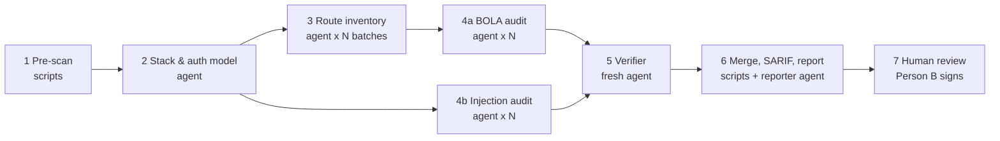

# LSA — Legacy Security Audit Kit

AI-agent kit that reviews the controllers / routers / pages of a **legacy web
system** and finds:

1. **BOLA / IDOR** — endpoints that load, change or delete an object by a
   request-controlled ID without checking that the object belongs to the
   current user or tenant (OWASP API1:2023, CWE-639).
2. **Hand-built queries** — SQL, HQL or NoSQL queries built by string
   concatenation, interpolation, formatting or template placeholders with
   user input (CWE-89, CWE-564, CWE-943).

The kit is **runtime-neutral**: prompts, knowledge and schemas are plain
Markdown/JSON; scripts are Python 3.8+ with the standard library only.
Adapters generate files for Claude Code, Cursor, or any platform that can call
an LLM with a system prompt and file-read tools.

## Supported stacks

| Focus (legacy) | Also covered |
|---|---|
| Plain PHP 4/5, CodeIgniter 2/3, CakePHP 1/2, Zend 1, early Laravel | Express 3/4 (Node) |
| Java Servlet/JSP, Struts 1/2, Spring MVC 2.5–4, JAX-RS, iBATIS/MyBatis, Hibernate 3 | Django ≤1.x, Flask, web.py |
| ASP.NET WebForms, MVC 2–5, Web API, ASMX/WCF, `.ashx` (C# and VB.NET) | Rails 2–4, Sinatra |
| Classic ASP (VBScript/JScript), Perl CGI (CGI.pm, DBI), ColdFusion (CFML) | T-SQL / PL-SQL stored procedures (dynamic SQL) |

## How it works



- **Pre-scan (deterministic)** lists every endpoint candidate and every line
  where a query is built dynamically. It favours recall, so agents never have
  to "search the whole repo" and no endpoint is silently skipped.
- **Agents** do what scripts cannot: understand the auth model, trace data
  flow, and decide whether an ownership check really binds the object to the
  session user.
- **Verifier** is a separate agent that tries to prove each finding wrong.
- **Human gate**: nothing leaves the team before a reviewer who did not run
  the audit signs `review-log.md` (see `governance/usage-policy.md`).

## Quick start

```bash
# 0. Self-test the kit (about 1 second)
python3 tests/run_tests.py

# 1. Pre-scan (OUT must be outside the audited repo)
python3 scripts/run_prescan.py /path/to/legacy-repo /path/to/lsa-out/legacy-repo \
        --config templates/audit-config.json

# 2. Generate files for your AI tool (pick one)
python3 adapters/build_adapters.py claude-code /path/to/audit-workspace
python3 adapters/build_adapters.py cursor      /path/to/audit-workspace
python3 adapters/build_adapters.py generic     /path/to/audit-workspace

# 3. Run the agent phases (see adapters/<tool>/README.md), then:
python3 scripts/merge_findings.py   /path/to/lsa-out/legacy-repo   # validate + coverage check
python3 scripts/findings_to_sarif.py /path/to/lsa-out/legacy-repo
python3 scripts/render_report.py    /path/to/lsa-out/legacy-repo
```

`merge_findings.py` exits with code 1 when there are coverage gaps (routes
without a verdict, invalid JSON, …). Fix those before reporting.

## Folder layout

| Path | Content |
|---|---|
| `AGENTS.md` | Entry point for any agent runtime that reads `AGENTS.md` |
| `prompts/` | Role prompts: orchestrator + 6 roles, and `_shared-rules.md` (prepend to every role) |
| `knowledge/` | Pattern catalogues (BOLA, injection, severity/CWE) and per-stack notes |
| `schemas/` | JSON Schemas for the stack profile, route inventory, findings |
| `scripts/` | Pre-scan, batching, merge/validation, SARIF export, report rendering |
| `templates/` | `audit-config.json`, `review-log.md`, `fix-ticket.md` |
| `adapters/` | Generators and notes for Claude Code, Cursor, OpenHands, generic LLM platforms |
| `governance/` | Usage policy: roles, data protection, approval gates, metrics |
| `tests/` | Fixture apps with known bugs, pre-scan self-test, agent evaluation tools |
| `docs/` | Internal business and planning documents (Modernization Boilerplates proposal, Boilerplate 1 plan) |

## Evaluating the agents (recommended before the first real audit)

```bash
python3 tests/build_eval_repo.py /tmp/lsa-eval          # fixtures without answer markers + ground truth
python3 scripts/run_prescan.py /tmp/lsa-eval/repo /tmp/lsa-eval/out
# ... run agent phases 2-5 on /tmp/lsa-eval/out ...
python3 scripts/merge_findings.py /tmp/lsa-eval/out
python3 tests/score_findings.py /tmp/lsa-eval/ground-truth.json /tmp/lsa-eval/out
```

Run this again whenever you change a prompt, a knowledge file or the model.

## Limits (read before promising anything to a customer)

- Static review only. It does not run or attack the application. It is not a
  penetration test, and "no findings" does not mean "no vulnerabilities".
- Checks that live outside the code (API gateway, stored procedures that are
  not in the repo, DB views, web server auth) cannot be confirmed; they are
  reported as `needs_review` / `likely`.
- Highly dynamic code (`eval`, `call_user_func($_GET[...])`, reflection,
  dynamic includes) lowers confidence.
- Pre-scan regexes are heuristics. Multi-line C# verbatim strings and some
  unusual query builders may be missed; the route inventory and auditors
  look for siblings in the same files to reduce this.
- Results depend on the model. Measure with the evaluation set above.

## Versioning

Kit version is in `VERSION`. Record it, the model name, and the LLM hosting in
every `review-log.md`.
