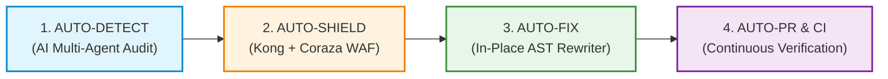
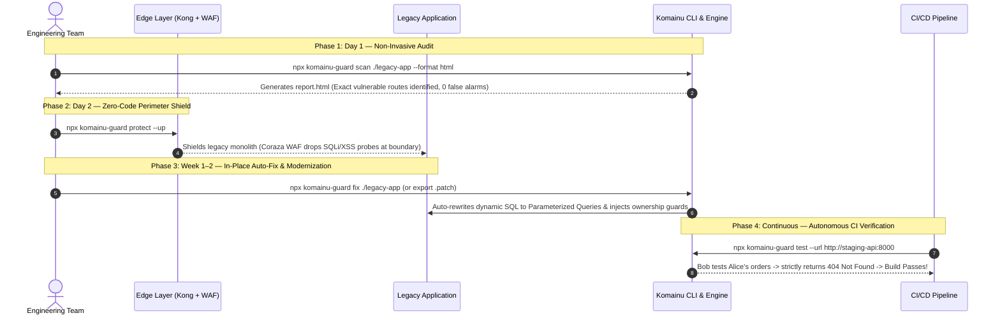

```text
  _  __                       _             
 | |/ /___  _ __ ___   __ _  (_)_ __  _   _ 
 | ' // _ \| '_ ` _ \ / _` | | | '_ \| | | |
 | . \ (_) | | | | | | (_| | | | | | | |_| |
 |_|\_\___/|_| |_| |_|\__,_| |_|_| |_|\__,_|
 Legacy Modernization & Security Platform  
```

# komainu-guard (狛犬)

> **Security-First CLI & Framework for Enterprise Legacy Modernization**  
> *Audit legacy vulnerabilities (BOLA/IDOR & SQLi), auto-generate code fixes, deploy instant edge shields, and continuously verify cross-user authorization in CI/CD.*

[](https://www.npmjs.com/package/komainu-guard)
[](https://github.com/hoanghainh1188/komainu/blob/main/LICENSE)
[](https://github.com/hoanghainh1188/komainu/actions/workflows/remediate-tests.yml)
[](https://github.com/hoanghainh1188/komainu/actions/workflows/security-scan.yml)
[-brightgreen.svg)](assess/lsa/)
[](operate/lsa_sarif/)
[](assess/lsa/prompts/60-reporter-ja.md)

---

## ⚡ The Autonomous Engine: Does Komainu Auto-Fix?

**YES.** Unlike traditional SAST tools that dump thousands of unverified warnings on developers, Komainu is an **autonomous security operating system** that not only detects vulnerabilities with zero false alarms, but also **automatically patches code, deploys edge shields, and opens remediation Pull Requests**.



### 🧠 Architecture: Deterministic Engine vs. Cognitive AI Agents (BYO-LLM)

A common question from engineers and security auditors is: **"Does Komainu connect to an external LLM API directly?"**

**Answer:** Komainu has no hardcoded API keys and zero vendor lock-in. It operates on a **Bring-Your-Own-LLM (BYO-LLM)** and **runtime-neutral** design to comply with strict enterprise NDAs and confidential code requirements:

| Tier | Engine | Execution | LLM Required? | Primary Role |
|---|---|---|---|---|
| **Tier 1** | **Deterministic Engine** (`komainu scan`, `fix`, `protect`) | Local Python 3.8+ stdlib CLI (Zero 3rd-party dependencies) | **No** (100% offline & local) | Blazing-fast regex/AST candidate extraction, WAF edge provisioning, AST code rewriting, and CI/CD cross-user gating. |
| **Tier 2** | **Cognitive AI Multi-Agents** (`assess/lsa/`) | Executed by your AI runtime (Claude Code, Cursor, Antigravity, OpenHands, or Private LLM API) | **Yes** (via your chosen AI tool) | Deep semantic data-flow tracing, custom authorization model inference (`auth-model.md`), and adversarial verification (*Skeptic Verifier Agent*) for 0 false positives. |

> **Enterprise Privacy Note:** Your sensitive legacy source code is never sent to any unapproved third-party API by Komainu. You retain full control over whether to run agents with self-hosted models (Ollama, vLLM) or approved enterprise subscriptions (see [`governance/usage-policy.md`](governance/usage-policy.md)).

### 1. 🔍 Auto-Detect (Zero False Positives)
- Scans **10 legacy stacks** (Classic ASP, ColdFusion, Java Struts/Servlet, .NET WebForms, PHP, Node.js, Python Flask, Perl CGI, SQL Procedures).
- Features an adversarial **Skeptic Verifier Agent** that actively cross-checks every finding against sanitizers, allow-lists, and existing owner checks — achieving an **empirically proven 1.000 precision** ([Evaluation Run 3](assess/lsa/tests/EVAL-RESULTS.md)).

### 2. 🛡️ Auto-Shield (Immediate Perimeter Defense)
- Commands like `npx komainu-guard protect --up` automatically provision **Kong API Gateway** and the **OWASP Coraza WAF engine** (OWASP CRS v4).
- Blocks hostile SQL injection payloads, XSS probes, and automated scrapers at the edge **without changing a single line of legacy application code**.

### 3. 🛠️ Auto-Fix (Self-Healing Code Rewriter)
- Run `npx komainu-guard fix .` to automatically transform vulnerable source code in-place:
  - **SQL Injection Auto-Rewrite (`remediate/query`):** Detects string concatenations (`"SELECT * FROM orders WHERE id = " + id`) and rewrites them into language-idiomatic **Parameterized Queries** across Python, JS/TS, PHP, C#, and Java.
  - **BOLA/IDOR Guard Injection (`remediate/authz`):** Automatically injects `@RequireOwnership` decorators, action filters, or middleware into controllers across NestJS, Express, .NET 8, Spring Boot 3, and FastAPI.
  - **CVE Dependency Bumping (`remediate/deps`):** Scans manifests (`package.json`, `pom.xml`, `requirements.txt`, `.csproj`, `go.mod`) and auto-upgrades vulnerable library versions.
  - **Safe Mode:** Supports `--dry-run` and unified `.patch` export (`-p security-fixes.patch`) for manual peer review.

### 4. 🤖 Auto-PR & Continuous CI/CD Verification
- Integrates directly into GitHub Actions or GitLab CI.
- **Simulated Attacker Gating:** Simulates **Persona A (Alice - owner)** and **Persona B (Bob - peer attacker)**. If Bob can read Alice's data (`2xx`), the build fails immediately.
- **Automated Remediation PR Bot:** When vulnerabilities are detected, CI can trigger `komainu fix` and automatically open a ready-to-merge **Pull Request** containing the verified patch and audit report.

---

## 🚀 Real-World Scenario: End-to-End Modernization Walkthrough

Consider an enterprise running an **Online Member & Order System** built on legacy stacks (PHP / Java Struts / Classic ASP / Express). The team fears that cross-user IDOR (changing order IDs in URLs) or SQL injection could lead to data breaches, but touching fragile legacy code risks breaking undocumented business rules.

Here is how Komainu solves this step-by-step:



### Phase 1: Day 1 — Non-Invasive Legacy Audit (`komainu scan`)
Scan without installing anything or disrupting production:
```bash
npx komainu-guard scan ./path-to-legacy-repo --format html --out ./audit-output
```
- **Tier 1 (Deterministic Pre-scan):** Runs 100% locally with zero dependencies. Generates an offline, interactive visual dashboard (`report.html`) and an **OASIS SARIF v2.1.0** report. It flags candidate controller routes and raw dynamic query locations.
- **Tier 2 (Cognitive AI Multi-Agent Audit — BYO-LLM):** To perform deep semantic BOLA verification and eliminate false alarms with the adversarial *Skeptic Verifier Agent*, dispatch the generated batches to your preferred AI environment:
  - **Claude Code / Antigravity:** `npx komainu-guard init --ai claude-code ./audit-workspace`
  - **OpenAI Codex:** `npx komainu-guard init --ai codex ./audit-workspace` (see [`assess/lsa/adapters/codex/README.md`](assess/lsa/adapters/codex/README.md))
  - **Cursor:** `npx komainu-guard init --ai cursor ./audit-workspace`
  - **Private / On-Premise LLM API:** `npx komainu-guard init --ai generic ./lsa-bundle`, then see [`assess/lsa/adapters/generic/README.md`](assess/lsa/adapters/generic/README.md).

### Phase 2: Day 2 — Immediate Perimeter Defense (`komainu protect`)
Before refactoring fragile code, eliminate external exploit risk at the network boundary:
```bash
npx komainu-guard protect --up
```
- **Result:** Kong API Gateway and Coraza WAF drop malicious SQLi and XSS probes immediately. Management and compliance teams gain peace of mind on Day 2.

### Phase 3: Week 1–2 — Automated Remediation (`komainu fix`)
Choose your modernization pace:
- **Approach A (In-Place Legacy Fix):** Run `komainu fix` to automatically patch vulnerable routes and queries in-place, or export a patch file for human review:
  ```bash
  # Preview planned code rewrites
  npx komainu-guard fix ./path-to-legacy-repo --dry-run -p ./security-fixes.patch

  # Apply fixes directly to source code
  npx komainu-guard fix ./path-to-legacy-repo
  ```
- **Approach B (Modern Target Services):** If rewriting services in NestJS, Express, .NET 8, Spring Boot 3, FastAPI, or Go, import `komainu-guard` to enforce strict ownership verification:
  ```typescript
  // NestJS Controller with Komainu Guard
  @Get(':id')
  @RequireOwnership(ResourceOperation.READ, {
    idParamName: 'id',
    resourceLoader: async (id, req) => orderService.findById(id),
  })
  async getOrder(@Param('id') id: string) {
    return this.orderService.findById(id);
  }
  ```
  *(All unauthorized or cross-user requests strictly return **HTTP 404 Not Found** to prevent resource enumeration).*

### Phase 4: Continuous Verification & Auto-PR Bot in CI/CD (`komainu test`)
Add Komainu to your CI pipeline to guarantee zero authorization regressions:
```bash
npx komainu-guard test --url http://127.0.0.1:8000 --auto-crud-path /api/v1/orders/{id}
```
- Komainu automatically sends requests using **Persona B's token** targeting **Persona A's resource IDs**.
- If any endpoint returns `200 OK` (cross-user data leakage), the pipeline **fails the build immediately**.

---

## 🤖 CI/CD Automation & Remediation Bot

Add this complete GitHub Actions workflow (`.github/workflows/komainu-ci.yml`) to enforce cross-user BOLA gating and automated SARIF reporting on every Pull Request:

```yaml
name: Komainu Continuous Security Verification

on:
  pull_request:
    branches: [main]

jobs:
  verify-authorization:
    name: Cross-User BOLA/IDOR Gating
    runs-on: ubuntu-latest
    steps:
      - name: Checkout Code
        uses: actions/checkout@v4

      - name: Setup Node.js & Python
        uses: actions/setup-node@v4
        with:
          node-version: '20'

      - name: Start Staging Service
        run: |
          docker compose up -d app-staging
          sleep 5

      - name: Run Komainu Cross-User Authorization Verification
        run: |
          npx komainu-guard test \
            --url http://localhost:8080 \
            --auto-crud-path "/api/v1/orders/{id}" \
            --resource-id "101" \
            --attacker-token "${{ secrets.ATTACKER_JWT_TOKEN }}"

      - name: Generate CycloneDX SBOM & Scan Vulnerabilities
        run: |
          npx komainu-guard devsecops sbom . --format cyclonedx -o ./cyclonedx.json
          npx komainu-guard devsecops run .

      - name: Upload Security Findings to GitHub Code Scanning
        if: always()
        uses: github/codeql-action/upload-sarif@v3
        with:
          sarif_file: reports/merged.sarif
```

---

## ⚡ Quick Start: Zero-Install Execution

Run Komainu commands immediately without local installation (requires Node.js 16+ or Docker):

```bash
# 1. Audit a legacy codebase (Classic ASP, ColdFusion, PHP, Java, .NET, Node, etc.)
npx komainu-guard scan ./path-to-repo --lang ja --format html

# 2. Automatically fix code in-place (or preview with --dry-run -p patchfile)
npx komainu-guard fix ./path-to-repo --dry-run -p ./fixes.patch

# 3. Generate CycloneDX 1.5 & SPDX 2.3 SBOM
npx komainu-guard devsecops sbom ./path-to-repo --format cyclonedx -o ./sbom.json

# 4. Merge and deduplicate OASIS SARIF v2.1.0 scan results
npx komainu-guard devsecops merge-sarif ./reports/*.sarif -o ./merged.sarif

# 5. Verify BOLA / IDOR defense against an active API in CI
npx komainu-guard test --url http://localhost:8000 --auto-crud-path /api/v1/orders/{id}

# 6. Launch Edge Kong & Coraza WAF perimeter
npx komainu-guard protect --up

# 7. Launch interactive reference Demo app
npx komainu-guard demo --up
```

Or run via self-contained Docker:
```bash
docker run --rm -v $(pwd):/workspace ghcr.io/hoanghainh1188/komainu:latest scan --target /workspace/legacy-repo --out /workspace/audit-out
```

---

## 🎮 Interactive Reference App: Member Portal (`examples/member-portal/`)

Experience the difference between vulnerable legacy code and Komainu-protected services in under 60 seconds:

```bash
cd examples/member-portal
docker compose up -d
```
Open `http://localhost:3000` in your browser:
- **Scenario 1 — Alice (Legitimate Owner):** Alice requests her order `ord-001` → `HTTP 200 OK`.
- **Scenario 2 — Bob (Attacker / Peer):** Switch persona to Bob and attempt to read Alice's `ord-001` via the Komainu-protected API → strictly returns `HTTP 404 Not Found` (preventing ID enumeration).
- **Scenario 3 — Planted Legacy API:** Test the unhardened legacy route. Bob successfully extracts Alice's order data (`HTTP 200 OK`), demonstrating the vulnerability before Komainu remediation.
- **Full Adoption Guide:** See [`examples/member-portal/README.md#4-adoption-guide-migrating-legacy-systems-behind-komainu`](examples/member-portal/README.md#4-adoption-guide-migrating-legacy-systems-behind-komainu).

---

## 📦 Programmatic Usage in Node.js & NestJS

`komainu-guard` provides drop-in BOLA guards for TypeScript and JavaScript backends:

### In NestJS:
```typescript
import { Controller, Get, Param, UseGuards, UseInterceptors } from '@nestjs/common';
import {
  RequireOwnership,
  OwnershipGuard,
  OwnershipInterceptor,
  ResourceOperation,
} from 'komainu-guard';

@Controller('api/v1/orders')
@UseGuards(OwnershipGuard)
@UseInterceptors(OwnershipInterceptor)
export class OrderController {
  @Get(':id')
  @RequireOwnership(ResourceOperation.READ, {
    idParamName: 'id',
    resourceLoader: async (id, req) => orderService.findById(id),
  })
  async getOrder(@Param('id') id: string) {
    return this.orderService.findById(id);
  }
}
```

### In Express.js:
```javascript
const { komainuOwnershipMiddleware, ResourceOperation } = require('komainu-guard');

app.get('/api/v1/orders/:id',
  komainuOwnershipMiddleware({
    operation: ResourceOperation.READ,
    idParamName: 'id',
    resourceLoader: async (id, req) => db.orders.findById(id),
  }),
  (req, res) => res.json(req.komainuResource)
);
```

---

## 🛠️ CLI Command Reference

| Command | Description | Example |
| :--- | :--- | :--- |
| `komainu scan <target>` | Runs Legacy Security Audit (LSA) detecting BOLA & SQLi across 10 stacks | `npx komainu-guard scan ./legacy-app --format html` |
| `komainu init --ai <runtime> [dest]` | Installs the Tier 2 audit skill and agents into your AI runtime (`claude-code`, `codex`, `cursor`, `generic`) — no LLM calls by Komainu | `npx komainu-guard init --ai codex ./audit-workspace` |
| `komainu fix <target>` | Automatically rewrites code in-place or exports `.patch` for BOLA, SQLi & CVEs | `npx komainu-guard fix ./legacy-app --dry-run -p fix.patch` |
| `komainu devsecops sbom <target>` | Generates CycloneDX 1.5 / SPDX 2.3 SBOM across npm, PyPI, NuGet, Maven, Go | `npx komainu-guard devsecops sbom . --format cyclonedx` |
| `komainu devsecops merge-sarif <files...>` | Merges & deduplicates multiple OASIS SARIF v2.1.0 scan results | `npx komainu-guard devsecops merge-sarif a.sarif b.sarif -o out.sarif` |
| `komainu devsecops run <target>` | Complete SAST, secret leak (Gitleaks), and SCA scan | `npx komainu-guard devsecops run .` |
| `komainu test --url <base-url>` | Executes automated cross-user authorization tests against live APIs in CI | `npx komainu-guard test --url http://127.0.0.1:5000` |
| `komainu protect --up` | Launches Kong API Gateway & Coraza WAF (OWASP CRS) perimeter | `npx komainu-guard protect --up` |
| `komainu demo --up` | Launches the reference Member Portal demo environment | `npx komainu-guard demo --up` |

---

## 🏛️ Platform Pillars & Capabilities

Komainu is named after the paired guardian lion-dogs at Shinto shrine entrances. They stand as an **a–un (阿吽)** pair: one with an open mouth to assess and call out vulnerabilities, and one with a closed mouth to remediate and seal the perimeter.

### 1. Assess — Legacy Security Assessment (`assess/lsa/`)
- **10 Legacy Stacks Covered:** Classic ASP, ColdFusion, .NET Legacy (WebForms/MVC/Handlers), Java Legacy (Servlet/JSP/Struts1/Spring MVC/MyBatis/Hibernate), Node Express, Perl CGI, PHP Plain, PHP CodeIgniter, Python Flask, SQL Procedures.
- **Multi-Agent Pipeline:** Autonomous pre-scan, route mapper, BOLA auditor, injection auditor, Skeptic Verifier, and bilingual reporter.
- **Benchmark:** 100% recall on BOLA & Injection, **0 False Positives**, Precision: **1.000**.

### 2. Protect — Edge Security (`remediate/edge/`)
- **Kong Gateway & Coraza WAF:** Declarative reverse proxy and OWASP CRS v4 WAF engine dropping SQLi, XSS, and scrapers at the edge.
- **Rate Limiting:** Granular quotas per Consumer ID, IP address, or API credential.

### 3. Remediate — 5 Modernization Boilerplates & Legacy Shims (`remediate/`)
- **Boilerplate 1 (D1) — Object-Level Authorization (`remediate/authz`):** Unified libraries across **.NET 8**, **Spring Boot 3**, **NestJS / Express**, **FastAPI**, and **Go**. Enforces server-side ID resolution and **deny-by-default 404 Not Found**.
- **Boilerplate 1 (D2) — Identity & Authentication (`remediate/identity`):** RFC 9700 / OAuth 2.1 OIDC integration (PKCE, token validation).
- **Boilerplate 1 (D3) — Safe Query Analyzers (`remediate/query`):** Roslyn Analyzer & Detekt rules flagging dynamic SQL at build time.
- **Legacy Remediation Shims (`remediate/legacy_shims`):** Lightweight shims for PHP, Java, ColdFusion, and Classic ASP.
- **Boilerplate 2 — Zero-PII eKYC & NFC Verification (`remediate/ekyc`):** Compliant with Japan's April 2027 Criminal Proceeds Act amendment for JPKI and IC-chip reading.
- **Boilerplate 3 — Multi-Region Resilience & Immutable WORM Backup (`remediate/resilience`):** Cross-region S3 Object Lock in COMPLIANCE mode and automated DR verification CLI (`dr_manager.py`).
- **Boilerplate 4 — Tenant-Isolated SaaS & BYOK Encryption (`remediate/tenancy`):** PostgreSQL RLS/schema-per-tenant, AES-256-GCM BYOK envelope encryption, and HMAC-SHA256 tamper-evident audit trails.

### 4. Operate — Continuous DevSecOps & Remediation Engine (`operate/`)
- **Automated Patcher (`komainu fix` / `operate/remediator`):** AST-based query rewriter and ownership injector.
- **Cross-User Authorization Test Runner (`operate/cross_user_tester`):** Multi-method test suite verifying IDOR compliance in CI/CD.
- **SBOM Generator (`operate/devsecops`):** CycloneDX 1.5 & SPDX 2.3 export.
- **SARIF Converter & Merger (`operate/lsa_sarif`):** Full OASIS SARIF v2.1.0 compatibility for GitHub Security Code Scanning.

---

## 📂 Repository Layout

```text
komainu/
├── bin/                  # Unified CLI entrypoints (komainu Python CLI & komainu.js npx bridge)
├── assess/               # Pillar 1: Finding vulnerabilities
│   └── lsa/              # Legacy Security Assessment kit (pre-scan, agents, prompts, HTML/MD/SARIF reports)
├── contracts/            # JSON Schemas (finding, route-inventory, stack-profile, verification)
├── remediate/            # Pillars 2 & 3: Reusable remediation modules (Boilerplates 1–4)
│   ├── authz/            # BP1-D1: Object-level authorization (.NET 8, Spring Boot 3, Node.js, Python, Go)
│   ├── identity/         # BP1-D2: OpenID Connect authentication & token validation (.NET 8, Spring Boot 3, Python)
│   ├── query/            # BP1-D3: Safe query helpers, C# Roslyn analyzer & Kotlin Detekt rule
│   ├── deps/             # Automated CVE dependency manifest & lockfile patcher across 5 ecosystems
│   ├── edge/             # BP1-D4: Kong gateway declarative configuration & Coraza WAF (OWASP CRS v4)
│   ├── legacy_shims/     # Drop-in ownership & safe-query shims (PHP, Java, ColdFusion, Classic ASP)
│   ├── ekyc/             # BP2: Zero-PII eKYC & NFC JPKI/IC-chip verification (Japan 2027 compliance)
│   ├── resilience/       # BP3: Multi-region Terraform S3 WORM backup, KMS CMK & DR verification CLI
│   └── tenancy/          # BP4: PostgreSQL RLS/schema isolation, BYOK AES-256-GCM & HMAC audit trail
├── operate/              # Pillar 4: Continuous verification & DevSecOps (Boilerplate 5)
│   ├── cli/              # Unified Komainu CLI implementation (scan, fix, devsecops, protect, test, demo)
│   ├── devsecops/        # BP5: CycloneDX 1.5 / SPDX 2.3 SBOM generator, SARIF merger & SAST/SCA runner
│   ├── remediator/       # Automated code patcher for BOLA/IDOR and SQL injection findings
│   ├── cross_user_tester/# BP1-D5: Automated cross-user authorization CLI test runner
│   ├── lsa_sarif/        # SARIF v2.1.0 converter for CI code scanning
│   └── ci/               # GitHub Actions & GitLab CI workflow templates
├── examples/             # Reference systems & walkthroughs
│   └── member-portal/    # BP1-D6: Full-stack demo app (React 18 + .NET 8 / Spring Boot 3 + Docker)
├── delivery/             # Pilot execution runbooks, verification scripts & sample deliverables
├── governance/           # AI usage policy, data privacy, and the Two-Person approval rule
└── docs/                 # Strategy documents, delivery plans, security scanning guide & ADRs
```

---

## 👥 Governance & The Two-Person Rule

Komainu implements the **Two-Person Rule** described in [`governance/usage-policy.md`](governance/usage-policy.md):
- **Auditor / Agent (Person A):** Runs the automated assessment and remediation tools, drafting findings and patches.
- **Reviewer / Architect (Person B):** A human security engineer or principal architect who independently verifies every finding and patch against the codebase before it is released to production.
- **Privacy Assurance:** Source code is analyzed under strict zero-retention / local processing guidelines; no client proprietary logic is stored or used for model training.

---

## 📜 License & Intellectual Property

Komainu follows an **Open Core** architecture ([ADR-0002](docs/adr/0002-ip-position-open-core.md)):
- The core LSA assessment kit, contracts, and remediation interfaces are open source under the MIT License.
- Enterprise-specific integrations, bespoke legacy adapters, and managed audit playbooks are retained for proprietary customer engagements.
