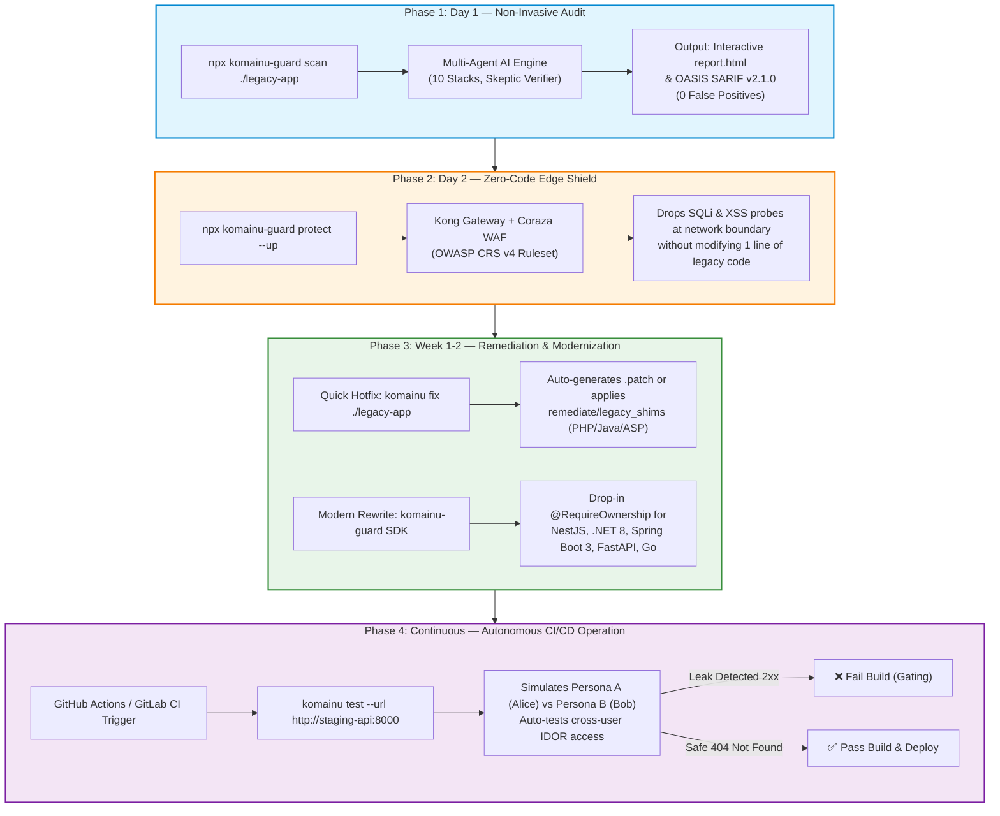
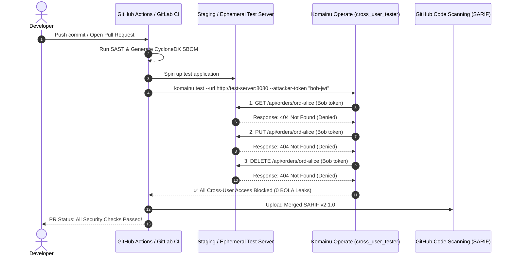

# komainu-guard (狛犬)

> **Security-First CLI & Framework for Enterprise Legacy Modernization**  
> *Audit legacy vulnerabilities (BOLA/IDOR & SQLi), generate SBOMs, verify cross-user authorization in CI/CD, and deploy drop-in authorization guards.*

[](https://www.npmjs.com/package/komainu-guard)
[](https://github.com/hoanghainh1188/komainu/blob/main/LICENSE)
[](https://github.com/hoanghainh1188/komainu/actions/workflows/remediate-tests.yml)
[](https://github.com/hoanghainh1188/komainu/actions/workflows/security-scan.yml)
[-brightgreen.svg)](assess/lsa/)
[](operate/lsa_sarif/)
[](assess/lsa/prompts/60-reporter-ja.md)

---

## 🧭 The Modernization Problem

Legacy enterprise systems (written in ASP.NET WebForms, Classic ASP, Java Struts/Servlet, PHP, ColdFusion, Perl CGI, or early Express/Node) carry critical architectural vulnerabilities that off-the-shelf SAST tools either miss or drown in hundreds of false alarms:

1. **BOLA / IDOR (Broken Object Level Authorization):** Endpoints fail to verify whether the requesting user owns the requested resource ID (e.g., Changing `/api/orders/101` to `/api/orders/102` exposes another customer's data).
2. **String-Built Dynamic Queries:** SQL, NoSQL, and HQL/JPQL statements constructed via string interpolation or concatenated parameters.
3. **Fear of Modernization:** Engineering teams avoid refactoring legacy code out of fear of breaking undocumented production business logic.

Komainu bridges the gap between static code scanning and modern secure architecture through an **end-to-end 4-stage lifecycle: Assess → Protect → Remediate → Operate**.

---

## 🚀 Real-World Scenario: End-to-End Modernization Walkthrough

Imagine your organization runs an **Enterprise Member & Order Portal** built on legacy stacks (PHP / Java Struts / Classic ASP / Express). You suspect critical BOLA and SQLi vulnerabilities exist in production, but you cannot afford downtime or weeks of regression testing. 

Here is how Komainu is deployed in practice:



### Step 1: Day 1 — Non-Invasive Legacy Audit (`komainu scan`)
Without touching running services, run an automated scan against your legacy source code:
```bash
npx komainu-guard scan ./path-to-legacy-repo --format html --out ./audit-output
```
- **What happens:** Komainu's autonomous multi-agent audit detects server frameworks, catalogs all API routes, traces object-level ownership checks, and uses an adversarial *Skeptic Verifier* to eliminate false alarms.
- **Output:** An offline interactive dashboard (`report.html`) and SARIF v2.1.0 report identifying the exact vulnerable endpoints (e.g., `GET /orders/:id` lacks ownership validation).

### Step 2: Day 2 — Immediate Perimeter Defense (`komainu protect`)
Before engineering teams begin rewriting fragile legacy logic, deploy an instant edge defense:
```bash
npx komainu-guard protect --up
```
- **What happens:** Launches a declarative Kong API Gateway paired with the OWASP Coraza WAF engine (`remediate/edge`).
- **Result:** Hostile SQL injection payloads and automated exploit scanners are dropped at the network perimeter before reaching your legacy application. Zero code changes required.

### Step 3: Week 1–2 — Remediation & Modernization (`komainu fix` & SDK)
Choose between patching the legacy code and vulnerable dependencies in place or building new services:
- **Option A (In-Place Legacy Hotfix & CVE Dependency Patching):** Use `komainu fix` (with `--sca` for automated manifest & lockfile CVE upgrades across `package.json`/`package-lock.json`/`yarn.lock`, `requirements.txt`/`pyproject.toml`/`Pipfile.lock`/`poetry.lock`, `.csproj`/`packages.lock.json`, `pom.xml`/`build.gradle`/`gradle.lockfile`, and `go.mod`/`go.sum`) or drop-in shims (`remediate/legacy_shims` for PHP, Java Servlet, ColdFusion, Classic ASP):
  ```bash
  # Preview BOLA, SQLi, and CVE dependency + lockfile patches
  npx komainu-guard fix ./path-to-legacy-repo --sca --dry-run -p ./security-fixes.patch
  ```
- **Option B (Modern Target Services):** When modernizing to NestJS, Express, .NET 8, Spring Boot 3, FastAPI, or Go, import `komainu-guard` to enforce strict ownership guards:
  ```typescript
  // NestJS Controller with Komainu Guard
  @Get(':id')
  @RequireOwnership(ResourceOperation.READ, {
    idParamName: 'id',
    resourceLoader: async (id, req) => orderService.findById(id),
  })
  async getOrder(@Param('id') id: string) {
    return this.orderService.findById(id);
  }
  ```
  *(Unauthorized access or unverified resource owners strictly return **HTTP 404 Not Found** to prevent resource enumeration).*

### Step 4: Day 30+ — Autonomous CI/CD Operation (`komainu test`)
Automate continuous verification so that no IDOR/BOLA regression ever merges into `main`:
```bash
npx komainu-guard test --url http://127.0.0.1:8000 --auto-crud-path /api/v1/orders/{id}
```
- **What happens:** Komainu simulates **Persona A (Alice - legitimate owner)** and **Persona B (Bob - peer attacker)**. Bob attempts to `GET`, `PUT`, and `DELETE` Alice's orders. If any endpoint returns `200 OK`, the pipeline fails immediately.

---

## 🤖 Automated Operation & Continuous CI/CD Verification

Komainu is not just a static scanner or a standalone library; it functions as an **Autonomous Security Operating System** inside your CI/CD pipeline.



### Ready-to-Use GitHub Actions Workflow (`.github/workflows/komainu-ci.yml`)

Add this workflow to your repository to automatically gate PRs against BOLA regressions:

```yaml
name: Komainu Automated Security Verification

on:
  pull_request:
    branches: [main]

jobs:
  verify-authorization:
    name: Autonomous Cross-User BOLA/IDOR Gating
    runs-on: ubuntu-latest
    steps:
      - name: Checkout Code
        uses: actions/checkout@v4

      - name: Setup Node.js & Python
        uses: actions/setup-node@v4
        with:
          node-version: '20'

      - name: Start Staging Service
        run: |
          docker compose up -d app-staging
          sleep 5

      - name: Run Komainu Cross-User Authorization Verification
        run: |
          npx komainu-guard test \
            --url http://localhost:8080 \
            --auto-crud-path "/api/v1/orders/{id}" \
            --resource-id "101" \
            --attacker-token "${{ secrets.ATTACKER_JWT_TOKEN }}"

      - name: Generate SBOM & Scan Vulnerabilities
        run: |
          npx komainu-guard devsecops sbom . --format cyclonedx -o ./cyclonedx.json
          npx komainu-guard devsecops run .

      - name: Upload Security Findings to GitHub Code Scanning
        if: always()
        uses: github/codeql-action/upload-sarif@v3
        with:
          sarif_file: reports/merged.sarif
```

---

## ⚡ Quick Start: Zero-Install Execution

Run Komainu immediately without manual environment setup:

```bash
# 1. Audit a legacy codebase (Classic ASP, ColdFusion, PHP, Java, .NET, Node, etc.)
npx komainu-guard scan ./path-to-repo --lang ja --format html

# 2. Preview automated code & CVE dependency/lockfile fixes
npx komainu-guard fix ./path-to-repo --sca --dry-run -p ./fixes.patch

# 3. Generate CycloneDX 1.5 & SPDX 2.3 SBOM
npx komainu-guard devsecops sbom ./path-to-repo --format cyclonedx -o ./sbom.json

# 4. Merge and deduplicate OASIS SARIF v2.1.0 reports
npx komainu-guard devsecops merge-sarif ./reports/*.sarif -o ./merged.sarif

# 5. Verify BOLA / IDOR defense against an active API in CI
npx komainu-guard test --url http://localhost:8000 --auto-crud-path /api/v1/orders/{id}
```

Or run via self-contained Docker:
```bash
docker run --rm -v $(pwd):/workspace ghcr.io/hoanghainh1188/komainu:latest scan --target /workspace/legacy-repo --out /workspace/audit-out
```

---

## 📦 Programmatic Usage in Node.js & NestJS

`komainu-guard` provides drop-in BOLA guards for TypeScript and JavaScript backends:

### In NestJS:
```typescript
import { Controller, Get, Param, UseGuards, UseInterceptors } from '@nestjs/common';
import {
  RequireOwnership,
  OwnershipGuard,
  OwnershipInterceptor,
  ResourceOperation,
} from 'komainu-guard';

@Controller('api/v1/orders')
@UseGuards(OwnershipGuard)
@UseInterceptors(OwnershipInterceptor)
export class OrderController {
  @Get(':id')
  @RequireOwnership(ResourceOperation.READ, {
    idParamName: 'id',
    resourceLoader: async (id, req) => orderService.findById(id),
  })
  async getOrder(@Param('id') id: string) {
    return this.orderService.findById(id);
  }
}
```

### In Express.js:
```javascript
const { komainuOwnershipMiddleware, ResourceOperation } = require('komainu-guard');

app.get('/api/v1/orders/:id',
  komainuOwnershipMiddleware({
    operation: ResourceOperation.READ,
    idParamName: 'id',
    resourceLoader: async (id, req) => db.orders.findById(id),
  }),
  (req, res) => res.json(req.komainuResource)
);
```

---

## 🛠️ CLI Command Reference

| Command | Description | Example |
| :--- | :--- | :--- |
| `komainu scan <target>` | Runs Legacy Security Audit (LSA) detecting BOLA & SQL injection across 10 stacks | `npx komainu-guard scan ./legacy-app --format html` |
| `komainu fix <target>` | Generates or applies automated fixes / `.patch` files for BOLA, SQLi, and CVE dependencies + lockfiles | `npx komainu-guard fix ./legacy-app --sca --dry-run` |
| `komainu devsecops sbom <target>` | Generates CycloneDX 1.5 / SPDX 2.3 SBOM across npm, PyPI, NuGet, Maven, Go | `npx komainu-guard devsecops sbom . --format cyclonedx` |
| `komainu devsecops merge-sarif <files...>` | Merges & deduplicates multiple OASIS SARIF v2.1.0 scan results | `npx komainu-guard devsecops merge-sarif a.sarif b.sarif -o out.sarif` |
| `komainu devsecops run <target>` | Complete SAST, secret leak (Gitleaks), and SCA scan | `npx komainu-guard devsecops run .` |
| `komainu test --url <base-url>` | Executes automated cross-user authorization tests against live APIs in CI | `npx komainu-guard test --url http://127.0.0.1:5000` |
| `komainu protect --up` | Launches Kong API Gateway & Coraza WAF (OWASP CRS) perimeter | `npx komainu-guard protect --up` |
| `komainu demo --up` | Launches the reference Member Portal demo environment | `npx komainu-guard demo --up` |

---

## 🎮 Interactive Reference App: Member Portal (`examples/member-portal/`)

To experience the real-world scenario interactively, spin up the included multi-tenant demo portal:

```bash
cd examples/member-portal
docker compose up -d
```
Visit `http://localhost:3000` to access the interactive web interface:
1. **Scenario 1 — Alice (Owner):** Select Alice in the persona switcher. Accessing `ord-001` returns `200 OK`.
2. **Scenario 2 — Bob (Attacker):** Switch to Bob. Attempting to access Alice's `ord-001` via the Komainu-protected API strictly returns `404 Not Found` (preventing ID harvesting).
3. **Scenario 3 — Planted Legacy API:** Test the planted unhardened legacy route. Bob extracts Alice's order data (`200 OK`), demonstrating the BOLA vulnerability in action.
4. **Adoption Guide:** Step-by-step migration guide for enterprise engineering teams is available in [`examples/member-portal/README.md#4-adoption-guide-migrating-legacy-systems-behind-komainu`](examples/member-portal/README.md#4-adoption-guide-migrating-legacy-systems-behind-komainu).

---

## 🏛️ Platform Pillars & Capabilities

### 1. Assess — Legacy Security Assessment (`assess/lsa/`)
An autonomous multi-agent audit pipeline designed to inspect legacy repositories with strict read-only guarantees:
- **10 Legacy Stacks Covered:** Classic ASP, ColdFusion, .NET Legacy (WebForms/MVC/Handlers), Java Legacy (Servlet/JSP/Struts1/Spring MVC/MyBatis/Hibernate), Node Express, Perl CGI, PHP Plain, PHP CodeIgniter, Python Flask, SQL Procedures.
- **Multi-Agent Architecture:** `10-stack-detector`, `20-route-mapper`, `30-bola-auditor`, `40-injection-auditor`, `50-finding-verifier` (*Skeptic Mode* to refute false positives), and `60-reporter`.
- **Empirical Benchmark ([Evaluation Run 3](assess/lsa/tests/EVAL-RESULTS.md)):** 100% Recall on BOLA & Injection, **0 False Positives**, Precision: **1.000**.
- **Standards & Interactive Output:** OASIS SARIF v2.1.0, bilingual reports (EN/JA), and self-contained interactive HTML dashboards.

### 2. Protect — Edge Security (`remediate/edge/`)
- **Kong Gateway (decK):** Declarative API gateway acting as a reverse proxy in front of legacy services.
- **Coraza WAF with OWASP Core Rule Set (CRS v4):** Automatically blocks SQL injection, XSS, and scrapers at the edge.
- **Granular Rate Limiting:** Enforces request quotas per Consumer ID, IP address, or API credential.

### 3. Remediate — 5 Modernization Boilerplates & Legacy Shims (`remediate/`)
- **Boilerplate 1 (D1) — Object-Level Authorization (`remediate/authz`):** Unified libraries across **.NET 8**, **Spring Boot 3**, **NestJS / Express**, **FastAPI**, and **Go**. Enforces claim-based principal resolution and **deny-by-default 404 Not Found**.
- **Boilerplate 1 (D2) — Identity & Authentication (`remediate/identity`):** RFC 9700 / OAuth 2.1 OIDC integration (PKCE, strict token verification).
- **Boilerplate 1 (D3) — Safe Query Analyzers (`remediate/query`):** Roslyn Analyzer & Detekt rules flagging string-built SQL at build time.
- **Legacy Remediation Shims (`remediate/legacy_shims`):** Lightweight shims for PHP, Java, ColdFusion, and Classic ASP.
- **Boilerplate 2 — Zero-PII eKYC & NFC Verification (`remediate/ekyc`):** Compliant with Japan's April 2027 Criminal Proceeds Act amendment for JPKI and IC-chip cryptographic verification.
- **Boilerplate 3 — Multi-Region Resilience & Immutable WORM Backup (`remediate/resilience`):** Cross-region S3 Object Lock in COMPLIANCE mode and automated DR verification CLI (`dr_manager.py`).
- **Boilerplate 4 — Tenant-Isolated SaaS & BYOK Encryption (`remediate/tenancy`):** PostgreSQL RLS/schema-per-tenant, AES-256-GCM BYOK envelope encryption, and HMAC-SHA256 tamper-evident audit trails.

### 4. Operate — Unified CLI & Continuous DevSecOps (`operate/`)
- **Unified CLI (`bin/komainu` & `operate/cli`):** Single binary distributed via npm (`npx komainu-guard`) and Docker (`ghcr.io/hoanghainh1188/komainu`).
- **SBOM Generator:** Produces **CycloneDX 1.5** and **SPDX 2.3** across npm, PyPI, NuGet, Maven/Gradle, and Go.
- **Automated Patcher (`komainu fix`):** Dry-run previews, unified `.patch` files, or in-place fixes for BOLA, SQLi, and vulnerable third-party dependencies (`--sca` / `--osv`) with automatic companion lockfile synchronization (`package-lock.json`, `yarn.lock`, `Pipfile.lock`, `poetry.lock`, `packages.lock.json`, `gradle.lockfile`, `go.sum`).
- **Cross-User Authorization Test Runner (`operate/cross_user_tester`):** Automated multi-method tests simulating cross-user access in CI/CD.

---

## 📂 Repository Layout

```text
komainu/
├── bin/                  # Unified CLI entrypoints (komainu Python CLI & komainu.js npx bridge)
├── assess/               # Pillar 1: Finding vulnerabilities
│   └── lsa/              # Legacy Security Assessment kit (pre-scan, agents, prompts, HTML/MD/SARIF reports)
├── contracts/            # JSON Schemas (finding, route-inventory, stack-profile, verification)
├── remediate/            # Pillars 2 & 3: Reusable remediation modules (Boilerplates 1–4)
│   ├── authz/            # BP1-D1: Object-level authorization (.NET 8, Spring Boot 3, Node.js, Python, Go)
│   ├── identity/         # BP1-D2: OpenID Connect authentication & token validation (.NET 8, Spring Boot 3, Python)
│   ├── query/            # BP1-D3: Safe query helpers, C# Roslyn analyzer & Kotlin Detekt rule
│   ├── deps/             # Automated CVE dependency manifest & lockfile patcher across 5 ecosystems
│   ├── edge/             # BP1-D4: Kong gateway declarative configuration & Coraza WAF (OWASP CRS v4)
│   ├── legacy_shims/     # Drop-in ownership & safe-query shims (PHP, Java, ColdFusion, Classic ASP)
│   ├── ekyc/             # BP2: Zero-PII eKYC & NFC JPKI/IC-chip verification (Japan 2027 compliance)
│   ├── resilience/       # BP3: Multi-region Terraform S3 WORM backup, KMS CMK & DR verification CLI
│   └── tenancy/          # BP4: PostgreSQL RLS/schema isolation, BYOK AES-256-GCM & HMAC audit trail
├── operate/              # Pillar 4: Continuous verification & DevSecOps (Boilerplate 5)
│   ├── cli/              # Unified Komainu CLI implementation (scan, fix, devsecops, protect, test, demo)
│   ├── devsecops/        # BP5: CycloneDX 1.5 / SPDX 2.3 SBOM generator, SARIF merger & SAST/SCA runner
│   ├── remediator/       # Automated code & CVE manifest/lockfile patcher for BOLA, SQLi, and SCA findings
│   ├── cross_user_tester/# BP1-D5: Automated cross-user authorization CLI test runner
│   ├── lsa_sarif/        # SARIF v2.1.0 converter for CI code scanning
│   └── ci/               # GitHub Actions & GitLab CI workflow templates
├── examples/             # Reference systems & walkthroughs
│   └── member-portal/    # BP1-D6: Full-stack demo app (React 18 + .NET 8 / Spring Boot 3 + Docker)
├── delivery/             # Pilot execution runbooks, verification scripts & sample deliverables
├── governance/           # AI usage policy, data privacy, and the Two-Person approval rule
└── docs/                 # Strategy documents, delivery plans, security scanning guide & ADRs
```

---

## 👥 Governance & The Two-Person Rule

Komainu implements the **Two-Person Rule** described in [`governance/usage-policy.md`](governance/usage-policy.md):
- **Auditor / Agent (Person A):** Runs the automated assessment tools and drafts findings.
- **Reviewer / Architect (Person B):** A human security engineer or principal architect who independently verifies every finding against the codebase before releasing it to clients or stakeholders.
- **Privacy Assurance:** Source code is analyzed under strict zero-retention / local processing guidelines; no client proprietary logic is stored or used for model training.

---

## 📜 License & Intellectual Property

Komainu follows an **Open Core** architecture ([ADR-0002](docs/adr/0002-ip-position-open-core.md)):
- The core LSA assessment kit, contracts, and remediation interfaces are open source under the MIT License.
- Enterprise-specific integrations, bespoke legacy adapters, and managed audit playbooks are retained for proprietary customer engagements.
