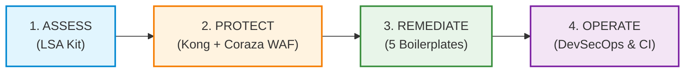

# komainu-guard (狛犬)

> **Security-First CLI & Framework for Enterprise Legacy Modernization**  
> *Audit legacy vulnerabilities (BOLA/IDOR & SQLi), generate SBOMs, verify cross-user authorization in CI/CD, and deploy drop-in authorization guards.*

[](https://www.npmjs.com/package/komainu-guard)
[](https://github.com/hoanghainh1188/komainu/blob/main/LICENSE)
[](https://github.com/hoanghainh1188/komainu/actions/workflows/remediate-tests.yml)
[](https://github.com/hoanghainh1188/komainu/actions/workflows/security-scan.yml)
[-brightgreen.svg)](assess/lsa/)
[](operate/lsa_sarif/)
[](assess/lsa/prompts/60-reporter-ja.md)

---

## ⚡ Quick Start (Zero-Install CLI with `npx`)

Run immediately without installation (requires Node.js 16+ and Python 3.8+):

```bash
# 1. Audit a legacy codebase (Classic ASP, ColdFusion, PHP, Java, .NET, Node, etc.)
npx komainu-guard scan ./path-to-repo --lang ja --format html

# 2. Generate CycloneDX 1.5 & SPDX 2.3 SBOM
npx komainu-guard devsecops sbom ./path-to-repo --format cyclonedx -o ./sbom.json

# 3. Merge and deduplicate OASIS SARIF v2.1.0 reports
npx komainu-guard devsecops merge-sarif ./reports/*.sarif -o ./merged.sarif

# 4. Verify BOLA / IDOR defense against an active API in CI
npx komainu-guard test --url http://localhost:8000 --auto-crud-path /api/v1/orders/{id}
```

Or install globally:

```bash
npm install -g komainu-guard
komainu --help
```

---

## 📦 Programmatic Usage in Node.js & NestJS

`komainu-guard` is both a CLI and a TypeScript/JavaScript library providing drop-in BOLA defenses:

```typescript
import { Controller, Get, Param, UseGuards, UseInterceptors } from '@nestjs/common';
import {
  RequireOwnership,
  OwnershipGuard,
  OwnershipInterceptor,
  ResourceOperation,
} from 'komainu-guard';

@Controller('api/v1/orders')
@UseGuards(OwnershipGuard)
@UseInterceptors(OwnershipInterceptor)
export class OrderController {
  @Get(':id')
  @RequireOwnership(ResourceOperation.READ, {
    idParamName: 'id',
    resourceLoader: async (id, req) => orderService.findById(id),
  })
  async getOrder(@Param('id') id: string) {
    return this.orderService.findById(id);
  }
}
```

In Express.js:

```javascript
const { komainuOwnershipMiddleware, ResourceOperation } = require('komainu-guard');

app.get('/api/v1/orders/:id',
  komainuOwnershipMiddleware({
    operation: ResourceOperation.READ,
    idParamName: 'id',
    resourceLoader: async (id, req) => db.orders.findById(id),
  }),
  (req, res) => res.json(req.komainuResource)
);
```

---

## 🛠️ CLI Command Reference

| Command | Description | Example |
| :--- | :--- | :--- |
| `komainu scan <target>` | Runs Legacy Security Audit (LSA) detecting BOLA & SQL injection across 10 stacks | `npx komainu-guard scan ./legacy-app --format html` |
| `komainu fix <target>` | Generates or applies automated code fixes / unified `.patch` files for BOLA & SQLi findings | `npx komainu-guard fix ./legacy-app --dry-run` |
| `komainu devsecops sbom <target>` | Generates CycloneDX 1.5 / SPDX 2.3 SBOM across npm, PyPI, NuGet, Maven, Go | `npx komainu-guard devsecops sbom . --format cyclonedx` |
| `komainu devsecops merge-sarif <files...>` | Merges & deduplicates multiple OASIS SARIF v2.1.0 scan results | `npx komainu-guard devsecops merge-sarif a.sarif b.sarif -o out.sarif` |
| `komainu devsecops run <target>` | Complete SAST, secret leak (Gitleaks), and SCA scan | `npx komainu-guard devsecops run .` |
| `komainu test --url <base-url>` | Executes automated cross-user authorization tests against live APIs in CI | `npx komainu-guard test --url http://127.0.0.1:5000` |
| `komainu protect --up` | Launches Kong API Gateway & Coraza WAF (OWASP CRS) perimeter | `npx komainu-guard protect --up` |
| `komainu demo --up` | Launches the reference Member Portal demo environment | `npx komainu-guard demo --up` |

---

## The Platform Behind `komainu-guard`

Komainu (狛犬) is named after the paired guardian lion-dogs at the entrance of a Shinto shrine. They stand as an **a–un (阿吽)** pair: one with an open mouth to assess and call out weaknesses, and one with a closed mouth to remediate and seal the perimeter. 

Komainu bridges the gap between static code scanning and modern secure architecture by providing an integrated, evidence-backed workflow for enterprise systems.

---

## The Modernization Problem & The Komainu Solution

Legacy enterprise applications (written in ASP.NET WebForms, Classic ASP, Java Struts/Servlet, PHP, ColdFusion, Perl CGI) carry critical architectural vulnerabilities that off-the-shelf SAST tools either miss or drown in hundreds of false alarms:
1. **BOLA / IDOR (Broken Object Level Authorization):** Endpoints fail to verify whether the requesting user actually owns the requested resource ID.
2. **String-Built Dynamic Queries:** SQL, NoSQL, and HQL/JPQL statements constructed via string interpolation or concatenated parameters.
3. **High Modernization Risk:** Teams hesitate to touch legacy code due to fear of breaking undocumented business logic.

Komainu solves this through a **4-stage lifecycle**:



1. **Assess (LSA):** High-precision AI-assisted security audit across 10 legacy stacks with zero false positives.
2. **Protect (Edge):** Immediate zero-code-change perimeter shield using Kong Gateway and Coraza WAF (OWASP CRS v4).
3. **Remediate (5 Modernization Boilerplates):** Production-ready modules across **5 modern target runtimes** (.NET 8, Kotlin / Spring Boot 3, Node.js / NestJS & Express, Python / FastAPI, Go), legacy shims, Zero-PII eKYC (Japan 2027 compliance), Multi-Region WORM Backup & DR, and Multi-Tenant Isolation & BYOK.
4. **Operate (DevSecOps & Continuous Verification):** Unified CLI, CycloneDX/SPDX SBOM generation, automated code remediation (`komainu fix`), cross-user authorization testing, and a 6-job CI security scanning pipeline.

---

## Platform Pillars & Capabilities

### 1. Assess — Legacy Security Assessment (`assess/lsa/`)
An autonomous multi-agent audit pipeline designed to inspect legacy repositories with strict read-only guarantees:
- **10 Legacy Stacks Covered:** Classic ASP, ColdFusion, .NET Legacy (WebForms/MVC/Handlers), Java Legacy (Servlet/JSP/Struts1/Spring MVC/MyBatis/Hibernate), Node Express, Perl CGI, PHP Plain, PHP CodeIgniter, Python Flask, SQL Procedures.
- **Multi-Agent Architecture:**
  - `10-stack-detector`: Identifies server frameworks, auth models, and DB layers.
  - `20-route-mapper`: Catalogs all public and private routes.
  - `30-bola-auditor`: Inspects object-level access controls per route (including indirect FK/parent ownership).
  - `40-injection-auditor`: Traces dynamic SQL/NoSQL query constructions and multi-step string builders.
  - `50-finding-verifier` (*Skeptic Mode*): Adversarial agent actively seeking evidence to refute false positives.
  - `60-reporter`: Generates executive summaries and technical markdown reports.
- **Empirical Benchmark ([Evaluation Run 3](assess/lsa/tests/EVAL-RESULTS.md)):**
  - **BOLA/IDOR Recall:** **100%** (25/25 vectors detected).
  - **Injection Recall:** **100%** (34/34 SQL & NoSQL candidates detected, including split multi-step query builders).
  - **False Positives on Safe Code:** **0** (Parameterized queries, allow-lists, and owner checks not flagged).
  - **Precision:** **1.000** (57/57 active findings verified).
- **Standards, Bilingual & Interactive Output:**
  - Standard **OASIS SARIF v2.1.0** for direct import into GitHub Security Code Scanning.
  - Bilingual Markdown reports: English (`report.md`) and Japanese (`report.ja.md`, compliant with IPA/NISC security guidelines).
  - **Interactive HTML Audit Dashboard (`report.html`):** Self-contained, offline-ready visual dashboard with SVG severity/category charts, filtering, and instant English/Japanese (`EN`/`日本語`) language toggle.

### 2. Protect — Edge Security (`remediate/edge/`)
Before touching a single line of fragile legacy backend code, Komainu deploys immediate edge protection:
- **Kong Gateway (decK):** Declarative API gateway acting as a reverse proxy in front of legacy services.
- **Coraza WAF with OWASP Core Rule Set (CRS v4):** Automatically blocks SQL injection, cross-site scripting (XSS), path traversal, and scrapers at the edge.
- **Granular Rate Limiting:** Enforces request quotas per Consumer ID, IP address, or API credential.

### 3. Remediate — 5 Modernization Boilerplates & Legacy Shims (`remediate/`)
Drop-in authorization, authentication, safe query, eKYC, resilience, and multi-tenancy modules for both modern target stacks and existing legacy codebases:
- **Boilerplate 1 (D1) — Object-Level Authorization (`remediate/authz`):**
  - Unified libraries across **5 target ecosystems**: **ASP.NET Core (.NET 8)**, **Spring Security (Kotlin / Spring Boot 3)**, **Node.js (NestJS & Express)**, **Python (FastAPI)**, and **Go (`net/http`)**.
  - **Unified Claim Semantics & Server-Side ID Resolution:** Extracts principal (`sub`, `uid`, `userId`, `user_id`, `id`) and tenant (`tenant_id`, `tid`, `tenant`, `org_id`, `organization_id`) strictly from verified token claims, resolving IDs server-side before trusting request body entities.
  - **Deny-by-default:** Missing ownership checks or unauthorized access strictly return **HTTP 404 Not Found** (preventing ID enumeration).
  - **Scoped Query Helpers:** Automatic owner-level database filtering via EF Core Global Query Filters and Spring Data JPA Specifications.
- **Boilerplate 1 (D2) — Identity & Authentication (`remediate/identity`):**
  - Standardized OpenID Connect (OIDC) integration across **.NET 8**, **Spring Boot 3**, and **Python** (Entra ID, Keycloak, AWS Cognito).
  - Enforces **RFC 9700 / OAuth 2.1 Best Current Practice** (Authorization Code + PKCE only, strict `exp`/`nbf`/clock-skew, issuer, audience, and subject validation).
- **Boilerplate 1 (D3) — Safe Query Analyzers (`remediate/query`):**
  - Compile-time static analyzers (**C# Roslyn Analyzer** and **Kotlin Detekt Rule** `StringBuiltSqlQuery`) that flag raw string interpolation in SQL/JPQL at build time, paired with `SafeSortAllowList` for safe `ORDER BY` validation.
- **Legacy Remediation Shims (`remediate/legacy_shims`):**
  - Lightweight, drop-in ownership verification and safe query helpers for **PHP**, **Java (Servlet/JDBC/MyBatis XML)**, **ColdFusion (`CFML`)**, and **Classic ASP (`VBScript`)** to patch vulnerabilities in-place before full migration.
- **Boilerplate 2 — Zero-PII eKYC & NFC Verification (`remediate/ekyc`):**
  - Compliant with **Japan's April 2027 Criminal Proceeds Act amendment** (警察庁 犯罪収益移転防止法施行規則改正 — [`LEGAL_COMPLIANCE_2027.md`](remediate/ekyc/LEGAL_COMPLIANCE_2027.md)), which abolishes photo-upload eKYC in favor of cryptographic IC-chip reading.
  - Verifies **JPKI (My Number Card)** X.509 certificates (with J-LIS trust anchors and CRL/OCSP revocation checks) and Driver's License IC-chip SOD signatures.
  - **Strict Zero-PII Invariant:** Rejects any payload containing raw images (`HTTP 422`), enforces replay-resistant nonces with rate limiting, and stores only blind-indexed HMAC-SHA256 tokens.
- **Boilerplate 3 — Multi-Region Resilience & Immutable WORM Backup (`remediate/resilience`):**
  - Ransomware-proof **Terraform IaC** provisioning cross-region S3 buckets with **Object Lock in `COMPLIANCE` mode** (Write-Once-Read-Many) and Customer Managed KMS keys (CMK) with explicit deny-delete guardrails.
  - Includes an automated Disaster Recovery verification CLI and runbook (`dr_manager.py`).
- **Boilerplate 4 — Tenant-Isolated SaaS & BYOK Encryption (`remediate/tenancy`):**
  - **Database Isolation:** PostgreSQL Row-Level Security (`rls_isolation.sql`) and schema-per-tenant provisioning (`schema_per_tenant.sql`) with `REVOKE ALL FROM PUBLIC` and safe `search_path` switching.
  - **Per-Tenant BYOK & Crypto-Shredding (`byok_manager.py`):** AES-256-GCM envelope encryption using per-tenant 256-bit master keys, supporting permanent crypto-shredding upon tenant offboarding.
  - **Tamper-Evident Audit Trail (`audit_trail.py`):** Keyed HMAC-SHA256 hash-chained audit logs with monotonic sequence enforcement and head anchoring to detect record modification or truncation.

### 4. Operate — Unified CLI, DevSecOps & Continuous Verification (`operate/`)
Ensures zero-friction developer experience and guarantees that fixed vulnerabilities never regress:
- **Unified CLI (`bin/komainu` & `operate/cli`):**
  - Single entrypoint (`komainu scan | fix | devsecops | protect | test | demo | help`) distributed via npmjs (`npx komainu-guard`) and Docker (`ghcr.io/hoanghainh1188/komainu`).
- **Boilerplate 5 — DevSecOps, SBOM & Automated Remediator (`operate/devsecops` & `operate/remediator`):**
  - **SBOM Generator:** Produces **CycloneDX 1.5** and **SPDX 2.3** Software Bills of Materials across npm, PyPI, NuGet, Maven/Gradle, and Go modules.
  - **Automated Code Remediator (`komainu fix`):** Generates dry-run previews, unified `.patch` files, or in-place fixes for BOLA and SQL injection findings.
  - **Continuous Security Scan Workflow (`.github/workflows/security-scan.yml`):** Automated 6-job pipeline running **Bandit**, **pip-audit**, **golangci-lint (`gosec`)**, **govulncheck**, **Roslyn security analyzers**, **Detekt + Komainu rules**, **CodeQL**, and **Trivy** (filesystem + container image), publishing SARIF directly to GitHub Code Scanning ([`docs/security-scanning.md`](docs/security-scanning.md)).
- **Cross-User Authorization Test Runner (`operate/cross_user_tester`):**
  - Automated CLI test suite simulating multi-tenant access (User A attempting to GET, PUT, or DELETE User B's resources).
  - Fails the build if an endpoint allows cross-user data leakage.
- **SARIF Converter (`operate/lsa_sarif`):** Converts LSA findings into OASIS SARIF v2.1.0 format.
- **CI Templates (`operate/ci`):** Ready-to-use workflows for GitHub Actions (`.github/workflows/cross-user-authz.yml`) and GitLab CI.

### 5. Reference Application & Adoption Guide (`examples/member-portal/`)
A complete reference system demonstrating all deliverables working end-to-end:
- **Architecture:** React 18 frontend + Twin backends (.NET 8 and Spring Boot 3) + PostgreSQL + Kong & Coraza WAF.
- **Dual Backend Equivalence:** Identical API surface, database schema, and test suite across both stacks.
- **Adoption Guide:** Step-by-step migration guide for enterprise engineering teams ([`ADOPTION-GUIDE.md`](examples/member-portal/ADOPTION-GUIDE.md) and [`ADOPTION-GUIDE.ja.md`](examples/member-portal/ADOPTION-GUIDE.ja.md)).

---

## Repository Layout

```text
komainu/
├── bin/                  # Unified CLI entrypoints (komainu Python CLI & komainu.js npx bridge)
├── assess/               # Pillar 1: Finding vulnerabilities
│   └── lsa/              # Legacy Security Assessment kit (pre-scan, agents, prompts, HTML/MD/SARIF reports)
├── contracts/            # JSON Schemas (finding, route-inventory, stack-profile, verification)
├── remediate/            # Pillars 2 & 3: Reusable remediation modules (Boilerplates 1–4)
│   ├── authz/            # BP1-D1: Object-level authorization (.NET 8, Spring Boot 3, Node.js, Python, Go)
│   ├── identity/         # BP1-D2: OpenID Connect authentication & token validation (.NET 8, Spring Boot 3, Python)
│   ├── query/            # BP1-D3: Safe query helpers, C# Roslyn analyzer & Kotlin Detekt rule
│   ├── edge/             # BP1-D4: Kong gateway declarative configuration & Coraza WAF (OWASP CRS v4)
│   ├── legacy_shims/     # Drop-in ownership & safe-query shims (PHP, Java, ColdFusion, Classic ASP)
│   ├── ekyc/             # BP2: Zero-PII eKYC & NFC JPKI/IC-chip verification (Japan 2027 compliance)
│   ├── resilience/       # BP3: Multi-region Terraform S3 WORM backup, KMS CMK & DR verification CLI
│   └── tenancy/          # BP4: PostgreSQL RLS/schema isolation, BYOK AES-256-GCM & HMAC audit trail
├── operate/              # Pillar 4: Continuous verification & DevSecOps (Boilerplate 5)
│   ├── cli/              # Unified Komainu CLI implementation (scan, fix, devsecops, protect, test, demo)
│   ├── devsecops/        # BP5: CycloneDX 1.5 / SPDX 2.3 SBOM generator, SARIF merger & SAST/SCA runner
│   ├── remediator/       # Automated code patcher for BOLA/IDOR and SQL injection findings
│   ├── cross_user_tester/# BP1-D5: Automated cross-user authorization CLI test runner
│   ├── lsa_sarif/        # SARIF v2.1.0 converter for CI code scanning
│   └── ci/               # GitHub Actions & GitLab CI workflow templates
├── examples/             # Reference systems & walkthroughs
│   └── member-portal/    # BP1-D6: Full-stack demo app (React 18 + .NET 8 / Spring Boot 3 + Docker)
├── delivery/             # Pilot execution runbooks, verification scripts & sample deliverables
├── governance/           # AI usage policy, data privacy, and the Two-Person approval rule
└── docs/                 # Strategy documents, delivery plans, security scanning guide & ADRs
```

---

## Quick Start

### 🚀 One-Liner Zero-Install Execution

Run Komainu instantly without manual environment setup:

```bash
# Zero-install via npmjs (Node.js 16+ & Python 3.8+)
npx komainu-guard scan --target /path/to/legacy/repo --out /path/to/audit-out

# Zero-install via Docker (Self-contained, zero host dependencies)
docker run --rm -v $(pwd):/workspace ghcr.io/hoanghainh1188/komainu:latest scan --target /workspace/legacy-repo --out /workspace/audit-out

# Or install globally via npm:
npm install -g komainu-guard
komainu help
```

### 1. Run the LSA Kit Self-Test
Verify that the LSA pre-scan engine and rule inventory pass across all 10 legacy fixture stacks:
```bash
python3 assess/lsa/tests/run_tests.py
```

### 2. Run an Audit on a Legacy Repository
```bash
python3 assess/lsa/scripts/orchestrate.py \
  --target /path/to/legacy/repo \
  --out /path/to/audit-output
```

### 3. Generate Bilingual Audit Reports
Render reports in English, Japanese, or both:
```bash
# Generate English report
python3 assess/lsa/scripts/render_report.py --audit-dir /path/to/audit-output --lang en

# Generate Japanese report (IPA/NISC compliant)
python3 assess/lsa/scripts/render_report.py --audit-dir /path/to/audit-output --lang ja

# Generate both reports and SARIF output
python3 assess/lsa/scripts/render_report.py --audit-dir /path/to/audit-output --lang all
```

### 4. Run the Cross-User Authorization Test Pipeline
Test target API endpoints for BOLA/IDOR compliance:
```bash
python3 -m operate.cross_user_tester.runner \
  --target-url http://localhost:5000 \
  --user-a-token "<token_user_a>" \
  --user-b-token "<token_user_b>" \
  --resource-id-b "42" \
  --endpoint "/api/v1/orders/{id}"
```

### 5. Launch the Reference Demo App
Spin up the complete multi-tenant environment (React + .NET 8 / Spring Boot 3 + PostgreSQL + Kong WAF):
```bash
cd examples/member-portal
docker compose up -d
```
Visit `http://localhost:3000` to interact with the portal and test cross-user authorization boundaries.

---

## Governance & The Two-Person Rule

Komainu implements the **Two-Person Rule** described in [`governance/usage-policy.md`](governance/usage-policy.md):
- **Auditor / Agent (Person A):** Runs the automated assessment tools and drafts findings.
- **Reviewer / Architect (Person B):** A human security engineer or principal architect who independently verifies every finding against the codebase before it is released to clients or stakeholders.
- **Privacy Assurance:** Source code is analyzed under strict zero-retention / local processing guidelines; no client proprietary logic is stored or used for model training.

---

## License & Intellectual Property

Komainu follows an **Open Core** architecture ([ADR-0002](docs/adr/0002-ip-position-open-core.md)):
- The core LSA assessment kit, contracts, and remediation interfaces are open source under the MIT License.
- Enterprise-specific integrations, bespoke legacy adapters, and managed audit playbooks are retained for proprietary customer engagements.
