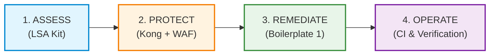

# Komainu (狛犬)

> **Security-First Modernization Platform for Legacy Enterprise Systems**  
> *Assess what is vulnerable, protect immediately at the edge, remediate with reusable modules, and operate with continuous verification.*

[-brightgreen.svg)](assess/lsa/)
[](examples/member-portal/)
[](operate/lsa_sarif/)
[](assess/lsa/prompts/60-reporter-ja.md)

Komainu (狛犬) is named after the paired guardian lion-dogs at the entrance of a Shinto shrine. They stand as an **a–un (阿吽)** pair: one with an open mouth to assess and call out weaknesses, and one with a closed mouth to remediate and seal the perimeter. 

Komainu bridges the gap between static code scanning and modern secure architecture by providing an integrated, evidence-backed workflow for enterprise systems.

---

## The Modernization Problem & The Komainu Solution

Legacy enterprise applications (written in ASP.NET WebForms, Classic ASP, Java Struts/Servlet, PHP, ColdFusion, Perl CGI) carry critical architectural vulnerabilities that off-the-shelf SAST tools either miss or drown in hundreds of false alarms:
1. **BOLA / IDOR (Broken Object Level Authorization):** Endpoints fail to verify whether the requesting user actually owns the requested resource ID.
2. **String-Built Dynamic Queries:** SQL, NoSQL, and HQL/JPQL statements constructed via string interpolation or concatenated parameters.
3. **High Modernization Risk:** Teams hesitate to touch legacy code due to fear of breaking undocumented business logic.

Komainu solves this through a **4-stage lifecycle**:



1. **Assess (LSA):** High-precision AI-assisted security audit across 10 legacy stacks.
2. **Protect (Edge):** Immediate zero-code-change perimeter shield using Kong Gateway and Coraza WAF.
3. **Remediate (Boilerplate 1):** Drop-in, production-ready modules for .NET 8 and Kotlin / Spring Boot 3.
4. **Operate (Verify):** Automated cross-user authorization tests in CI blocking pull requests that introduce BOLA.

---

## Platform Pillars & Capabilities

### 1. Assess — Legacy Security Assessment (`assess/lsa/`)
An autonomous multi-agent audit pipeline designed to inspect legacy repositories with strict read-only guarantees:
- **10 Legacy Stacks Covered:** Classic ASP, ColdFusion, .NET Legacy (WebForms/MVC/Handlers), Java Legacy (Servlet/JSP/Struts1/Spring MVC/MyBatis/Hibernate), Node Express, Perl CGI, PHP Plain, PHP CodeIgniter, Python Flask, SQL Procedures.
- **Multi-Agent Architecture:**
  - `10-stack-detector`: Identifies server frameworks, auth models, and DB layers.
  - `20-route-mapper`: Catalogs all public and private routes.
  - `30-bola-auditor`: Inspects object-level access controls per route.
  - `40-injection-auditor`: Traces dynamic SQL/NoSQL query constructions.
  - `50-finding-verifier` (*Skeptic Mode*): Adversarial agent actively seeking evidence to refute false positives.
  - `60-reporter`: Generates executive summaries and technical markdown reports.
- **Empirical Benchmark (Evaluation Run 2):**
  - **BOLA/IDOR Recall:** **100%** (25/25 vectors detected).
  - **Injection Recall:** **94.1%** (32/34 candidates detected; 2 inert string builders correctly distinguished).
  - **False Positives on Safe Code:** **0** (Parameterized queries and owner checks not flagged).
  - **Precision:** **0.965** (55/57 findings verified).
- **Standards & Bilingual Output:**
  - Standard **OASIS SARIF v2.1.0** for direct import into GitHub Security Code Scanning.
  - Bilingual reports: English (`report.md`) and Japanese (`report.ja.md`, compliant with IPA/NISC security guidelines).

### 2. Protect — Edge Security (`remediate/edge/`)
Before touching a single line of fragile legacy backend code, Komainu deploys immediate edge protection:
- **Kong Gateway (decK):** Declarative API gateway acting as a reverse proxy in front of legacy services.
- **Coraza WAF with OWASP Core Rule Set (CRS v4):** Automatically blocks SQL injection, cross-site scripting (XSS), path traversal, and scrapers at the edge.
- **Granular Rate Limiting:** Enforces request quotas per Consumer ID, IP address, or API credential.

### 3. Remediate — Reusable Security Modules (`remediate/`)
Drop-in authorization, authentication, and safe query libraries for modern target stacks:
- **Object-Level Authorization (`remediate/authz`):**
  - Libraries for **ASP.NET Core (.NET 8)** and **Spring Security (Kotlin / Spring Boot 3)**.
  - **Deny-by-default:** Missing ownership checks or unauthorized access strictly return **HTTP 404 Not Found** (preventing ID enumeration).
  - **Scoped Query Helpers:** Automatic owner-level database filtering via EF Core Global Query Filters and Spring Data JPA Specifications.
- **Identity & Authentication (`remediate/identity`):**
  - Standardized OpenID Connect (OIDC) integration (Entra ID, Keycloak, AWS Cognito).
  - Enforces **RFC 9700 / OAuth 2.1 Best Current Practice** (Authorization Code + PKCE only, exact redirect URIs, strict token verification).
- **Safe Query Analyzers (`remediate/query`):**
  - Compile-time static analyzers (**C# Roslyn Analyzer** and **Kotlin Detekt Rule**) that flag raw string interpolation in SQL/JPQL at build time.

### 4. Operate — Continuous Verification & CI/CD (`operate/`)
Ensures that fixed vulnerabilities never regress:
- **Cross-User Authorization Test Runner (`operate/cross_user_tester`):**
  - Automated CLI test suite simulating multi-tenant access (User A attempting to GET, PUT, or DELETE User B's resources).
  - Fails the build if an endpoint allows cross-user data leakage.
- **SARIF Converter (`operate/lsa_sarif`):** Converts LSA findings into OASIS SARIF v2.1.0 format.
- **CI Templates (`operate/ci`):** Ready-to-use workflows for GitHub Actions (`.github/workflows/cross-user-authz.yml`) and GitLab CI.

### 5. Reference Application & Adoption Guide (`examples/member-portal/`)
A complete reference system demonstrating all deliverables working end-to-end:
- **Architecture:** React 18 frontend + Twin backends (.NET 8 and Spring Boot 3) + PostgreSQL + Kong & Coraza WAF.
- **Dual Backend Equivalence:** Identical API surface, database schema, and test suite across both stacks.
- **Adoption Guide:** Step-by-step migration guide for enterprise engineering teams ([`ADOPTION-GUIDE.md`](examples/member-portal/ADOPTION-GUIDE.md) and [`ADOPTION-GUIDE.ja.md`](examples/member-portal/ADOPTION-GUIDE.ja.md)).

---

## Repository Layout

```text
komainu/
├── assess/               # Finding vulnerabilities
│   └── lsa/              # Legacy Security Assessment kit (pre-scan, agents, prompts, tests)
├── contracts/            # JSON Schemas (finding, route-inventory, stack-profile, verification)
├── remediate/            # Reusable remediation modules
│   ├── authz/            # D1: Object-level authorization (.NET 8 & Spring Boot 3)
│   ├── identity/         # D2: OpenID Connect authentication & token validation
│   ├── query/            # D3: Safe query helpers, Roslyn analyzer & Detekt rule
│   └── edge/             # D4: Kong gateway declarative configuration & Coraza WAF
├── operate/              # Continuous verification & operations
│   ├── cross_user_tester/# D5: Automated cross-user authorization CLI test runner
│   ├── lsa_sarif/        # SARIF v2.1.0 converter for CI code scanning
│   └── ci/               # GitHub Actions & GitLab CI workflow templates
├── examples/             # Reference systems & walkthroughs
│   └── member-portal/    # D6: Full-stack demo app (React 18 + .NET 8 / Spring Boot 3 + Docker)
├── governance/           # AI usage policy, data privacy, and the Two-Person approval rule
└── docs/                 # Strategy documents, delivery plans, and Architecture Decision Records (ADRs)
```

---

## Quick Start

### 🚀 One-Liner Zero-Install Execution

Run Komainu instantly without manual environment setup:

```bash
# Zero-install via npmjs (Node.js 16+ & Python 3.8+)
npx komainu-guard scan --target /path/to/legacy/repo --out /path/to/audit-out

# Zero-install via Docker (Self-contained, zero host dependencies)
docker run --rm -v $(pwd):/workspace ghcr.io/hoanghainh1188/komainu:latest scan --target /workspace/legacy-repo --out /workspace/audit-out

# Or install globally via npm:
npm install -g komainu-guard
komainu help
```

### 1. Run the LSA Kit Self-Test
Verify that the LSA pre-scan engine and rule inventory pass across all 10 legacy fixture stacks:
```bash
python3 assess/lsa/tests/run_tests.py
```

### 2. Run an Audit on a Legacy Repository
```bash
python3 assess/lsa/scripts/orchestrate.py \
  --target /path/to/legacy/repo \
  --out /path/to/audit-output
```

### 3. Generate Bilingual Audit Reports
Render reports in English, Japanese, or both:
```bash
# Generate English report
python3 assess/lsa/scripts/render_report.py --audit-dir /path/to/audit-output --lang en

# Generate Japanese report (IPA/NISC compliant)
python3 assess/lsa/scripts/render_report.py --audit-dir /path/to/audit-output --lang ja

# Generate both reports and SARIF output
python3 assess/lsa/scripts/render_report.py --audit-dir /path/to/audit-output --lang all
```

### 4. Run the Cross-User Authorization Test Pipeline
Test target API endpoints for BOLA/IDOR compliance:
```bash
python3 -m operate.cross_user_tester.runner \
  --target-url http://localhost:5000 \
  --user-a-token "<token_user_a>" \
  --user-b-token "<token_user_b>" \
  --resource-id-b "42" \
  --endpoint "/api/v1/orders/{id}"
```

### 5. Launch the Reference Demo App
Spin up the complete multi-tenant environment (React + .NET 8 / Spring Boot 3 + PostgreSQL + Kong WAF):
```bash
cd examples/member-portal
docker compose up -d
```
Visit `http://localhost:3000` to interact with the portal and test cross-user authorization boundaries.

---

## Governance & The Two-Person Rule

Komainu implements the **Two-Person Rule** described in [`governance/usage-policy.md`](governance/usage-policy.md):
- **Auditor / Agent (Person A):** Runs the automated assessment tools and drafts findings.
- **Reviewer / Architect (Person B):** A human security engineer or principal architect who independently verifies every finding against the codebase before it is released to clients or stakeholders.
- **Privacy Assurance:** Source code is analyzed under strict zero-retention / local processing guidelines; no client proprietary logic is stored or used for model training.

---

## License & Intellectual Property

Komainu follows an **Open Core** architecture ([ADR-0002](docs/adr/0002-ip-open-core.md)):
- The core LSA assessment kit, contracts, and remediation interfaces are open source under the MIT License.
- Enterprise-specific integrations, bespoke legacy adapters, and managed audit playbooks are retained for proprietary customer engagements.
