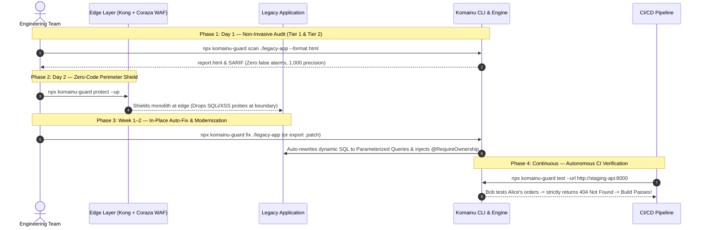

```text
  _  __                       _             
 | |/ /___  _ __ ___   __ _  (_)_ __  _   _ 
 | ' // _ \| '_ ` _ \ / _` | | | '_ \| | | |
 | . \ (_) | | | | | | (_| | | | | | | |_| |
 |_|\_\___/|_| |_| |_|\__,_| |_|_| |_|\__,_|
 Legacy Modernization & Security Platform  
```

# komainu-guard (狛犬)

> **Security-First CLI & Framework for Enterprise Legacy Modernization**  
> *Audit legacy vulnerabilities (BOLA/IDOR, BFLA, mass assignment & SQLi), auto-generate code fixes, deploy instant edge shields, and continuously verify cross-user authorization in CI/CD.*

[](https://www.npmjs.com/package/komainu-guard)
[](https://github.com/hoanghainh1188/komainu/blob/main/LICENSE)
[](https://github.com/hoanghainh1188/komainu/actions/workflows/remediate-tests.yml)
[](https://github.com/hoanghainh1188/komainu/actions/workflows/security-scan.yml)
[-brightgreen.svg)](assess/lsa/)
[](operate/lsa_sarif/)
[](assess/lsa/prompts/60-reporter-ja.md)

**[Changelog](https://github.com/hoanghainh1188/komainu/blob/main/CHANGELOG.md)** · [GitHub Releases](https://github.com/hoanghainh1188/komainu/releases)

---

## ⚡ Quick Start: Zero-Install Execution

Run Komainu commands immediately without local installation (requires Node.js 16+ or Docker):

```bash
# 1. Audit a legacy codebase (10 stacks: ASP, ColdFusion, PHP, Java, .NET, Node, etc.)
npx komainu-guard scan ./legacy-app --format html --out ./audit-output

# 2. Deploy instant perimeter defense (Kong API Gateway + OWASP Coraza WAF)
npx komainu-guard protect --up

# 3. Automatically patch vulnerable code in-place (or preview unified diff with --dry-run)
npx komainu-guard fix ./legacy-app --dry-run -p ./security-fixes.patch

# 4. Verify cross-user authorization defense (IDOR / BOLA) against live API in CI
npx komainu-guard test --url http://localhost:8000 --auto-crud-path /api/v1/orders/{id}

# 5. Launch interactive reference Demo app (Alice vs. Bob IDOR walkthrough)
npx komainu-guard demo --up
```

*Or via Docker:*
```bash
docker run --rm -v $(pwd):/workspace ghcr.io/hoanghainh1188/komainu:latest scan --target /workspace/legacy-repo --out /workspace/audit-out
```

---

## 🚀 How It Works: The Autonomous Security Lifecycle

Unlike traditional SAST scanners that flood teams with noisy false alarms, Komainu is an **autonomous security operating system** that detects, shields, auto-patches, and continuously verifies authorization boundaries.



### 🧠 Architecture: Deterministic Engine vs. Cognitive AI Agents (BYO-LLM)

Komainu operates on a strict **Bring-Your-Own-LLM (BYO-LLM)** and runtime-neutral design to honor enterprise confidentiality:

| Tier | Engine | Execution | LLM Required? | Primary Role |
|---|---|---|---|---|
| **Tier 1** | **Deterministic Engine** (`komainu scan`, `fix`, `protect`) | Local Python 3.8+ stdlib CLI (Zero 3rd-party dependencies) | **No** (100% offline & local) | Blazing-fast regex/AST candidate extraction, WAF edge provisioning, AST code rewriting, and CI/CD cross-user gating. |
| **Tier 2** | **Cognitive AI Multi-Agents** (`assess/lsa/`) | Executed by your AI runtime (Claude Code, Cursor, Antigravity, or Private LLM API) | **Yes** (via your chosen AI tool) | Deep semantic data-flow tracing, custom authorization model inference (`auth-model.md`), and **Multi-AI Consensus Council** (*Skeptic Verifier*) for **1.000 precision** ([Evaluation Run 3](assess/lsa/tests/EVAL-RESULTS.md)). |

> **Enterprise Privacy Note:** Your source code is never sent to any unapproved third-party API. You retain full control over running agents locally (Ollama, vLLM) or via approved subscriptions (see [`governance/usage-policy.md`](governance/usage-policy.md)).

---

## 🛠️ CLI Command Reference

> 📖 For full argument listings, POSIX exit codes, and pipeline integrations, see the [CLI Comprehensive User Guide](docs/cli-guide.md).

| Command | Description | Example |
| :--- | :--- | :--- |
| `komainu scan <target>` | Runs Legacy Security Audit (LSA) detecting BOLA & SQLi across 10 stacks | `npx komainu-guard scan ./legacy-app --format html` |
| `komainu init --ai <runtime>` | Installs audit skills into your AI runtime (`claude-code`, `codex`, `cursor`, `generic`) | `npx komainu-guard init --ai codex ./audit-workspace` |
| `komainu protect --up` | Launches Kong API Gateway & Coraza WAF (OWASP CRS) perimeter | `npx komainu-guard protect --up --virtual-patch findings.json` |
| `komainu fix <target>` | Automatically rewrites code in-place or exports `.patch` for BOLA, SQLi & CVEs | `npx komainu-guard fix ./legacy-app --dry-run -p fix.patch` |
| `komainu test --url <base-url>` | Executes active cross-user authorization tests against live APIs | `npx komainu-guard test --url http://127.0.0.1:5000 --from-scan findings.json` |
| `komainu devsecops sbom <target>`| Generates CycloneDX 1.5 / SPDX 2.3 SBOM across npm, PyPI, NuGet, Maven, Go | `npx komainu-guard devsecops sbom . --format cyclonedx` |
| `komainu devsecops run <target>` | Complete SAST, secret leak (Gitleaks), and SCA scan | `npx komainu-guard devsecops run .` |
| `komainu simulate --scenario <name>` | Executes Breach & Attack Simulation (Times Car, Metabase SQLi, IDC Frontier) | `npx komainu-guard simulate --target http://localhost:5001 -o report.md` |
| `komainu demo --up` | Launches the interactive Member Portal reference app | `npx komainu-guard demo --up` |

---

## 📦 Programmatic Usage (Node.js & NestJS)

`komainu-guard` provides drop-in BOLA guards enforcing server-side ownership and **HTTP 404 Not Found** invariants (preventing resource enumeration):

```typescript
// NestJS Controller with Komainu Guard
import { Controller, Get, Param, UseGuards, UseInterceptors } from '@nestjs/common';
import { RequireOwnership, OwnershipGuard, OwnershipInterceptor, ResourceOperation } from '@hoanghainh/komagu';

@Controller('api/v1/orders')
@UseGuards(OwnershipGuard)
@UseInterceptors(OwnershipInterceptor)
export class OrderController {
  @Get(':id')
  @RequireOwnership(ResourceOperation.READ, {
    idParamName: 'id',
    resourceLoader: async (id, req) => orderService.findById(id),
  })
  async getOrder(@Param('id') id: string) {
    return this.orderService.findById(id);
  }
}
```

*For Express.js, .NET 8, Spring Boot 3, FastAPI, and Go libraries, see [`remediate/authz/`](remediate/authz/).*

---

## 🤖 CI/CD Automation & Remediation Bot

<details>
<summary><b>Click to expand GitHub Actions Workflow (<code>.github/workflows/komainu-ci.yml</code>)</b></summary>

```yaml
name: Komainu Continuous Security Verification

on:
  pull_request:
    branches: [main]

jobs:
  verify-authorization:
    name: Cross-User BOLA/IDOR Gating
    runs-on: ubuntu-latest
    steps:
      - name: Checkout Code
        uses: actions/checkout@v4

      - name: Setup Node.js & Python
        uses: actions/setup-node@v4
        with:
          node-version: '20'

      - name: Start Staging Service
        run: |
          docker compose up -d app-staging
          sleep 5

      - name: Run Komainu Cross-User Authorization Verification
        run: |
          npx komainu-guard test \
            --url http://localhost:8080 \
            --auto-crud-path "/api/v1/orders/{id}" \
            --resource-id "101" \
            --attacker-token "${{ secrets.ATTACKER_JWT_TOKEN }}"

      - name: Generate CycloneDX SBOM & Scan Vulnerabilities
        run: |
          npx komainu-guard devsecops sbom . --format cyclonedx -o ./cyclonedx.json
          npx komainu-guard devsecops run . -o reports/merged.sarif

      - name: Upload Security Findings to GitHub Code Scanning
        if: always()
        uses: github/codeql-action/upload-sarif@v3
        with:
          sarif_file: reports/merged.sarif
```
</details>

---

## 🏛️ Platform Architecture & Repository Layout

Named after the paired guardian lion-dogs at Shinto shrines, Komainu acts as an **a–un (阿吽)** pair: assessing vulnerabilities with an open mouth and sealing defenses with a closed mouth.

```text
komainu/
├── bin/              # Unified CLI entrypoints (komainu Python CLI & komainu.js npx bridge)
├── assess/           # Pillar 1 (Assess): LSA kit (10 legacy stacks, pre-scan, multi-agent consensus)
├── contracts/        # JSON Schemas (finding, route-inventory, stack-profile, verification)
├── remediate/        # Pillars 2 & 3 (Protect & Remediate): Reusable security modules
│   ├── authz/        # BP1-D1: Object-level authorization (.NET 8, Spring Boot 3, NestJS, FastAPI, Go)
│   ├── identity/     # BP1-D2: OIDC / OAuth 2.1 authentication & token validation
│   ├── query/        # BP1-D3: Safe query helpers & static analyzers
│   ├── deps/         # Automated CVE dependency manifest patcher across 5 ecosystems
│   ├── edge/         # BP1-D4: Kong Gateway & Coraza WAF (OWASP CRS v4) edge configs
│   ├── legacy_shims/ # Drop-in ownership & query shims (PHP, Java, ColdFusion, Classic ASP)
│   ├── ekyc/         # BP2: Zero-PII eKYC & NFC verification (Japan 2027 compliance)
│   ├── resilience/   # BP3: Multi-region S3 WORM backup, KMS & DR verification CLI
│   └── tenancy/      # BP4: PostgreSQL RLS tenant isolation & BYOK AES-256-GCM encryption
├── operate/          # Pillar 4 (Operate): Continuous verification & DevSecOps
│   ├── cli/          # Unified Komainu CLI core implementation
│   ├── devsecops/    # BP5: SBOM generator, SARIF merger & SAST/SCA runner
│   ├── remediator/   # AST-based automated code patcher for BOLA & SQLi
│   ├── cross_user_tester/ # Automated cross-user authorization CLI test runner
│   └── simulate/     # Breach & Attack Simulation (BAS) suite
├── examples/         # Reference apps (Member Portal: React 18 + .NET 8 / Spring Boot 3)
├── governance/       # AI usage policy, data privacy & the Two-Person approval rule
└── docs/             # Strategy documents, delivery runbooks & Architecture Decision Records (ADRs)
```

---

## 👥 Governance & License

- **The Two-Person Rule:** Komainu enforces strict governance ([`governance/usage-policy.md`](governance/usage-policy.md)) where automated audits/patches (Person A) must be validated by a human architect/engineer (Person B) prior to production deployment.
- **Open Core Architecture ([ADR-0002](docs/adr/0002-ip-position-open-core.md)):** Core LSA assessment kit, contracts, and remediation interfaces are licensed under **MIT**. Enterprise integrations and managed playbooks are retained for customer engagements.
