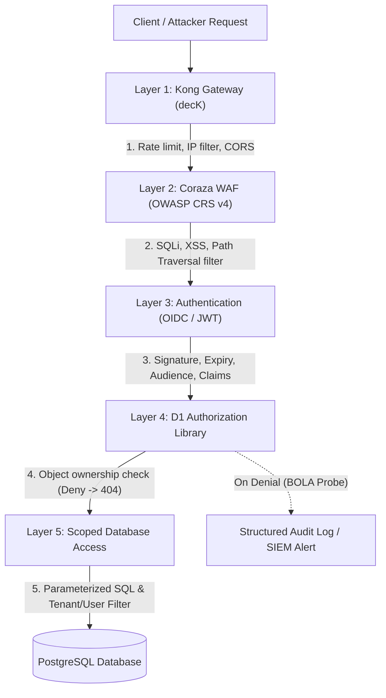
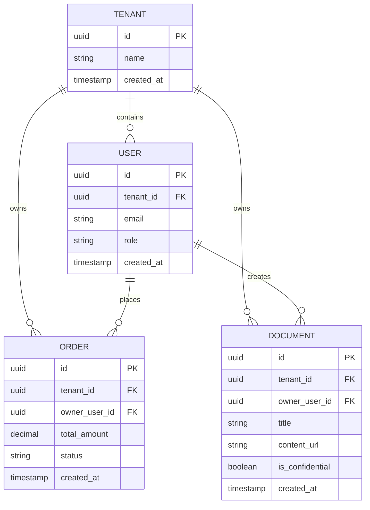

# ADR-0004: Boilerplate 1 (B1) Design Review — D1 Interface, Request Path Threat Model, and D6 Demo App Scope

Date: 2026-10-17 · Status: accepted · Owner: Harry (Principal Architect & BOD)

## Context

Per the Boilerplate 1 Delivery Plan (`docs/boilerplate-1-delivery-plan.md`), **Approval Point 1 (Design review at the end of Week 2 / Milestone M1)** requires formal review and sign-off on three core architectural foundations before core implementation begins:

1. **D1 Public Interface Draft:** Standardized object-level authorization library contracts for both target platforms (.NET 8 and Kotlin/Spring Boot 3).
2. **Threat Model for the Complete Request Path:** Defense-in-depth security model across all network and application boundaries (Kong Gateway limits → Coraza WAF → Token check → Ownership check → Scoped DB access).
3. **Demo App (D6) Scope:** Specification of the multi-tenant Member Portal used as the test target for cross-user security pipelines (D5) and client pilot pitches.

Additionally, the strategic open questions deferred from Week 1 (Team staffing model, IP position, WAF engine selection) were resolved in ADR-0002, ADR-0003, and the delivery plan updates, leaving the design review ready for final approval.

---

## Decision

We approve the architectural design for Boilerplate 1 comprising:
1. Dual-style (Imperative + Declarative) D1 object-level authorization interfaces with deny-by-default (404) semantics.
2. A 5-layer STRIDE-aligned request path threat model.
3. A focused multi-tenant Member Portal demo app (D6) featuring twin .NET 8 and Spring Boot 3 backends with planted test vulnerabilities.

---

### 1. D1 Public Interface Specification

#### 1.1. Core Architectural Invariants

All implementations of the D1 library across both .NET and JVM platforms must satisfy these strict invariants:

1. **Identity Strictly from Verified Token Claims:** The caller identity (`userId`, `tenantId`, `roles`) is extracted exclusively from cryptographic claims verified by the authentication middleware (D2). Never bind identity from path parameters, query parameters, or request payloads.
2. **Deny-by-Default with HTTP 404 Not Found:** When an authenticated user requests a resource that exists but does not belong to them, D1 **must return `404 Not Found`** instead of `403 Forbidden`. This eliminates ID enumeration and information disclosure (attacker cannot distinguish between nonexistent IDs and existing IDs belonging to other users).
3. **Dual API Styles:**
   - **Imperative (Programmatic):** Explicit service calls inside controller/service methods. Recommended for dynamic, multi-condition, or business-logic-coupled authorization rules.
   - **Declarative (Annotation / Attribute):** Method/action filters and annotations. Recommended for standard single-resource CRUD endpoints to ensure clean controller code.
4. **Scoped Data-Access Helpers:** Query-level filters to prevent fetching cross-tenant or cross-user data into application memory.
5. **Structured Security Audit Event:** Every denied authorization attempt emits a structured audit event containing `timestamp`, `traceId`, `actorId`, `tenantId`, `resourceType`, `resourceId`, and `clientIp` for SIEM/logging integration.

---

#### 1.2. .NET 8 (ASP.NET Core & EF Core) Interface Contract

##### Core Abstractions (`Komainu.Security.Authorization`)

```csharp
namespace Komainu.Security.Authorization;

using System.Security.Claims;

/// <summary>
/// Supported authorization operations on resources.
/// </summary>
public enum ResourceOperation
{
    Read,
    Create,
    Update,
    Delete
}

/// <summary>
/// Result of an object-level authorization evaluation.
/// </summary>
public record AuthorizationResult(bool Succeeded, string? FailureReason = null)
{
    public static AuthorizationResult Success() => new(true);
    public static AuthorizationResult Denied(string reason) => new(false, reason);
}

/// <summary>
/// Interface implemented by domain entities supporting ownership checks.
/// </summary>
public interface IOwnedResource<TKey>
{
    TKey Id { get; }
    string OwnerUserId { get; }
    string TenantId { get; }
}

/// <summary>
/// Primary imperative authorization service for ASP.NET Core applications.
/// </summary>
public interface IKomainuAuthorizationService
{
    /// <summary>
    /// Evaluates if the current authenticated user owns and can access the given resource.
    /// Emits a structured security audit event on denial.
    /// </summary>
    ValueTask<AuthorizationResult> AuthorizeAsync<T>(
        ClaimsPrincipal user,
        T resource,
        ResourceOperation operation,
        CancellationToken cancellationToken = default);

    /// <summary>
    /// Extracts the verified subject user ID from token claims.
    /// Throws UnauthorizedAccessException if missing or invalid.
    /// </summary>
    string GetCurrentUserId(ClaimsPrincipal user);

    /// <summary>
    /// Extracts the verified tenant ID from token claims.
    /// </summary>
    string GetCurrentTenantId(ClaimsPrincipal user);
}
```

##### Declarative Attribute & Action Filter (`Komainu.Security.AspNetCore`)

```csharp
namespace Komainu.Security.AspNetCore;

using Microsoft.AspNetCore.Mvc;

/// <summary>
/// Declarative attribute to enforce object ownership at the controller action boundary.
/// Automatically returns 404 Not Found on ownership mismatch.
/// </summary>
[AttributeUsage(AttributeTargets.Method | AttributeTargets.Class, AllowMultiple = false, Inherited = true)]
public sealed class RequireOwnershipAttribute : TypeFilterAttribute
{
    public RequireOwnershipAttribute(Type resourceType, string idRouteParameter = "id", ResourceOperation operation = ResourceOperation.Read)
        : base(typeof(OwnershipAuthorizationFilter))
    {
        Arguments = new object[] { resourceType, idRouteParameter, operation };
    }
}
```

##### Scoped Data Access (EF Core Extensions) (`Komainu.Security.EntityFrameworkCore`)

```csharp
namespace Komainu.Security.EntityFrameworkCore;

using System.Linq;
using System.Linq.Expressions;
using Microsoft.EntityFrameworkCore;

public static class ScopedQueryExtensions
{
    /// <summary>
    /// Appends user and tenant isolation filter to the IQueryable pipeline before DB execution.
    /// </summary>
    public static IQueryable<T> WithUserScope<T>(
        this IQueryable<T> query,
        string currentUserId,
        string currentTenantId) where T : class, IOwnedResource<Guid>
    {
        return query.Where(entity => entity.TenantId == currentTenantId && entity.OwnerUserId == currentUserId);
    }
}
```

---

#### 1.3. Kotlin / Spring Boot 3 Interface Contract

##### Core Abstractions (`io.komagu.security.authorization`)

```kotlin
package io.komagu.security.authorization

import org.springframework.security.core.Authentication
import java.util.UUID

enum class ResourceOperation {
    READ, CREATE, UPDATE, DELETE
}

data class AuthorizationDecision(
    val granted: Boolean,
    val failureReason: String? = null
)

interface OwnedResource<TKey> {
    val id: TKey
    val ownerUserId: String
    val tenantId: String
}

/**
 * Primary security manager for JVM / Spring applications.
 */
interface KomaguSecurityManager {
    /**
     * Imperative assertion: verifies ownership. Throws ResourceNotFoundException (mapped to 404) on failure.
     */
    fun <T> requireOwnership(
        resource: T?,
        operation: ResourceOperation = ResourceOperation.READ,
        ownerUserIdExtractor: (T) -> String
    )

    fun getCurrentUserId(authentication: Authentication? = null): String
    fun getCurrentTenantId(authentication: Authentication? = null): String
}
```

##### Declarative Annotation & Aspect (`io.komagu.security.spring`)

```kotlin
package io.komagu.security.spring

import io.komagu.security.authorization.ResourceOperation
import kotlin.reflect.KClass

/**
 * Declarative annotation to enforce ownership on service or controller methods.
 */
@Target(AnnotationTarget.FUNCTION)
@Retention(AnnotationRetention.RUNTIME)
@MustBeDocumented
annotation class RequireOwnership(
    val entityClass: KClass<*>,
    val idParam: String = "id",
    val operation: ResourceOperation = ResourceOperation.READ
)
```

##### Scoped Data Access (Spring Data JPA)

```kotlin
package io.komagu.security.data

import org.springframework.data.repository.NoRepositoryBean
import org.springframework.data.repository.Repository
import java.util.Optional

@NoRepositoryBean
interface ScopedRepository<T, ID> : Repository<T, ID> {
    /**
     * Safe query guaranteeing tenant and user boundary matching.
     */
    fun findByIdAndTenantIdAndOwnerUserId(id: ID, tenantId: String, ownerUserId: String): Optional<T>
}
```

---

### 2. Threat Model for the Request Path

The Boilerplate 1 request path implements Defense-in-Depth across 5 distinct tiers.



#### 2.1. STRIDE Analysis Matrix

| Request Path Layer | STRIDE Category | Primary Threat Description | Defense Mechanism & Invariant in B1 |
|---|---|---|---|
| **Layer 1: Kong Gateway** | **Denial of Service (DoS)** | Credential stuffing, ID brute-force scraping, high-volume request flood. | **Kong Rate Limiting Plugin** configured via decK: per-IP limit for unauthenticated paths; per-consumer/token limit for authenticated APIs. Strict origin/CORS enforcement. |
| **Layer 2: Coraza WAF** | **Tampering (T)** | SQL injection, XSS, HTTP request smuggling, path traversal in URI/headers/body. | **OWASP Coraza WAF** sidecar with OWASP CRS v4.0. Inspects request payload before backend execution; blocks SQL injection strings before query binding. |
| **Layer 3: Authentication** | **Spoofing (S)** & **Elevation of Privilege (EoP)** | Forged JWT tokens, expired credentials, token replaying, claims tampering. | **OIDC Code Flow with PKCE** only (RFC 9700). Validates token signature (RS256/ES256), issuer (`iss`), audience (`aud`), expiration (`exp`), and not-before (`nbf`). Identity context populated only from verified token claims. |
| **Layer 4: D1 Authz Lib** | **Information Disclosure (I)** & **BOLA / IDOR (EoP)** | Attacker alters resource ID (`/orders/{attacker_id}` → `/orders/{victim_id}`) to view or mutate another tenant's or user's records. | **Deny-by-default with HTTP 404 Not Found**. Verifies resource ownership against verified token context. Returns 404 so attacker cannot probe valid IDs. Emits structured security audit event. |
| **Layer 5: Scoped DB Access** | **Information Disclosure (I)** & **Tampering (T)** | Developer accidentally omits `WHERE user_id = ...`, leading to bulk data leakage; dynamic SQL injection. | **100% Parameterized queries** (enforced by D3 Roslyn/detekt rules). Global query filters and scoped repository methods automatically appending tenant and user filters. |

#### 2.2. Threat Scenario Walkthroughs

1. **BOLA / IDOR Attack Scenario:**
   - *Attacker Action:* Authenticates as User B (Tenant 1), then sends `GET /api/v1/orders/00000000-0000-0000-0000-000000000001` (owned by User A).
   - *System Response:* Request passes Layer 1 (within rate limits), Layer 2 (valid format), Layer 3 (valid token for User B). At Layer 4, D1 checks `order.ownerUserId == token.sub`. Evaluation fails.
   - *Outcome:* Backend immediately returns `HTTP 404 Not Found`. An audit event `KomainuSecurityAuditEvent.OwnershipDenied` is recorded with `actor: User B`, `targetResource: Order/1`. User B cannot confirm if Order 1 exists.

2. **SQL Injection Probe Scenario:**
   - *Attacker Action:* Sends `GET /api/v1/orders?sort=status;DROP+TABLE+orders;--`.
   - *System Response:* Layer 2 (Coraza WAF with CRS v4 rule 942100) detects SQL injection pattern and drops the request with `HTTP 403 Forbidden` before it touches the application. Even if passed through, Layer 5 D3 safe-query helpers require strict column allow-lists and parameterized bindings.

---

### 3. Demo App (D6) Scope & Specification

The Demo App serves as the canonical reference architecture and the automated test target for D5 security test runners.

#### 3.1. Domain: Multi-Tenant Member Portal

The demo app models a standard SaaS Customer Portal where users manage orders and upload/download confidential business documents within their isolated organizational tenant.

#### 3.2. Data Model



#### 3.3. Technical Stack & Component Topology

1. **Frontend (`d6-frontend`):**
   - Single-Page Application (SPA) built with React 18, Vite, TypeScript, and Tailwind CSS.
   - Includes a **Persona Switcher** in the UI header to seamlessly test as:
     - *User A:* Tenant Alpha regular member.
     - *User B:* Tenant Alpha regular member (cross-user peer).
     - *User C:* Tenant Beta member (cross-tenant attacker).
2. **Backends (Twin Implementations sharing OpenAPI 3.1 spec):**
   - **`d6-backend-dotnet`:** .NET 8 Web API, ASP.NET Core Minimal APIs / Controllers, EF Core, using D1 NuGet package.
   - **`d6-backend-spring`:** Spring Boot 3, Kotlin, Spring Security 6, Spring Data JPA, using D1 Maven artifact.
3. **Database:** PostgreSQL 16 (single shared database, isolated schemas or tenant column).

#### 3.4. API Endpoints Specification

| Method | Endpoint | Protection Level | Expected Security Behavior |
|---|---|---|---|
| `POST` | `/api/v1/auth/token` | Public | Issues mock/test JWT tokens for selected persona. |
| `GET` | `/api/v1/profile` | D2 Authenticated | Returns profile of the authenticated caller. |
| `GET` | `/api/v1/orders` | D1 Scoped Query | Returns only orders belonging to caller's tenant and user ID. |
| `GET` | `/api/v1/orders/{id}` | D1 Protected (404) | Returns order if caller is owner; returns **404 Not Found** if owned by another user. |
| `POST` | `/api/v1/orders` | D1 Protected | Creates order with `ownerUserId` bound to caller token. |
| `DELETE` | `/api/v1/orders/{id}` | D1 Protected (404) | Deletes order if caller is owner; returns **404 Not Found** on mismatch. |
| `GET` | `/api/v1/documents/{id}` | D1 Multi-tenant Protected | Accessible to owner or tenant admin; returns **404** to other tenants. |

#### 3.5. Planted Test Vulnerabilities (for D5 Automation)

To guarantee that the D5 automated test pipeline (Schemathesis + SARIF scanner) is effective, D6 includes deliberate security vulnerabilities active **only** when `ENABLE_SECURITY_TEST_VULNERABILITIES=true`:

1. **Planted BOLA Endpoint:** `GET /api/v1/test/legacy-orders/{id}`: Directly queries the database by ID and returns the order without checking `ownerUserId` or `tenantId`.
2. **Planted SQL Injection Endpoint:** `GET /api/v1/test/legacy-search?query=...`: Concatenates the query string directly into a raw SQL query.

When D5 runs in CI:
- With test endpoints enabled, D5 **must fail** (detecting BOLA and SQLi).
- Against standard `/api/v1/orders` endpoints, D5 **must pass completely green**.

---

## Consequences

- **Milestone M1 (Design Review) Complete:** The architecture, public interfaces, threat model, and demo scope are formally aligned and frozen.
- **Unblocks Milestone M2 Development:** Developers (AI agents and human architect) can proceed with sprint work:
  - Week 3: D1 library implementation (.NET 8 & Spring Boot 3).
  - Week 4: D2 OIDC token validation & D4 Kong + Coraza WAF setup.
  - Week 5: API Freeze and demo app scaffold.
- **Clear Verification Target:** D5 test pipeline authors have explicit contract specifications for cross-user test generation.
