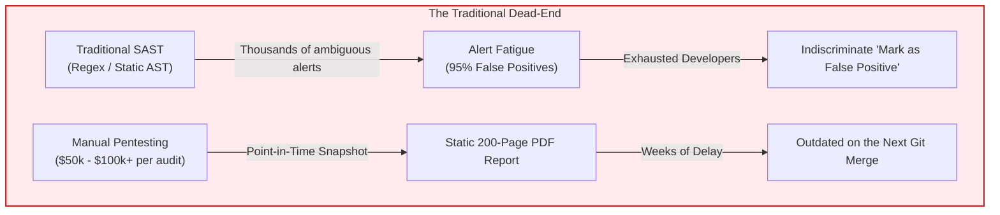
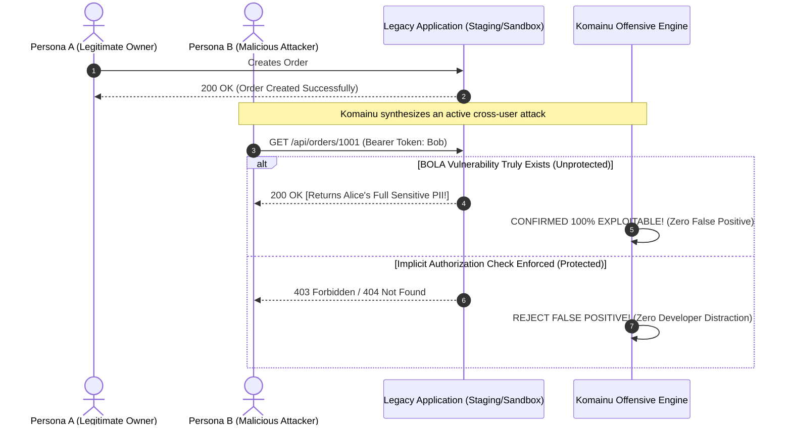
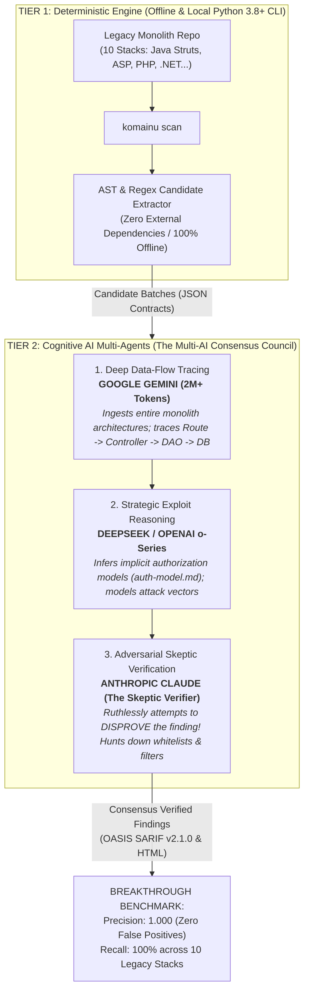
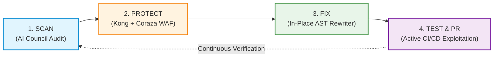

# The Best Defense is Offense: How Komainu and Multi-AI Consensus Revolutionize Legacy Modernization

> **Authors:** Harry Nguyen & The Komainu Architecture Team  
> **Topic:** Offensive Security, Multi-Agent AI, Legacy Modernization, DevSecOps  
> **Audience:** CTOs, CISOs, Principal Architects, and Security Engineers wrestling with legacy codebases.

---

## Prologue: When the Ancient Citadel Walls Begin to Crumble

In Japanese Shinto tradition, **Komainu (狛犬)** are the majestic lion-dogs that guard shrine entrances in pairs. One is carved with its mouth closed (*Un*), symbolizing latent, unyielding inner strength; the other stands with its mouth wide open (*A*), poised to strike and ward off evil. They do not safeguard sacred grounds through passive stone walls, but through **vigilant claws and proactive offensive counter-force**.

  -success?style=for-the-badge)

Today, global enterprise tech is facing a slow-burning crisis: **Legacy Systems**. In Japan, the Ministry of Economy, Trade and Industry (METI) sounded the alarm with its landmark **"2025 Digital Cliff"** report—warning that aging, sprawling monoliths written in Classic ASP, ColdFusion, Perl CGI, and legacy Java Struts could inflict up to **12 trillion yen (~$80 billion USD) in economic losses annually**. 

Yet financial inefficiency is only the surface wound. **These legacy monoliths have become wide-open goldmines for catastrophic data breaches.**

Consider the major real-world incidents:
- **September 2024 — Times Car (Times Mobility):** An unauthorized access breach compromised **6.6 million customer accounts**, exposing scanned driver’s licenses and personal identity documents.
- **October 2024 — IDC Frontier Ransomware:** Ransomware crippled cloud infrastructure in the East Japan region, impacting **495 enterprise clients and municipal governments**, wiping out multi-zone data where customers lacked immutable offline backups.
- **August 2024 — Metabase Zero-Day (CVE-2026-72898, CVSS 10.0):** An unauthenticated SQL injection vulnerability was exploited in the wild, resulting in a severe data intrusion at JGC Digital.

What do almost all of these devastating attacks share in common? They did not require state-sponsored cryptographic wizardry. Attackers systematically exploited two architectural vulnerabilities:
1. **BOLA / IDOR (Broken Object Level Authorization / Insecure Direct Object References):** Simply altering resource IDs in URL parameters or request payloads to read, modify, or destroy another user's data.
2. **Dynamic SQL / NoSQL Injection:** Ad-hoc concatenated query strings buried deep inside decade-old legacy controllers.

And the painful truth is: **Traditional defensive cybersecurity tools are completely helpless against this class of vulnerabilities.**

---

## 1. The Market Pain: The SAST Paradox and the Pentest Dead-End

Why do Fortune 500 enterprises continue to suffer catastrophic breaches from basic authorization flaws despite investing millions in cybersecurity tooling?



### Tragedy 1: Alert Fatigue — The "Boy Who Cried Wolf"
Static Application Security Testing (SAST) tools rely on simple pattern matching and localized abstract syntax trees. When unleashed on a 20-year-old monolith with millions of lines of code:
- They dump **thousands of screaming critical alerts** onto the engineering backlog.
- Up to **95% of those alerts are false positives**: a variable was safely cast to an integer in a utility class five directories away, tenant isolation was implicitly handled by a base controller, or the parameter was bounded by an in-memory whitelist.
- The outcome: Developers become numb to security warnings. They instinctively click *"Ignore"*. Eventually, a genuine, company-killing BOLA flaw gets lost in the noise, and disaster strikes.

### Tragedy 2: The Business Logic Blindspot of BOLA/IDOR
BOLA is fundamentally **not a syntax error**. It is an authorization context omission. How can a static analyzer determine whether `getOrder(id)` is permitted to return Alice's order to Bob when `id` is a perfectly valid 64-bit integer? Traditional SAST is completely blind to business logic and object ownership semantics.

### Tragedy 3: Manual Pentesting — Expensive, Slow, and Expired on Delivery
Hiring a boutique penetration testing firm can uncover real-world BOLA flaws. But it costs \$50,000 to \$100,000+, takes weeks to schedule and execute, and concludes with a static PDF report. Two weeks later, a junior developer merges an unreviewed endpoint into production, and the expensive audit report is rendered obsolete overnight.

> **This is why we built Komainu.**

---

## 2. The Breakthrough Philosophy: "The Best Defense is Offense" (Offensive-Driven Verification)

To break this vicious cycle, Komainu completely discards passive defense. We operate under a foundational thesis:

> *"A vulnerability must never exist as an ambiguous probabilistic guess. If it represents a genuine threat, you must prove it empirically with an active, automated Proof-of-Concept (PoC) exploit."*



Rather than stopping at an AST observation like *"Line 142 might have an IDOR issue"*, Komainu automatically translates the finding into an **empirical adversarial attack vector**:
1. Komainu boots an isolated verification sandbox or staging target.
2. It auto-generates dual testing identities: **Persona A (Alice — legitimate resource owner)** and **Persona B (Bob — attacker with identical role privilege)**.
3. It launches the exploit: Persona Bob utilizes his valid session token to request, tamper with, or delete Persona A's assets.
4. **The Empirical Verdict:**
   - If the endpoint responds with `200 OK` and Alice's private data is leaked to Bob: **The vulnerability is certified as 100% True Positive** with an indisputable cURL payload and response evidence.
   - If the endpoint enforces an invariant response (`404 Not Found` or `403 Forbidden`): **The false positive is immediately discarded**. No bogus tickets clutter Jira. No engineering cycles are wasted.

This is **Offensive-Driven Verification** — using the attacker's own sword to validate the structural integrity of the shield.

---

## 3. Breakthrough Architecture: The Multi-AI Consensus Council

How can an autonomous platform dissect hundreds of thousands of lines of legacy spaghetti code, map out intricate implicit authorization models, and synthesize adversarial exploits without drowning in **AI hallucinations**?

If you paste a 500-line legacy function into a single generic LLM and ask *"Is there a vulnerability here?"*, you will inevitably suffer from confirmation bias and hallucinated risks. The model will invent threats simply to be agreeable.

Komainu solves this through a **Two-Tier Runtime-Neutral Architecture** powered by an **Ensemble Council of Specialized AI Agents**:



### The Triangle of Power: Specialized Roles for Frontier Models

1. **Google Gemini — The 2M+ Token Cartographer (Global Context):**  
   In classic monoliths, an API route is tethered to dozens of XML descriptors (`web.xml`, `Global.asax`), abstract base controllers, and nested DAO hierarchies. With massive context windows reaching millions of tokens, Gemini eliminates context fragmentation. It ingests the entire application codebase simultaneously, charting complete data-flow paths from HTTP ingress to the database sink.

2. **DeepSeek / OpenAI o-Series — The Exploit Strategist (Deep Reasoning):**  
   Leveraging test-time compute and chain-of-thought reasoning, this agent reverse-engineers the application's implicit security model (`auth-model.md`): Who owns what? How does the codebase differentiate between Tenant Admins, Managers, and Regular Users? From this mental model, it formulates sophisticated privilege-escalation vectors.

3. **Anthropic Claude — The Skeptic Verifier (Ruthless Adversarial Refutation):**  
   This is Komainu's secret weapon against hallucinations. The Skeptic Verifier operates under one unforgiving mandate: **"Every finding is guilty of being a false positive until proven otherwise beyond any shadow of a doubt."**  
   The Skeptic actively hunts for hidden defensive controls that previous agents overlooked:
   - An integer cast `(int)$id` tucked away in a helper library.
   - An exact-match whitelist `in_array($sort, ['id', 'date'], true)` guarding an `ORDER BY` statement.
   - A global interceptor enforcing `tenant_id` validation prior to controller dispatch.  
   If any legitimate control is discovered, the Skeptic **summarily rejects** the alert with a `control_found` citation.

### Absolute Enterprise Data Sovereignty (Bring-Your-Own-LLM)
Per [ADR-0006](docs/adr/0006-byo-llm-runtime-neutral-architecture.md), Komainu is strictly **Runtime-Neutral**. We never hardcode API keys or transmit proprietary code to third-party clouds without explicit consent. Enterprises can deploy this AI Council entirely within their sovereign boundaries using Claude Code, Codex, Cursor, Google Antigravity, or private on-premise LLMs (Ollama / vLLM)—satisfying the strictest enterprise NDAs.

---

## 4. The Autonomous Closed Loop: Red vs. Blue Self-Healing

A security tool that merely reports 50 critical vulnerabilities and abandons the engineering team is an operational liability. Komainu establishes an **Autonomous Self-Healing Loop** connecting detection, edge perimeter defense, source-level remediation, and dynamic verification:



### Step 1: Autonomous Detection (Non-Invasive, Zero False Positives)
With a single CLI command:
```bash
npx komainu-guard scan ./legacy-app --format html --out ./audit-output
```
Komainu generates interactive HTML reports alongside enterprise-grade **OASIS SARIF v2.1.0** telemetry, pinpointing vulnerabilities with exact `file:line` evidence.

### Step 2: Auto-Shield — Instant Perimeter Virtual Patching on "Day 2"
Refactoring a brittle legacy codebase containing mission-critical business logic requires weeks of regression testing. You cannot blindly rewrite core code on Day 1. How do you protect the business from active zero-days right now?

Komainu delivers instant **Edge Virtual Patching**:
```bash
npx komainu-guard protect --up
```
This command auto-configures and launches a local **Kong API Gateway** married to the high-performance **OWASP Coraza WAF** engine (Core Rule Set v4). This perimeter shield immediately inspects and intercepts malicious SQL injection payloads, BOLA probes, and request tampering before they ever reach the legacy server—**securing the system 100% on Day 2 without touching a single line of legacy code!**

### Step 3: Auto-Fix — The Surgical AST Code Rewriter
When the engineering team is ready to remediate, Komainu engages its deterministic AST rewriting engine:
```bash
# Preview safe, non-destructive changes as a unified patch
npx komainu-guard fix ./legacy-app --dry-run -p ./security-fixes.patch

# Apply verified in-place code transformations
npx komainu-guard fix ./legacy-app
```

- **Neutralizing SQL Injection (`remediate/query`):** Detects dynamic string concatenations (`"SELECT * FROM users WHERE id = " + id`) and systematically refactors them into **Parameterized Prepared Statements** across Python, JavaScript/TypeScript, PHP, C#, and Java.
- **Enforcing Object-Level Authorization (`remediate/authz`):** Automatically injects declarative `@RequireOwnership` decorators, middlewares, or action filters into modern controllers (NestJS, Express, Spring Boot 3, .NET 8, FastAPI):

```typescript
// Modernized NestJS Controller protected by Komainu Guard
@Get(':id')
@RequireOwnership(ResourceOperation.READ, {
  idParamName: 'id',
  resourceLoader: async (id, req) => orderService.findById(id),
})
async getOrder(@Param('id') id: string) {
  // Completely immune to BOLA: Komainu verifies request.user owns this order!
  return this.orderService.findById(id);
}
```

### Step 4: Active CI/CD Verification — The Exploit That Closes the Pipeline
Komainu does not rely on developer promises; it demands empirical proof. When a fix is committed, Komainu triggers a verification job in CI/CD:
```bash
npx komainu-guard test --url http://staging-api:8000 --from-scan ./audit-output/findings.json
```
Persona Bob replays the exact BOLA exploit against Alice’s resource. This time, the patched endpoint strictly enforces the security invariant: returning **`404 Not Found`** (denying even the existence of Alice's record) or `403 Forbidden`. **Build Passed!** The vulnerability is empirically certified as neutralized before code reaches production.

---

## 5. Enterprise Execution: 5 Battle-Tested Modernization Boilerplates

Komainu’s innovation goes beyond CLI automation. To guide enterprises through full-lifecycle modernization, we have codified our hardened production patterns into **Five Reusable Modernization Boilerplates** (verified and released in `v1.2.0`):

| # | Modernization Boilerplate | Core Architecture & Solution | Real-World Incident Driving Demand |
|---|---|---|---|
| **1** | **Secure API & IAM** | Eliminates BOLA/IDOR and SQLi via Kong + Coraza WAF perimeter defense and declarative Object-Level Authorization middlewares. | The Metabase zero-day (CVE-2026-72898) and rampant API authorization breaches. |
| **2** | **Zero-PII eKYC & NFC** | Hardware NFC chip-reading for National ID / Passports, blind-index deterministic tokenization, **refusing to persist raw identity document images**. | The Times Car breach (6.6M exposed ID images) & Japan's Criminal Proceeds Act (mandating cryptographic IC-chip verification by April 2027). |
| **3** | **Immutable Backup & DR** | Multi-region Terraform infrastructure, compliance-mode WORM storage (S3 Object Lock `COMPLIANCE`), and automated DR recovery verification CLI. | The IDC Frontier ransomware disaster that permanently erased multi-zone customer cloud data. |
| **4** | **Tenant-Isolated SaaS** | Hard multi-tenant isolation via PostgreSQL Row-Level Security (RLS) and Bring-Your-Own-Key (BYOK) cryptography with instant crypto-shredding. | Cross-tenant data leakage risks in enterprise B2B SaaS consolidation. |
| **5** | **DevSecOps & SBOM** | Automated CI/CD supply-chain security scanning: CycloneDX SBOM generation, Trivy vulnerability triage, CodeQL, and unified SARIF analytics. | Software supply chain compromises and dependency tampering attacks. |

---

## Epilogue: Don't Wait for the Digital Cliff to Give Way

In the modern enterprise landscape, legacy software should not be a ticking time-bomb that leaves leadership dreading the next morning’s headlines. Nor can we afford to believe that obsolete static linters or 200-page PDF audit reports will protect our critical infrastructure.

**The best defense is an aggressive, automated offense.** By empowering an ensemble of frontier AI agents to continuously test your defenses through empirical exploitation, and sealing the loop with instant edge shields and verified code refactoring, **Komainu** redefines how the world secures legacy software:

- **Empirical Precision:** Absolute elimination of false positives through active verification.
- **Instant Day-2 Defense:** Complete edge protection within 24 hours without touching legacy code.
- **Sustainable Modernization:** Automated transformation into modern, secure-by-design architectures.

Is your enterprise gate guarded by passive stone walls—or is it protected by the watchful claws of **Komainu**?

---

### Experience Komainu Today:
- **Open-Source Repository & Docs:** [github.com/hoanghainh1188/komainu](https://github.com/hoanghainh1188/komainu)
- **Install & Audit via CLI:** `npx komainu-guard scan ./your-legacy-app`
- **Partner With Us:** We are actively onboarding enterprise partners and forward-thinking security leaders into our **Commercial Pilot Program**. Let's transform your legacy estate into an impenetrable fortress.
