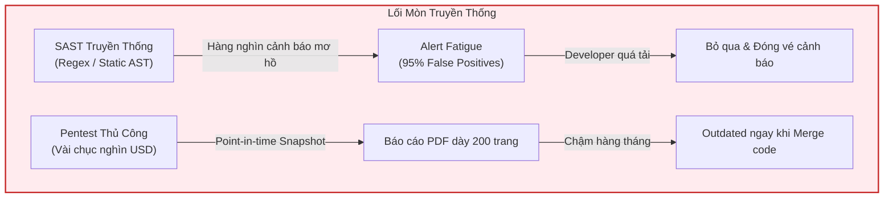
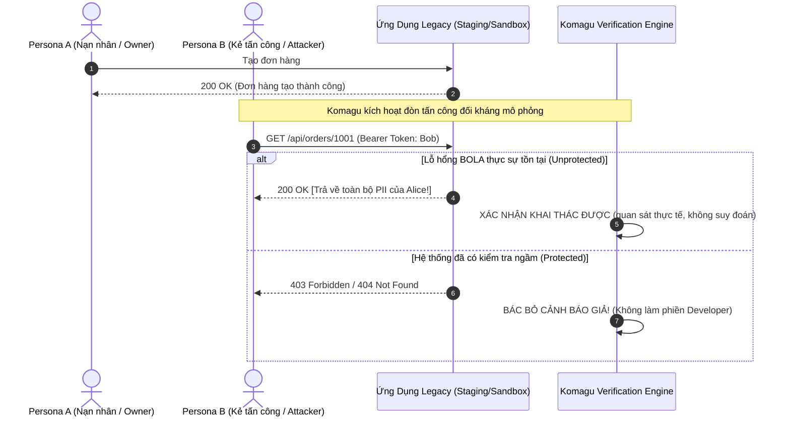
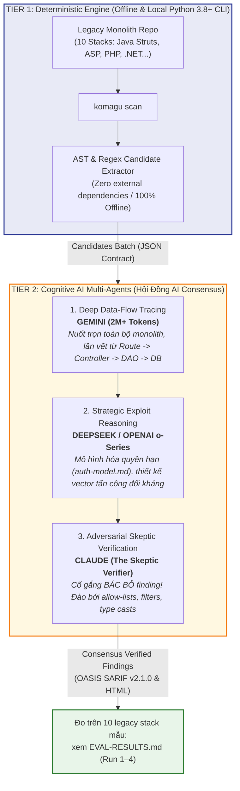
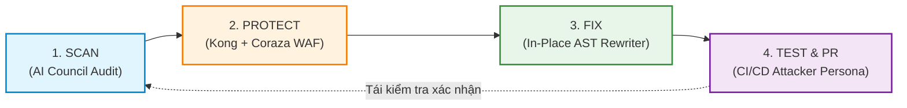

# Kỹ Thuật Phòng Thủ Tốt Nhất Là Tấn Công: Bước Đột Phá Từ Komagu Với Hội Đồng Multi-AI Consensus Trong Hiện Đại Hóa Hệ Thống Legacy

> **Tác giả:** Harry & Đội ngũ Kiến trúc sư Komagu  
> **Chủ đề:** An ninh mạng thực chiến, Trí tuệ nhân tạo (AI Agents), Hiện đại hóa hệ thống cũ (Legacy Modernization)  
> **Dành cho:** CTO, CISO, Lead Architects và Kỹ sư phần mềm đang đối mặt với bài toán di sản công nghệ.

---

## Mở đầu: Khi những bức tường thành cổ xưa bắt đầu rạn nứt

Trong văn hóa thần đạo Nhật Bản, **Komagu (狛犬)** là cặp linh thú hộ vệ uy nghiêm trấn giữ cổng đền. Một con ngậm miệng biểu trưng cho sự tĩnh lặng nội tại, con còn lại mở miệng sẵn sàng nghênh chiến. Chúng bảo vệ sự linh thiêng không phải bằng cách dựng lên những bức tường vô tri, mà bằng **nanh vuốt cảnh giác và sức mạnh chủ động đối kháng**.

 

Ngày nay, ngành công nghệ toàn cầu đang chứng kiến một cuộc khủng hoảng mang tên **Legacy Systems**. Tại Nhật Bản, Bộ Kinh tế, Thương mại và Công nghiệp (METI) đã gióng lên hồi chuông cảnh báo về **"Vách đá số 2025" (2025 Digital Cliff)** — nơi sự già cỗi của các hệ thống nguyên khối (Monolith) viết bằng Classic ASP, ColdFusion, Perl CGI hay Java Struts có thể gây tổn thất kinh tế lên tới **12.000 tỷ Yên mỗi năm**. Nhưng tổn thất tài chính chưa phải là điều tồi tệ nhất: **những hệ thống di sản này đang biến thành mỏ vàng lộ thiên cho các cuộc tấn công dữ liệu quy mô lớn**.

Tháng 9/2024, vụ xâm phạm an ninh tại **Times Car (Times Mobility)** khiến dữ liệu và hình ảnh giấy phép lái xe của 6,6 triệu tài khoản bị rò rỉ. Tiếp đó, cuộc tấn công ransomware vào **IDC Frontier** đánh sập hạ tầng đám mây khu vực Đông Nhật Bản, ảnh hưởng trực tiếp tới 495 doanh nghiệp và cơ quan chính quyền. Tháng 8/2024, lỗ hổng zero-day nghiêm trọng **CVE-2026-72898 (CVSS 10.0)** unauthenticated SQL Injection trên công cụ BI Metabase bị khai thác thực tế, dẫn tới vụ rò rỉ dữ liệu tại JGC Digital.

Điểm chung của phần lớn các cuộc tấn công thảm khốc này là gì? Chúng không cần các kỹ thuật phá mã siêu việt. Kẻ tấn công chỉ đơn giản khai thác:
1. **BOLA/IDOR (Broken Object Level Authorization / Insecure Direct Object References):** Thay đổi ID tài nguyên trên URL hoặc request body để truy xuất và sửa đổi dữ liệu của người dùng khác.
2. **Dynamic SQL Injection:** Các chuỗi truy vấn được ghép thủ công trong mã nguồn cũ kỹ hàng chục năm tuổi.

Và thực tế đau xót là: **Các công cụ phòng ngự truyền thống gần như bất lực trước thảm kịch này.**

---

## 1. Nỗi đau thị trường: Bi kịch của công cụ SAST và sự bế tắc của Pentest thủ công

Tại sao sau hàng thập kỷ đầu tư vào an ninh mạng, các tập đoàn lớn vẫn gục ngã trước những lỗ hổng cơ bản như BOLA/IDOR và SQLi?



### Bi kịch 1: Alert Fatigue — Khi "Tiếng sói hú" làm tê liệt đội ngũ kỹ sư
Các công cụ kiểm tra mã nguồn tĩnh truyền thống (SAST) hoạt động dựa trên cơ chế khớp mẫu (pattern matching) hoặc phân tích luồng dữ liệu cơ bản. Khi quét một hệ sinh thái mã nguồn khổng lồ tích tụ 15-20 năm:
- SAST ném ra **hàng ngàn cảnh báo đỏ rực**. 
- Nhưng 90% đến 95% trong số đó là **cảnh báo giả (False Positives)**: biến đã được cast sang kiểu số ở một helper class cách đó 5 tầng thư mục, quyền sở hữu đã được lọc ngầm bởi một base controller, hoặc tham số nằm trong một danh sách trắng (allow-list) tĩnh.
- Kết quả: Các kỹ sư mệt mỏi, mất lòng tin vào công cụ an ninh và hình thành phản xạ nhấp chuột vào nút *"Ignore / False Positive"*. Đến một ngày, một lỗ hổng BOLA chí mạng thực sự nằm lẫn trong đống rác cảnh báo đó bị bỏ qua, và thảm họa xảy ra.

### Bi kịch 2: Điểm mù logic nghiệp vụ của BOLA/IDOR
BOLA không phải là một lỗi cú pháp. Nó là sự thiếu sót về mặt logic ủy quyền (authorization context). Làm sao một bộ phân tích tĩnh thuần túy có thể biết rằng hàm `getOrder(id)` có được phép trả về đơn hàng của Alice cho Bob hay không, khi mà `id` vẫn là một số nguyên hoàn toàn hợp lệ? SAST truyền thống mù tịt trước ngữ cảnh kinh doanh (business logic).

### Bi kịch 3: Pentest thủ công — Quá đắt, quá chậm và mang tính thời điểm
Thuê một đội ngũ chuyên gia kiểm thử thâm nhập (Pentest) có thể tìm ra BOLA thực tế. Nhưng cái giá phải trả là hàng chục nghìn USD cho một đợt kiểm thử kéo dài nhiều tuần. Kết quả trả về là một file PDF tĩnh. Hai tuần sau, một lập trình viên junior commit một route mới vào nhánh production — báo cáo pentest đắt đỏ kia ngay lập tức trở thành phế liệu.

> **Đó chính là lý do chúng tôi kiến tạo Komagu.**

---

## 2. Triết lý đột phá: "Phòng thủ bằng Tấn công" (Offensive-Driven Verification)

Để giải quyết tận gốc rễ bi kịch trên, Komagu từ bỏ hoàn toàn lối mòn phòng thủ thụ động. Chúng tôi đưa ra một nguyên lý tối thượng:

> *"Một lỗ hổng không bao giờ được phép tồn tại dưới dạng một phỏng đoán xác suất. Nếu nó thực sự là mối đe dọa, bạn phải chứng minh được nó bằng một đòn tấn công thực nghiệm (Empirical Proof-of-Concept Exploit)."*



Thay vì dừng lại ở việc đọc Abstract Syntax Tree (AST) rồi đưa ra nhận định mơ hồ *"Dòng 142 có nguy cơ IDOR"*, Komagu tự động chuyển hóa giả thuyết đó thành một **vector tấn công đối kháng thực tế**:
1. Komagu thiết lập môi trường thử nghiệm độc lập (sandbox / staging container).
2. Tự động sinh ra hai vai diễn: **Persona A (Alice - chủ sở hữu tài nguyên hợp pháp)** và **Persona B (Bob - kẻ tấn công cùng cấp độ quyền)**.
3. Kích hoạt đòn tấn công: Cho Bob sử dụng token hợp lệ của mình để truy vấn, thay đổi hoặc xóa tài nguyên do Alice sở hữu.
4. **Phán quyết thực nghiệm:**
   - Nếu máy chủ trả về `200 OK` và dữ liệu của Alice lọt vào tay Bob: **Lỗ hổng được xác thực 100% (Confirmed Exploit)** kèm payload bằng chứng không thể chối cãi.
   - Nếu máy chủ trả về `403 Forbidden` hoặc `404 Not Found`: **Cảnh báo giả bị bác bỏ ngay lập tức**. Không có chiếc vé Jira nào bị tạo rác. Không có kỹ sư nào phải mất hàng giờ tra cứu thủ công.

Đây chính là **Offensive-Driven Verification** — dùng nhát kiếm của kẻ tấn công để thẩm định sự vững chãi của tấm khiên.

---

## 3. Kiến trúc Đột Phá: Hội đồng Multi-AI Consensus (The AI Council)

Làm sao một hệ thống tự động có thể hiểu thấu hàng trăm nghìn dòng mã spaghetti legacy, phân tích logic ủy quyền tinh vi và tự động tạo ra các kịch bản tấn công đối kháng mà không mắc bẫy **ảo giác (hallucination)**?

Nếu bạn chỉ đơn giản đưa một đoạn code vào ChatGPT hay Claude và hỏi *"Code này có lỗ hổng không?"*, bạn sẽ nhận lại ảo giác và thiên kiến xác nhận (confirmation bias). AI sẽ cố gắng làm hài lòng bạn bằng cách "bịa" ra những mối nguy vô căn cứ.

Komagu giải quyết bài toán này bằng **Kiến trúc Two-Tier Runtime-Neutral** và **Hội đồng Đa Tác tử (Multi-AI Consensus)**:



### Tam giác Sức mạnh: Mỗi Mô hình Đảm nhận Một Vai trò Chuyên biệt

1. **Gemini — "Chiếc Kính Thiên Văn Siêu Ngữ Cảnh" (The 2M+ Context Cartographer):**
   Trong các monolith cổ điển, một API route thường liên kết với hàng tá filter, file cấu hình toàn cục (`web.xml`, `Global.asax`), các lớp abstract controller và các DAO class sâu hút. Nhờ cửa sổ ngữ cảnh khổng lồ lên tới hàng triệu tokens, Gemini không bị "chột" ngữ cảnh như các mô hình nhỏ. Nó nạp trọn vẹn toàn bộ kiến trúc ứng dụng, vẽ nên bản đồ luồng dữ liệu (data-flow) hoàn chỉnh từ điểm vào HTTP cho tới dòng SQL cuối cùng.
   
2. **DeepSeek / OpenAI o-Series — "Bộ Não Chiến Lược" (The Exploit Strategist):**
   Với năng lực suy luận chuỗi tư duy (Chain-of-Thought Reasoning), mô hình này đóng vai trò phân tích logic kinh doanh ngầm. Nó tự động suy diễn mô hình ủy quyền của ứng dụng (`auth-model.md`): Ai là chủ tài nguyên? Bằng cách nào hệ thống phân biệt Admin, Manager và User thường? Từ đó, nó tính toán các kịch bản bypass quyền tinh vi nhất.

3. **Claude — "Thẩm Tra Viên Hoài Nghi" (The Skeptic Verifier):**
   Đây là vũ khí bí mật giúp Komagu loại bỏ hoàn toàn cảnh báo giả. Skeptic Agent hoạt động với tôn chỉ duy nhất: **"Mọi phát hiện của các agent trước đều là sai, trừ khi không thể bác bỏ."**
   Skeptic chủ động săn tìm các cơ chế phòng vệ ẩn mà các agent trước bỏ sót:
   - Một hàm ép kiểu số `(int)$id` nằm khuất trong file helper.
   - Một khối `in_array($sort, ['id', 'date'], true)` kiểm soát tham số `ORDER BY`.
   - Một interceptor toàn cục kiểm tra `tenant_id` trước khi request chạm vào controller.
   Nếu tìm thấy bất kỳ cơ chế kiểm soát hợp lệ nào, Skeptic **thẳng tay khai tử (Reject)** cảnh báo đó với mã lý do `control_found`.

### Tôn trọng tuyệt đối chủ quyền dữ liệu (Bring-Your-Own-LLM)
Theo thiết kế kiến trúc [ADR-0006](docs/adr/0006-byo-llm-runtime-neutral-architecture.md), Komagu là **Runtime-Neutral**. Chúng tôi không bao giờ hardcode API key và không gửi mã nguồn của khách hàng ra bất kỳ dịch vụ đám mây nào ngoài ý muốn. Doanh nghiệp có thể vận hành Hội đồng AI này thông qua Claude Code, Cursor, Antigravity, hoặc các mô hình nội bộ (Private On-Premise LLM như Ollama / vLLM) để đảm bảo tuân thủ 100% các điều khoản bảo mật ngặt nghèo nhất.

---

## 4. Vòng Lặp Đối Kháng Khép Kín: Closed-Loop Red vs. Blue

Một công cụ bảo mật vạch ra 50 lỗ hổng rồi để mặc cho lập trình viên tự xoay xở là một công cụ thất bại. Komagu tạo ra một **Cỗ máy tự chữa lành khép kín (Autonomous Self-Healing Loop)** từ phát hiện, phòng thủ biên, sửa mã đến tái thẩm định:



### Bước 1: Auto-Detect (Không xâm phạm)
Chỉ với một dòng lệnh:
```bash
npx @hoanghainh/komagu scan ./legacy-app --format html --out ./audit-output
```
Hệ thống tạo ra báo cáo tương tác trực quan và chuẩn mực quốc tế **OASIS SARIF v2.1.0** với từng dòng bằng chứng `file:line` chính xác tuyệt đối.

### Bước 2: Auto-Shield — Tấm Khiên Biên Giới Ngay Trong "Ngày Thứ 2"
Sửa mã nguồn legacy chứa đầy logic nghiệp vụ nhạy cảm là việc đòi hỏi nhiều tuần kiểm thử. Bạn không thể liều lĩnh sửa code ngay trong ngày đầu tiên. Vậy làm sao để bảo vệ hệ thống trước các mối đe dọa đang hoạt động ngoài Internet?

Komagu cung cấp giải pháp **Virtual Patch tức thời**:
```bash
npx @hoanghainh/komagu protect --up
```
Lệnh này tự động cấu hình và kích hoạt **Kong API Gateway** kết hợp cùng động cơ **OWASP Coraza WAF** (Core Rule Set v4). Tấm khiên ở tầng biên này lập tức phân tích và đánh chặn mọi payload SQL Injection, XSS probe hay request bất thường trước khi chúng chạm tới ứng dụng legacy — **bảo vệ hệ thống 100% mà không cần sửa đổi một dòng code cũ nào!**

### Bước 3: Auto-Fix — Bác Sĩ Phẫu Thuật AST Tự Động
Khi đội ngũ kỹ sư sẵn sàng tái cấu trúc, Komagu kích hoạt bộ máy tái viết mã nguồn dựa trên AST:
```bash
# Xem trước các thay đổi an toàn dưới dạng file .patch
npx @hoanghainh/komagu fix ./legacy-app --dry-run -p ./security-fixes.patch

# Tự động sửa trực tiếp trên mã nguồn
npx @hoanghainh/komagu fix ./legacy-app
```

- **Hóa giải SQL Injection (`remediate/query`):** Tự động phát hiện các chuỗi nối (`"SELECT * FROM users WHERE id = " + id`) và tái cấu trúc thành **Parameterized Queries** chuẩn mực trên Python, JS/TS, PHP, C# và Java.
- **Tiêm chốt chặn BOLA/IDOR (`remediate/authz`):** Tự động tiêm Decorator `@RequireOwnership`, Middleware hoặc Action Filter vào các Controller hiện đại (NestJS, Express, Spring Boot 3, .NET 8, FastAPI):

```typescript
// Modernized NestJS Controller with Komagu Guard
@Get(':id')
@RequireOwnership(ResourceOperation.READ, {
  idParamName: 'id',
  resourceLoader: async (id, req) => orderService.findById(id),
})
async getOrder(@Param('id') id: string) {
  // Safe from BOLA: Komagu automatically verifies request.user owns this order!
  return this.orderService.findById(id);
}
```

### Bước 4: Auto-PR & CI Verification — Đòn Tấn Công Đóng Cổng CI/CD
Komagu không tin vào lời hứa của lập trình viên; Komagu tin vào kết quả kiểm thử. Khi bản vá được tạo, hệ thống tự động mở một **Pull Request** trên GitHub/GitLab và kích hoạt CI Runner:
```bash
npx @hoanghainh/komagu test --url http://staging-api:8000
```
Persona Bob tái hiện lại cuộc tấn công chiếm quyền đơn hàng của Alice. Lần này, hệ thống trả về mã lỗi nghiêm ngặt `404 Not Found` (không để lộ sự tồn tại của tài nguyên) hoặc `403 Forbidden`. **Build Passed!** Bản vá được chứng minh hiệu quả bằng thực nghiệm trước khi được merge vào production.

---

## 5. Hiện Thực Hóa: Bộ 5 Modernization Boilerplates Cho Doanh Nghiệp

Sự thành công của Komagu không dừng lại ở công cụ dòng lệnh CLI. Để đồng hành cùng các doanh nghiệp trên hành trình hiện đại hóa toàn diện, chúng tôi đã đóng gói toàn bộ tri thức thực chiến thành **5 Bộ Khung Hiện Đại Hóa (Modernization Boilerplates)** sẵn sàng triển khai trong phiên bản `v1.2.0`:

| # | Boilerplate | Bài toán giải quyết | Sự kiện thực tế chứng minh tính cấp thiết |
|---|---|---|---|
| **1** | **Secure API & IAM** | Triệt tiêu BOLA/IDOR, SQLi, chống scraping và rò rỉ API key thông qua Kong WAF + Object-Level Auth Middleware. | Vụ rò rỉ Metabase 0-day (CVE-2026-72898) & thảm họa API authorization. |
| **2** | **Zero-PII eKYC & NFC** | Module đọc chip NFC thẻ căn cước (My Number Card / Hộ chiếu), mã hóa token hóa mù (blind-index), **từ chối lưu trữ ảnh giấy tờ thô (raw ID images)**. | Vụ Times Car rò rỉ 6,6 triệu ảnh bằng lái xe & Luật Phòng chống chuyển tiền bất hợp pháp Nhật Bản (hiệu lực 4/2027 cấm eKYC bằng ảnh chụp). |
| **3** | **Immutable Backup & DR** | Hạ tầng Terraform đa vùng (Multi-Region), khóa chống sửa/xóa dữ liệu (S3 Object Lock `COMPLIANCE` mode), CLI kiểm thử khôi phục thảm họa tự động. | Thảm họa ransomware tại IDC Frontier khiến 495 cơ quan/doanh nghiệp mất sạch dữ liệu đám mây. |
| **4** | **Tenant-Isolated SaaS** | Phân lập dữ liệu triệt để bằng PostgreSQL Row-Level Security (RLS) và cơ chế mã hóa BYOK (Bring Your Own Key) với tính năng xóa khóa tiền mã hóa (crypto-shredding). | Nguy cơ rò rỉ dữ liệu chéo giữa các tập đoàn khách hàng trong mô hình B2B SaaS. |
| **5** | **DevSecOps & SBOM** | Tích hợp chuỗi quét bảo mật tự động trong CI/CD: CycloneDX SBOM, Trivy, CodeQL, kết hợp báo cáo SARIF hợp nhất từ Komagu. | Các cuộc tấn công chuỗi cung ứng phần mềm (Software Supply Chain Attacks). |

---

## Lời kết: Đừng Chờ Đợi Vách Đá Số Sụp Đổ

Trong kỷ nguyên số, di sản phần mềm không nên là một gánh nặng khiến các doanh nghiệp phải nơm nớp lo sợ trước các cuộc tấn công dữ liệu. Nhưng chúng ta cũng không thể tiếp tục ảo tưởng rằng những công cụ quét mã lỗi thời hay những bản báo cáo PDF dày cộp có thể bảo vệ được hệ thống.

**Kỹ thuật phòng thủ tốt nhất chính là tấn công.** Bằng cách trao quyền cho Hội đồng Multi-AI Consensus liên tục thử lửa hệ thống qua các đòn tấn công thực nghiệm, và khép kín vòng lặp bằng những tấm khiên WAF tức thời cùng các bản vá mã tự động, **Komagu** định nghĩa lại cách thế giới tiếp cận bài toán bảo mật hệ thống di sản:

- **Chính xác tuyệt đối:** Không còn cảnh báo giả làm phiền kỹ sư.
- **Bảo vệ tức thì:** An toàn ở tầng biên chỉ sau 24 giờ mà không cần đụng vào code cũ.
- **Hiện đại hóa vững bền:** Mã nguồn được tự động chuyển đổi thành kiến trúc bảo mật chuẩn mực.

Cổng đền của doanh nghiệp bạn đã có linh thú Komagu trấn giữ hay chưa?

---

### Trải nghiệm Komagu ngay hôm nay:
- **Mã nguồn mở & Tài liệu:** [github.com/hoanghainh1188/komagu](https://github.com/hoanghainh1188/komagu)
- **Cài đặt & Dùng thử CLI:** `npx @hoanghainh/komagu scan ./your-legacy-app`
- **Kết nối cùng chúng tôi:** Chúng tôi đang tìm kiếm các đối tác doanh nghiệp và các kỹ sư đam mê bảo mật tham gia chương trình Commercial Pilot. Hãy cùng nhau biến những hệ thống legacy mỏng manh thành những pháo đài bất khả xâm phạm.
