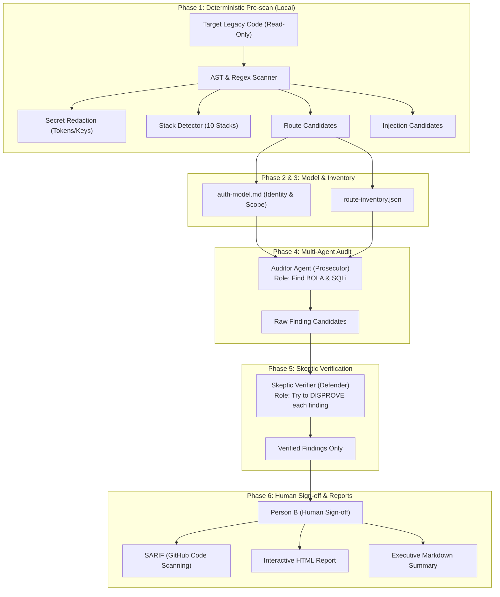

## はじめに：APIセキュリティにおける最大の難所「BOLA」

近年の Web API において、最も被害規模が大きく、かつ発見が困難な脆弱性が **BOLA（Broken Object Level Authorization / オブジェクトレベルの認可不備、別名 IDOR: Insecure Direct Object References）** です。

OWASP API Security Top 10 において、2019年版に続き2023年版でも不動の **第1位（API1:2023）** に指定されており、実社会でも配車アプリの顧客情報漏洩や、SaaS プラットフォームでの他社データ閲覧など、深刻なインシデントの原因であり続けています。

特に日本国内のエンタープライズ領域では、10〜20年前に開発された **レガシーシステム（PHP、Java Struts/Spring、ASP.NET WebForms など）** が現役で稼働しており、DX や API 化の波の中で認可不備が潜んだまま外部へ公開されるリスクが急増しています。

筆者はこの課題を解決するため、**「AST（抽象構文木）による決定論的プリスキャン」×「敵対的マルチエージェントAI（監査役と懐疑派レビュアー）」** を組み合わせたセキュリティ監査基盤 **「Komainu（狛犬）」** を設計・開発し、その CLI ツールである [`komainu-guard`](https://www.npmjs.com/package/komainu-guard) を OSS として npm に公開しました。

この記事では、**「なぜ従来の SAST は BOLA を見逃すのか？」** という技術的本質から、Komainu がそれをいかにして解決したのか、そのアーキテクチャと設計思想を共有します。

---

## 1. 従来の静的解析（SAST）が BOLA に対して無力な理由

SonarQube や Checkmarx、Fortify といった従来の SAST ツールは、**SQL インジェクション（SQLi）や XSS（クロスサイトスクリプティング）の検出には極めて有効** です。これらは「入力源（Source）」から「危険な関数呼び出し（Sink）」への **データフロー追跡（Taint Analysis / 汚染解析）** という確立された理論で解けるからです。

```
[Source] $_GET['id']  =====(データフロー)=====>  [Sink] mysql_query("SELECT ... WHERE id = " . $id)
                                                  ^^^^^^^^^^^^^^^^^^^^^^^^^^^^^^^^^^^^^^^^^^^^^^^^^
                                                  -> 構文解析だけで「悪」と断定可能 (SQLi)
```

しかし、BOLA は全く異なる性質を持っています。

```php
// 例：あるレガシーPHPの注文詳細取得API
function getOrderDetail() {
    $orderId = $_GET['order_id']; // ユーザー入力
    
    // 認証チェックはある（ログイン済みであることは確認している）
    if (!isset($_SESSION['user_id'])) {
        http_response_code(401);
        exit;
    }
    
    // 【致命的欠陥】注文の所有者チェック（WHERE user_id = ...）が抜けている！
    // 認証済みユーザーAが order_id=9999 を指定すると、ユーザーBの機密注文情報が丸見えになる
    $stmt = $db->prepare("SELECT * FROM orders WHERE id = :order_id");
    $stmt->execute(['order_id' => $orderId]);
    return json_encode($stmt->fetch());
}
```

このコードにおいて：
1. **パラメータバインドは行われており、SQLi は存在しない**
2. **ログイン認証（Authentication）は行われている**
3. しかし、**認可（Authorization: 誰がそのリソースにアクセスできるか）が完全に欠落している**

SAST エンジンから見れば、これは「正常なパラメータバインドと正常な DB クエリ」にしか見えません。**「注文データは所有者本人または管理者しか参照してはならない」という業務知識（ドメイン認可モデル）を持たない限り、構文木だけから欠落を検出することは原理的に不可能** なのです。

---

## 2. なぜ「単なる LLM によるコード監査」も実戦で破綻するのか？

LLM（大規模言語モデル）の登場により、「コードの意味や業務文脈を理解できるのではないか」と期待されました。しかし、実務で LLM 単体にセキュリティ監査をやらせると、すぐに以下の3つの壁に直面します。

1. **コンテキストウィンドウとコストの限界:**  
   中規模以上のレガシーリポジトリ（数十万行〜数百ファイル）全体を一度にプロンプトへ投入することはコスト的にもトークン的にも現実的ではありません。
2. **構造的ハルシネーション（過剰検知）:**  
   「セキュリティ上の懸念を探せ」とプロンプトで指示すると、LLM は存在しない脆弱性や、すでに親フィルターやミドルウェアで防御されている箇所に対して大量の False Positive（誤検知）を生成し、人間のエンジニアのレビュー工数を爆発させます。
3. **再現性と標準化の欠如:**  
   実行するたびに指摘内容やフォーマットが揺れ、CI/CD パイプラインに組み込むことができません。

---

## 3. Komainu のハイブリッド・アーキテクチャ

Komainu では、**「静的解析の決定論的スピード」** と **「LLMの文脈理解力」** を直列・並列にハイブリッド構成し、さらに **「敵対的マルチエージェント（Auditor vs Skeptic Verifier）」** によって誤検知を極小化する多層パイプラインを採用しました。



### コア設計思想 1：最小コンテキストの切り出し（Phase 1）
最初にリポジトリ全体を言語スタックごとの正規表現 & AST 解析にかけます。
- 10種類のスタック（PHP, Java, .NET, Node.js, Python, Perl, Classic ASP, ColdFusion, SQL Stored Procs）をミリ秒単位で自動特定。
- ルーティング定義と DB 呼び出し箇所を抜き出し、関連するコントローラーの関数ブロックのみを抽出。
- **機密情報（APIキー、接続文字列、JWT Secret）はローカル環境で自動マスキング。**
これにより、LLM に送信するコンテキスト量を 1/50 以下に圧縮し、機密データの外部流出を根源から防止します。

### コア設計思想 2：敵対的検証ループ（Auditor vs Skeptic Verifier）
法廷劇における「検察官（Prosecutor）」と「弁護人（Defender）」の関係性を AI エージェント間で再現しました。
- **Auditor（第1のAI）:** 「認可不備やSQL結合がないか」を疑い、積極的に告発する。
- **Skeptic Verifier（第2のAI）:** 「ミドルウェアや基底クラスでテナントチェックされていないか？」「本当にこのパラメータは攻撃者が操作可能か？」と、Auditor の指摘を論破（Disprove）しようとコードを再精査する。

Skeptic の反論に耐え抜いた指摘のみが `findings.json` に記録されるため、従来の AI 診断ツールにありがちな「オオカミ少年（誤検知の山）」を劇的に排除できます。

### コア設計思想 3：Person B（人間による100%監査承認）
AI の出力はドラフトであり、最終的な確定情報ではありません。すべての診断結果はセキュリティ責任者（Person B）が `review-log.md` に署名を行うガバナンスプロトコルを標準化しています。

---

## 4. npm パッケージ「komainu-guard」としての提供

この監査基盤の価値を即座に体験できるよう、Node.js の CLI パッケージとして npm に公開しました。

- **Package:** `komainu-guard` (Dual-alias: `komainu` / `komainu-guard`)
- **Version:** `0.2.1`

### 実行例
インストール不要で、`npx` コマンドだけで即座にスキャンを実行できます：

```bash
# ヘルプと使用可能なサブコマンド一覧
npx --yes komainu-guard help

# リポジトリのスキャン（スタック検出、ルート候補抽出、日本語HTML＆Markdownレポート生成）
npx --yes komainu-guard scan ./my-legacy-app --out ./audit-out --lang ja --format all
```

:::message
**CLI とマルチエージェント AI パイプラインの役割分担：**  
`komainu-guard scan` は完全ローカルで高速に Phase 1（決定論的プリスキャン）を実行し、機密情報をマスキングした上で AST 解析結果と構造化レポートを生成します。深層監査（Phase 4–5 の Auditor / Skeptic Verifier）は、このプリスキャン成果物をインプットとしてエージェントワークフローにより精密に実行されます。
:::

### ベンチマーク実績（Evaluation Run 3）
多様な脆弱性パターンと正常コードを混合させた検証テストセットにおいて：
- **検出率（Recall）: 100.0%**
- **適合率（Precision）: 1.000 (誤検知ゼロ)**

---

## 5. 今後の展望：発見（Assess）から自動修復（Remediate）へ

Komainu プロジェクトは、脆弱性を指摘して終わり（Assess）ではありません。
指摘された BOLA や SQLi を、標準化されたセキュアコンポーネントで短工期かつ安全に塞ぐ **「Remediate & Operate」** への展開を進めています。

1. **D1: Object-Level Authorization Library:**  
   .NET 8 および Spring Boot 3 向けに、属性/アノテーション1行でテナントおよび所有者検証を強制するミドルウェアライブラリ。
2. **D4: Kong Gateway & OWASP Coraza WAF (ADR-0003):**  
   コード改修が直ちに困難なレガシーシステムの手前にリバースプロキシを配置し、WAF と IP/ユーザー単位のレートリミットで即時防御。
3. **D5: Schemathesis CI Pipeline:**  
   OpenAPI 定義からクロスユーザー攻撃テストケース（ユーザーAのトークンでユーザーBのデータを操作するリクエスト）を自動生成し、PR ごとに CI で防衛。

---

## まとめ

Web API のセキュリティモダン化において、BOLA の撲滅は避けて通れない最大の壁です。
「AST による高速な決定論的絞り込み」と「マルチエージェント AI による深い意味論的検証」を組み合わせることで、これまで熟練エンジニアの属人的な目視レビューに頼っていた領域を、再現性のある自動化パイプラインへと昇華させることができました。

まずはぜひ、ご自身のプロジェクトやレガシーコードに対して `npx komainu-guard` を試してみてください！

- **npm:** [https://www.npmjs.com/package/komainu-guard](https://www.npmjs.com/package/komainu-guard)
- **GitHub Repository:** [https://github.com/hoanghainh1188/komainu](https://github.com/hoanghainh1188/komainu)

フィードバックやディスカッションを歓迎いたします！
