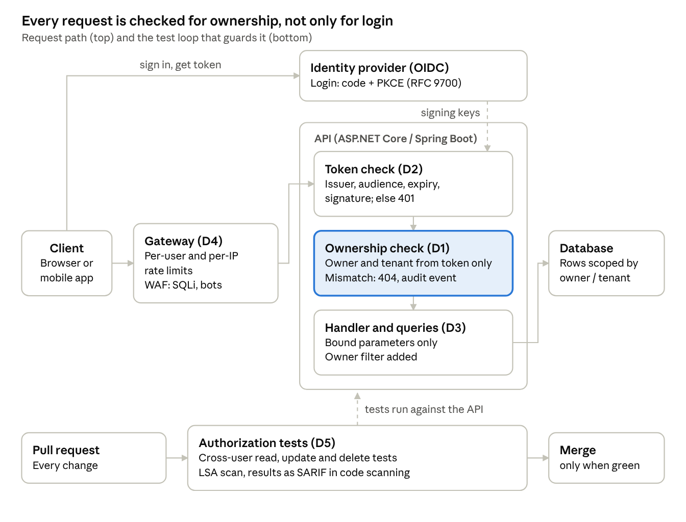
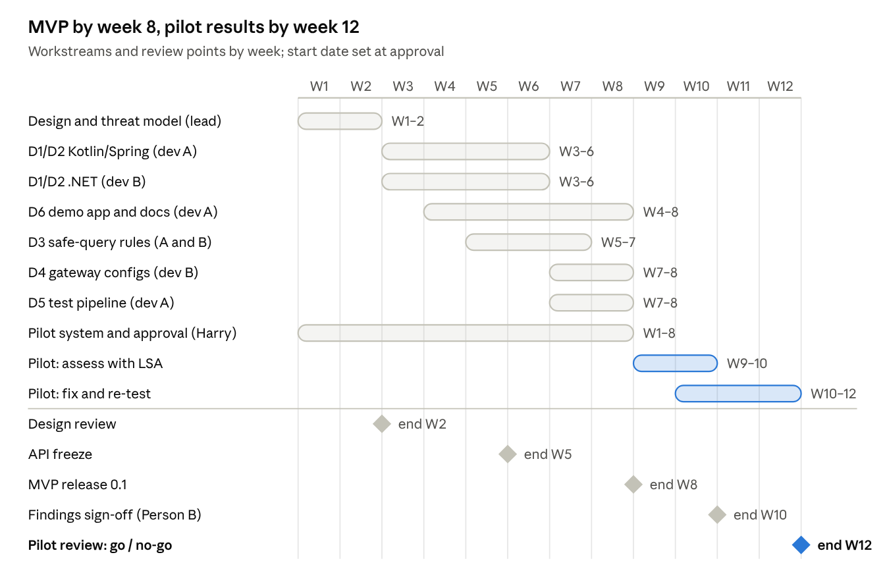

# Boilerplate 1 — Secure API & IAM: Delivery Plan

Version 0.1 · 2026-10-17 · Owner: Harry · Status: approved by management (BOD) on 2026-10-17

## Goal and success criteria

In 12 weeks we deliver a reusable Secure API & IAM boilerplate for .NET and Kotlin/Spring, and use it to fix the findings of one real Legacy Security Assessment. Success is measured, not claimed.

The stage succeeds when all of these hold at the pilot review:

1. Every endpoint covered by the boilerplate passes the automated cross-user test (user A cannot read, change or delete user B's object).
2. The assessment on the pilot system reaches 100% endpoint coverage and at least 70% of findings are accepted by the reviewer.
3. Every accepted BOLA/IDOR and injection finding in the pilot scope is fixed and re-tested.
4. We have measured the person-days it took to put the boilerplate in place, against a baseline from a comparable past project.
5. The pilot owner agrees to be named as a reference, or we know why not.

This plan implements Boilerplate 1 of the [Modernization Boilerplates proposal](modernization-boilerplates-proposal.md).

## Scope

The MVP covers two server stacks (.NET and Kotlin/Spring) and one self-hosted gateway (Kong); everything else waits for real demand from the pilot.

| In scope (MVP) | Out of scope (later, on demand) |
| --- | --- |
| .NET 8 (ASP.NET Core) | .NET Framework 4.x WebForms (handled through the gateway and fixes, not the library) |
| Kotlin with Spring Boot 3 and Spring Security | Node.js (NestJS, Express), Python, PHP, Java EE |
| Login through an external identity provider using OpenID Connect; token checks in the API | Building our own identity provider; social login; FIDO2/passkeys |
| Object-level authorization middleware (owner and tenant checks) | Full policy engines (OPA, Cedar) beyond an adapter interface |
| Gateway: Kong (self-hosted) with a WAF in front or beside it | AWS API Gateway + AWS WAF, Envoy, Azure API Management, Cloudflare |
| Automated authorization tests in GitHub Actions and GitLab CI | Load testing; full DAST |
| One demo app showing all parts end to end | Mobile clients |

**OAuth version.** OAuth 2.1 is still an IETF draft (draft-16, September 2026). We implement OAuth 2.0 following the Security Best Current Practice (RFC 9700), which matches what OAuth 2.1 requires: authorization code + PKCE only, no implicit grant, exact redirect URIs. We say "aligned with the OAuth 2.1 draft", not "OAuth 2.1 certified".

Decided 2026-10-16: .NET + Kotlin/Spring as first stacks, Kong first, pilot on the AMS project with an internal tool as fallback.

## Architecture

A request passes four checks in order: gateway limits, token check, ownership check, and owner-scoped data access. The ownership check (D1) is the part legacy systems most often miss.

The CI loop runs the same cross-user cases on every pull request, so a missing ownership check blocks the merge instead of reaching production.

## Components and deliverables

Six deliverables; the authorization library and its tests are the core, the rest support them.

| # | Deliverable | Form | Key features | How we test it |
| --- | --- | --- | --- | --- |
| D1 | Object-level authorization library | NuGet package (ASP.NET Core authorization handler and filter); Maven/Gradle artifact (Spring Security authorization manager + annotation) | Declare per route "this resource belongs to owner / tenant"; identity always from the verified token, never from the request; deny by default (404 on mismatch); scoped data-access helpers that add the owner filter to queries (EF Core, Spring Data / JPA); audit event per denial | Unit tests; cross-user tests on the demo app; LSA scan of the demo app shows no BOLA finding |
| D2 | Authentication integration | Same packages + config templates | OpenID Connect login through the client's identity provider (e.g. Entra ID, Keycloak, Cognito); access-token validation (issuer, audience, expiry, signature); code + PKCE only (RFC 9700) | Tests against a local Keycloak; expired / wrong-audience token cases |
| D3 | Safe query helpers | Analyzer rules + examples per stack | Parameterized queries only; allow-lists for sort and column names; Roslyn analyzer (C#) and detekt rule (Kotlin) that flag string-built SQL and JPQL | Rule tests with good and bad samples (reuse LSA fixtures) |
| D4 | Gateway configs | Kong declarative config (decK) + Docker Compose | Per-user and per-IP rate limits ([Kong rate limiting](https://developer.konghq.com/plugins/rate-limiting/) by consumer, credential or IP); WAF with the OWASP Core Rule Set (Coraza per ADR-0003) for SQL injection; bot and scraping limits; API keys never in clients | Run locally and in a test environment; scripted abuse requests are blocked |
| D5 | Authorization test pipeline | GitHub Actions + GitLab CI templates | [Schemathesis](https://schemathesis.readthedocs.io/en/stable/guides/object-level-authorization/) cross-user read checks from the OpenAPI spec; our own cross-user write/delete test runner; LSA scan step with SARIF upload | Pipeline goes red on a planted BOLA in the demo app |
| D6 | Demo app + docs | Small member portal (React front end, ASP.NET Core and Spring Boot back ends, PostgreSQL) | Shows D1–D5 working together; English and Japanese README; adoption guide for legacy systems behind the gateway | Used in the pilot pitch; reviewed by Person B |

The gateway (D4) is the fastest protection for a legacy system that cannot take the library yet: it adds rate limits and WAF rules in front, while the library is adopted endpoint by endpoint.

## Timeline

Weeks 1–8 build the MVP; weeks 9–12 run the pilot. The search for a pilot system starts in week 1 because it is the slowest dependency.

Cut list if the team is smaller or pulled away: the detekt and Roslyn rules (keep the LSA scan in CI), the GitLab template (keep GitHub), then the Japanese README.

## Team, roles and approvals

Operating model: **AI-Augmented Engineering Team**. Harry acts as the Principal Architect, Project Owner, and Human Sign-off Authority (Person B for AI-generated audits). Specialist AI coding agents act as the implementation developers under Harry's direct guidance and review.

| Role | Who | Load | Does | Approves |
| --- | --- | --- | --- | --- |
| Principal Architect & PM | Harry | Lead oversight | Architecture direction, D1 interfaces review, pilot client, written AI approval, scope | Design review, API freeze, MVP release, Go/no-go |
| Developer A (Kotlin/Spring) | AI Coding Agent (supervised by Harry) | Autonomous implementation | D1/D2 for Spring, D3 detekt rule, D5 pipelines, Spring demo back end | — |
| Developer B (.NET + infra) | AI Coding Agent (supervised by Harry) | Autonomous implementation | D1/D2 for ASP.NET Core, D3 Roslyn analyzer, D4 Kong and WAF, .NET demo back end | — |
| Security reviewer (Person B) | Harry (human sign-off for AI audits) | Review & sign-off | Reviews AI assessment findings, signs review-log.md, accepts pilot fixes | Findings sign-off; fix acceptance |

Approval points:

1. **Design review (end of week 2):** D1 interface, threat model, demo app scope. Approved by the lead and Harry.
2. **API freeze (end of week 5):** D1/D2 public API fixed; changes after this need the lead's approval.
3. **MVP release (end of week 8):** D1–D6 pass their tests; version 0.1 tagged.
4. **Findings sign-off (week 10):** Person B accepts or rejects each assessment finding before it reaches the client.
5. **Pilot review (week 12):** metrics against the acceptance criteria; go / no-go for Stage 2.

## Pilot: assess, then fix with the boilerplate

The pilot runs on one real system from week 9 to week 12; it is the only source of the numbers we may later show clients.

**Choosing the pilot system.** The pilot is the AMS (application maintenance) project, if its client gives written approval for AI processing of the code by the end of week 6. Otherwise we use an internal tool. Either way the system should have a web API with per-user data and 30–150 endpoints. A system written in a legacy stack the LSA kit supports (PHP, Java, ASP.NET, Classic ASP) shows the most value.

1. **Prepare (week 9):** written approval, model hosting chosen per the client's policy, baseline effort figure picked from a comparable past project.
2. **Assess (week 9–10):** run the LSA pipeline; Person B signs off findings; report to the owner.
3. **Protect the edge (week 10):** put D4 in front of the system: rate limits and WAF rules. This lowers risk before any code change.
4. **Fix (week 10–12):** for endpoints in a supported stack, adopt D1/D2; for others, fix with D3 patterns. Each fix gets a cross-user test (D5).
5. **Re-test and measure (week 12):** re-run LSA and D5; record person-days, findings fixed, defects found after the fix.

If no pilot system is approved by the end of week 6, the pilot runs on the demo app plus one of our own internal tools, and the review notes that the numbers are internal only.

## Acceptance criteria and metrics

The MVP is accepted at week 8 by tests; the stage is judged at week 12 by pilot numbers.

| Check | Measure | Pass when | When |
| --- | --- | --- | --- |
| Cross-user protection | D5 runs on the demo app with a planted BOLA on read, update and delete | All three fail the pipeline; removing them turns it green | Week 8 |
| No string-built SQL | D3 lint rules on the demo app and LSA fixtures | All bad samples flagged, no good sample flagged | Week 8 |
| Token handling | D2 tests: expired, wrong issuer, wrong audience, bad signature, no token | All rejected with 401 | Week 8 |
| Edge protection | Scripted abuse against D4 in the test account | Rate limit and SQL injection rules block the requests | Week 8 |
| Assessment quality | Accepted findings / reported findings; endpoints audited / inventoried | ≥ 70%; 100% | Week 10 |
| Fix completeness | Accepted findings fixed and re-tested | 100% in pilot scope | Week 12 |
| Effort | Person-days to adopt the boilerplate vs. baseline | Measured and reported, no target | Week 12 |
| Reuse | Share of D1–D5 code used unchanged | Measured and reported | Week 12 |

## Risks

The two risks most likely to sink the stage are having no pilot system and a library that does not fit real legacy code.

| Risk | Effect | How we handle it |
| --- | --- | --- |
| No pilot system approved in time | No real numbers at week 12 | Ask from week 1; fallback to an internal tool by week 6 (see Pilot) |
| Legacy code cannot take the library (old frameworks, no DI) | D1 unused in the pilot | D4 gateway protects first; D3 fix patterns for unsupported stacks; record what was missing for Stage 2 |
| Ownership rules are unclear in the client's data model | Wrong "owner" checks; false denials or leaks | Map owner and tenant columns with the client in week 9; cover each rule with a cross-user test |
| Identity provider differences (Cognito, Entra ID, Keycloak) | Integration delays | Standard OIDC only in the MVP; one provider tested per stack, others listed as untested |
| OAuth 2.1 changes before it becomes an RFC | Docs or features out of date | Build to RFC 9700; review the draft at each release |
| Team pulled onto client work | Timeline slips | Named people, protected time agreed at the design review; scope cut list ready (see Timeline) |
| Security of the boilerplate itself | We ship a weakness to every client | Person B reviews D1/D2; dependency scanning on the repo; version and changelog |

## Open questions

The first three are decided. The other three are deferred (2026-10-16); they must be answered before the design review.

- [x] First stacks: .NET + Kotlin/Spring (decided 2026-10-16)
- [x] Gateway first: Kong, self-hosted (decided 2026-10-16)
- [x] Pilot: AMS project; fallback to an internal tool if no approval by end of week 6 (decided 2026-10-16)
- [x] Who are the lead, the two developers and Person B? (Decided: AI-augmented engineering team led by Harry on 2026-10-17)
- [x] Is the boilerplate open source (MIT) or closed? (Decided: Open Core per ADR-0002 on 2026-10-17)
- [ ] Which past project gives the effort baseline?

## Sources

Pages opened on 2026-10-16:

- [draft-ietf-oauth-v2-1 (OAuth 2.1), IETF Datatracker](https://datatracker.ietf.org/doc/draft-ietf-oauth-v2-1/) — draft-16, 3 September 2026, not yet an RFC
- [RFC 9700 — Best Current Practice for OAuth 2.0 Security](https://datatracker.ietf.org/doc/rfc9700/) — January 2025
- [AWS WAF managed rule groups](https://docs.aws.amazon.com/waf/latest/developerguide/aws-managed-rule-groups-use-case.html) — `AWSManagedRulesSQLiRuleSet`
- [Kong Gateway rate limiting plugin](https://developer.konghq.com/plugins/rate-limiting/)
- [Schemathesis — object-level authorization guide](https://schemathesis.readthedocs.io/en/stable/guides/object-level-authorization/)
- [Modernization Boilerplates — Proposal](modernization-boilerplates-proposal.md)
- LSA kit: this repository (`README.md`)

## Version history

| Version | Date | Change |
| --- | --- | --- |
| 0.1 | 2026-10-16 | First plan |
