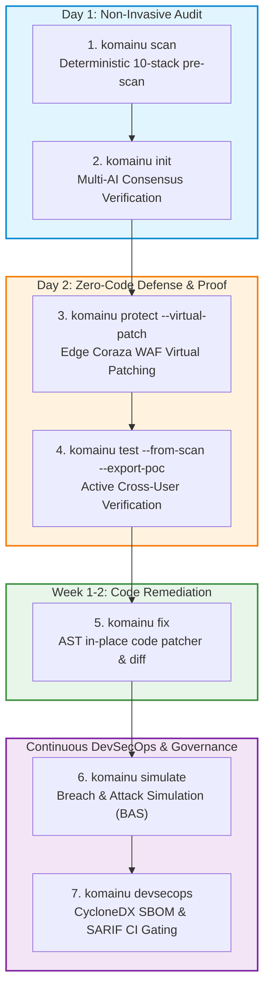

# Komainu CLI Comprehensive User Guide

> **Komainu — Security-First Legacy Modernization Platform**  
> Unified CLI for Automated Auditing, Perimeter Virtual Patching, Offensive Exploit Verification, In-Place Remediation, and Breach Simulation.

---

## 1. Overview & Execution Models

Komainu provides a unified command-line interface adhering strictly to **Zero Third-Party Dependency** standards (Python 3.8+ standard library only per [ADR-0006](docs/adr/0006-remediation-architecture-standard-library-only.md)). It can be executed across developer workstations, air-gapped enterprise environments, and CI/CD runners using three flexible execution models.

### 1.1 Zero-Install via Node.js (`npx`)
Requires Node.js 16+ or higher. No global installation needed:
```bash
npx komainu-guard <command> [options]
```

### 1.2 Containerized via Docker
Recommended for air-gapped environments or restricted CI environments:
```bash
docker run --rm -v $(pwd):/workspace \
  ghcr.io/hoanghainh1188/komainu:latest <command> --target /workspace/legacy-app
```

### 1.3 Direct Python CLI
Requires Python 3.8+ or higher with zero external pip dependencies:
```bash
# Via wrapper script
./bin/komainu <command> [options]

# Via Python module execution
python3 -m operate.cli.main <command> [options]
```

---

## 2. The 7-Step Modernization Journey

Komainu transforms legacy monolith modernization from a high-risk multi-year rewrite into an incremental, verified, day-by-day progression:



---

## 3. Subcommand Reference

### 3.1 `komainu scan` — Legacy Codebase Security Audit

Audits monolithic repositories across 10 legacy stacks (Classic ASP, ColdFusion, PHP Plain/CodeIgniter, Java Servlet/JSP/Struts1/Spring MVC, .NET WebForms/MVC, Node Express, Perl CGI, Python Flask, SQL Procedures) for Broken Object-Level Authorization (BOLA/IDOR) and dynamic string SQL injection.

```bash
komainu scan <target> [options]
```

#### Flags & Arguments
| Flag | Short | Default | Description |
| :--- | :--- | :--- | :--- |
| `<target>` | | *Required* | Path to legacy application directory to audit |
| `--out` | `-o` | `./komainu-out` | Output directory for report files and SARIF |
| `--format` | | `all` | Output format (`html`, `md`, `sarif`, `all`) |
| `--lang` | | `all` | Report language (`en`, `ja`, `all`) |
| `--sarif-out` | | `OUT/findings.sarif` | Designated path for OASIS SARIF v2.1.0 output |
| `--baseline` | | `None` | Previous `baseline.json` or SARIF file; findings become `new`, `unchanged` or `regressed` (SARIF `baselineState`) and `OUT/baseline-diff.json` lists fixed ones |
| `--update-baseline` | | `false` | Write the updated baseline to `--baseline` (default `OUT/baseline.json`) |
| `--suppressions` | | `TARGET/.komainu/suppressions.json` if present | Approved accepted-risk suppressions; matched findings are marked accepted in SARIF and never fail `--fail-on` |
| `--diff` | | `None` | PR mode: scan only files changed since the merge base with `BASE_REF` (git) plus files that reference them; writes `OUT/diff-scope.json` |
| `--fail-on` | | `none` (`new` with `--diff`) | Exit `1` when findings match: `new` (new or regressed), `any` (all active), `none` |
| `--fail-severity` | | `low` | Minimum severity counted by `--fail-on` (`info` … `critical`) |
| `--headless-ai` | | `None` (`http://localhost:11434/v1` if passed without value) | Execute Tier 2 cognitive AI audit autonomously via an OpenAI-compatible endpoint |
| `--model` | `-m` | `llama3.1` | Model name for headless cognitive AI execution |
| `--api-key` | | `ollama` | Bearer API token for private LLM endpoint |
| `--ai-timeout` | | `120` | Timeout in seconds per LLM request |

#### Examples
```bash
# Tier 1: Deterministic offline scan (Zero LLM, regex/AST candidates only)
komainu scan ./legacy-monolith --lang ja --format html --out ./reports

# Tier 2: Fully autonomous headless cognitive audit via local Ollama / vLLM (0 false positives)
komainu scan ./legacy-monolith --headless-ai http://localhost:11434/v1 --model llama3.1

# Export machine-readable OASIS SARIF v2.1.0 for GitHub Code Scanning
komainu scan ./legacy-monolith --format sarif --out ./reports/audit.sarif

# Continuous scanning: record a baseline, then fail CI only on new or regressed high+ findings
komainu scan ./legacy-monolith --baseline .komainu/baseline.json --update-baseline
komainu scan ./legacy-monolith --baseline .komainu/baseline.json --fail-on new --fail-severity high
```

Every finding gets a line-independent `kfp1:` fingerprint (SARIF `partialFingerprints["komainu/v1"]`), so moving code does not turn old findings into new ones. A missing or unreadable `--baseline` is a usage error (exit `2`) unless `--update-baseline` is set, which starts a fresh baseline.

#### Trend and time to fix
Each full scan with `--baseline` adds one point per day to `history` in `baseline.json` (a same-day rerun replaces it; at most 365 points). Diff scans add none, because they see only part of the tree. Commit `baseline.json` so the history follows the repository.

- `report.md`, `report.ja.md` and `report.html` gain a **Trend and time to fix** section: open findings per scan (new, regressed, fixed, suppressed) and the mean days from first seen to fixed (MTTR) per severity.
- The same data is in `OUT/baseline-diff.json` under `trend`, for monthly retainer reports.
- A regressed finding keeps its original first-seen date, so its next fix counts the whole time it was open.

#### PR diff mode
```bash
# In a pull request: scan what changed against main, fail only on new or regressed findings
komainu scan . --diff origin/main --baseline .komainu/baseline.json --fail-severity high
```

- Changed files = committed, staged, unstaged, untracked and deleted files since `git merge-base BASE_REF HEAD`, limited to the scan target.
- Files that reference a changed file one level deep are scanned too: any file naming it (`include 'inc/db.php'`, `web.xml`), the class name for Java/Kotlin/Groovy/C#/VB, and `import`/`require` for JS/TS/Python/Ruby.
- Stack detection still sees the whole tree; unchanged files are served from the content-hash cache.
- With `--baseline`, only entries in scanned files can become `fixed`.
- An unknown `BASE_REF` or a target outside a git work tree is a usage error (exit `2`).
- **Limitation:** changes deeper than one level (a helper of a helper) are not followed. Keep a scheduled full scan (for example nightly) as well. In CI, fetch enough history for the merge base (`actions/checkout` with `fetch-depth: 0`).

#### Accepted-risk suppressions
Copy the `fingerprint` from `findings.json` (or SARIF `partialFingerprints["komainu/v1"]`) into `.komainu/suppressions.json` in the scanned repository. JSON is used instead of YAML so Tier 1 stays standard-library only.

```json
{
  "version": 1,
  "suppressions": [
    {
      "fingerprint": "kfp1:3f9a…",
      "reason": "Admin page reachable only from the office VPN",
      "approved_by": "ciso@client.example",
      "expires": "2027-03-31"
    }
  ]
}
```

- `reason` and `approved_by` are required (record the human sign-off from `governance/`); `expires` is a `YYYY-MM-DD` date or `null`.
- A suppression applies up to and including its expiry date. After that the finding fails the gate again and the scan prints a warning.
- Suppressions that match no finding are reported so they can be removed. `OUT/baseline-diff.json` lists both under `expired_suppressions` and `unused_suppressions`.
- An invalid or missing explicit `--suppressions` file is a usage error (exit `2`).

---

### 3.2 `komainu init` — AI Auditor Skill & Adapter Installer

Installs Tier 2 semantic audit prompts, schemas, and adapters into your AI developer environment under a Bring-Your-Own-LLM (BYO-LLM) model. Komainu **never makes direct LLM calls** and retains zero client code.

```bash
komainu init --ai <runtime> [destination]
```

#### Flags & Arguments
| Flag | Short | Default | Description |
| :--- | :--- | :--- | :--- |
| `--ai` | | *Required* | Target AI runtime (`claude-code`, `codex`, `cursor`, `generic`) |
| `[destination]` | | Current directory | Target workspace directory to install agent bundle |
| `--force` | `-f` | `false` | Overwrite existing configurations if present |

#### Examples
```bash
# Setup Tier 2 audit agents for Claude Code / Antigravity workspace
komainu init --ai claude-code ./my-audit-project

# Setup adapter for OpenAI Codex CLI
komainu init --ai codex ~/audits/client-repo
```

---

### 3.3 `komainu protect` — Edge Gateway & Coraza WAF Perimeter

Deploys and manages the zero-code perimeter security layer (Kong API Gateway & Coraza WAF with OWASP Core Rule Set v4). Features instant **Virtual Patching** to block newly discovered vulnerabilities before legacy code can be refactored.

```bash
komainu protect [action] [options]
```

#### Actions & Flags
| Option | Default | Description |
| :--- | :--- | :--- |
| `--up` | | Launch Kong & Coraza WAF perimeter via Docker Compose |
| `--down` | | Tear down perimeter security containers |
| `--status` | | Display running status and proxy telemetry |
| `--virtual-patch` | | Ingest `findings.json` or SARIF and compile into Coraza SecRules |
| `--patch-out` | `./remediate/edge/coraza/rules/virtual-patches.conf` | Target destination path for generated WAF rules |

#### Examples
```bash
# Launch edge perimeter proxy in front of legacy application
komainu protect --up

# Automatically generate and deploy virtual patches from audit findings
komainu protect --virtual-patch ./audit-output/findings.json

# Export virtual patch rules to custom path
komainu protect --virtual-patch findings.json --patch-out /etc/coraza/rules/custom.conf
```

---

### 3.4 `komainu test` — Offensive Exploit Verification & BOLA Invariant Testing

Performs active, cross-user authorization tests against live APIs to verify tenant isolation. Automatically converts scan findings into active exploits, evaluates Multi-AI Consensus scores, and verifies the **HTTP 404 Not Found invariant**.

```bash
komainu test --url <base-url> [options]
```

#### Flags & Arguments
| Flag | Short | Default | Description |
| :--- | :--- | :--- | :--- |
| `--url` | `-u` | *Required* | Base URL of target API (`http://localhost:8000`) |
| `--from-scan` | | `None` | Ingest candidate BOLA routes from `findings.json` or `SARIF` |
| `--min-consensus` | | `0.0` | Minimum Multi-AI Consensus score threshold (0.0 – 1.0) |
| `--export-poc` | | `None` | Export verified exploit scripts (`.py` & `.sh`) to directory |
| `--auto-crud-path` | | `None` | Direct endpoint path pattern (e.g., `/api/v1/orders/{id}`) |
| `--resource-id` | | `1` | Resource ID belonging to Persona A (target) |
| `--attacker-token` | | `token-attacker-bob` | Bearer token belonging to unauthorized Persona B |
| `--output` | `-o` | `None` | Path to save JSON test verification report |
| `--suite` | `-s` | `operate/tests/test_suite.json` | Test suite file. `"version": 2` turns on the persona matrix |
| `--strict` | | `false` | Persona matrix: only 404 counts as refused (401/403 fail) |
| `--token-env` | | `None` | Env variable with a normal user's token for BFLA / mass assignment findings from `--from-scan` (default: `--token`) |

#### Persona matrix (suite v2): BFLA and mass assignment

Suite v2 lists personas and, per route, which personas may call it. Every
other persona is sent the request and must be refused (401, 403 or 404; only
404 with `--strict`). A `2xx` is a **BFLA** breach (CWE-285).

A `mass_assignment_probe` reads the object, sends a normal write with extra
privileged fields as an allowed persona, then reads the object again. A
privileged value that was stored is a **mass assignment** breach (CWE-915).
If the object already holds the probe value, the case is reported as
inconclusive.

```json
{
  "version": 2,
  "personas": {
    "anonymous": {},
    "user":  { "token_env": "KOMAINU_TOKEN_USER" },
    "admin": { "token_env": "KOMAINU_TOKEN_ADMIN" }
  },
  "routes": [
    { "method": "DELETE", "path": "/api/admin/users/{id}", "params": { "id": "42" }, "allow": ["admin"] },
    { "method": "PUT", "path": "/api/profile", "allow": ["user", "admin"],
      "payload": { "name": "Komainu probe" },
      "mass_assignment_probe": { "fields": { "role": "admin" }, "readback": "GET /api/profile" } }
  ]
}
```

- Tokens come **only** from environment variables (`token_env`). A suite with a
  token inside is rejected (exit 2). Tokens never appear in output or reports.
- A persona whose variable is not set gives an error for its cases, so the run
  fails instead of passing silently.
- Allowed personas are not called, except the probe persona, so the suite does
  not perform privileged actions as an admin. Denied requests can still run if
  the route is vulnerable: use a test environment.
- The JSON report (`--output`) lists these results under `matrix_results`.
  Schema: `contracts/schemas/persona-suite.schema.json`. Suite v1 files work as before.
- `--from-scan` also turns `bfla` and `mass_assignment` findings into cases
  (normal user from `--token-env`; probe fields from `attack_vector.fields`,
  default `role` / `is_admin`). `--export-poc` writes PoC scripts for both;
  they read the token from `KOMAINU_TOKEN`.

#### Examples
```bash
# Persona matrix: BFLA + mass assignment checks
KOMAINU_TOKEN_USER=... KOMAINU_TOKEN_ADMIN=... komainu test --url http://staging-api:8000 --suite personas.json

# Ingest LSA findings and verify only findings with >= 80% AI Consensus
komainu test --url http://staging-api:8000 --from-scan findings.json --min-consensus 0.8

# Verify and export reproducible Python & cURL PoC exploit scripts
komainu test --url http://staging-api:8000 --from-scan findings.json --export-poc ./pocs

# Test a single endpoint directly
komainu test --url http://localhost:8000 --auto-crud-path /api/v1/orders/{id} --resource-id 101
```

---

### 3.5 `komainu fix` — In-Place AST Code Remediation

Automatically refactors legacy code in-place to remediate BOLA/IDOR and SQL injection vulnerabilities by rewriting dynamic string queries into parameterized prepared statements and injecting ownership checks.

```bash
komainu fix <target> [options]
```

#### Flags & Arguments
| Flag | Short | Default | Description |
| :--- | :--- | :--- | :--- |
| `<target>` | | *Required* | Path to legacy codebase to remediate |
| `--dry-run` | `-d` | `false` | Preview planned transformations without modifying files |
| `--patch` | `-p` | `None` | Export transformations as a standard unified `.patch` file |
| `--rule` | | `all` | Specific remediation rule to apply (`all`, `bola`, `sqli`, `cve`) |

#### Examples
```bash
# Safe preview: generate a unified diff patch without changing source files
komainu fix ./legacy-monolith --dry-run -p ./security-fixes.patch

# Apply verified fixes directly to codebase
komainu fix ./legacy-monolith
```

---

### 3.6 `komainu simulate` — Breach & Attack Simulation (BAS) Suite

Simulates catastrophic real-world cyber incidents modeled after notable enterprise disasters to empirically measure defensive resilience and compute the **Platform Resilience Index (%)**.

```bash
komainu simulate [options]
```

#### Flags & Arguments
| Flag | Short | Default | Description |
| :--- | :--- | :--- | :--- |
| `--scenario` | `-s` | `all` | Scenario: `all`, `times-car-breach`, `metabase-cve-2026-72898`, `idc-frontier-ransomware` |
| `--target` | `-t` | `http://localhost:5001` | Target API base URL or storage volume path |
| `--endpoint` | | `/api/legacy-orders/{id}` | Target endpoint pattern for BOLA scenario |
| `--param` | | `q` | Target search query parameter for SQLi scenario |
| `--token` | | `mock-attacker-bob-token` | Attacker bearer credential for impersonation |
| `--format` | | `table` | Report output format (`table`, `markdown`, `json`) |
| `--output` | `-o` | `None` | Output file path to save Executive C-Level Report |

#### Available Scenarios
1. **`times-car-breach`**: Simulates the 2024 Times Car mass IDOR attack (6.6M customer accounts and ID photos harvested).
2. **`metabase-cve-2026-72898`**: Simulates remote unauthenticated SQL injection probe (CVSS 10.0 zero-day).
3. **`idc-frontier-ransomware`**: Simulates malicious in-flight backup overwriting, truncation, and deletion testing immutable WORM / S3 Object Lock compliance.

#### Examples
```bash
# Run all breach simulations and generate Executive Board of Directors Report
komainu simulate --target http://staging-api:8000 --output ./executive-bas-report.md --format markdown

# Simulate specifically the Times Car IDOR account harvesting probe
komainu simulate --scenario times-car-breach --target http://localhost:8000 --endpoint /api/orders/{id}
```

---

### 3.7 `komainu devsecops` — SBOM Generation & CI Gating

Manages continuous software supply chain security, CycloneDX/SPDX Software Bill of Materials (SBOM) generation, SARIF result deduplication, and automated SAST/SCA execution.

```bash
komainu devsecops <action> [options]
```

#### Actions
- **`komainu devsecops sbom <target>`**: Generates CycloneDX 1.5 (`--format cyclonedx`) or SPDX 2.3 (`--format spdx`) SBOM across npm, PyPI, NuGet, Maven, and Go.
- **`komainu devsecops merge-sarif <files...>`**: Merges and deduplicates multiple OASIS SARIF v2.1.0 scan results into a single consolidated file for GitHub Security Code Scanning.
- **`komainu devsecops run <target>`**: Runs complete DevSecOps scan suite (SAST, secret scanning via Gitleaks, SCA dependency audit).

#### Examples
```bash
# Export CycloneDX 1.5 SBOM for enterprise compliance
komainu devsecops sbom . --format cyclonedx -o ./sbom-cyclonedx.json

# Merge SARIF results from multiple scanners
komainu devsecops merge-sarif lsa.sarif trivy.sarif gitleaks.sarif -o ./reports/merged.sarif

# Run full DevSecOps audit pipeline
komainu devsecops run .
```

---

### 3.8 `komainu demo` — Interactive Member Portal Reference App

Launches the reference modern architecture application (`examples/member-portal/`) demonstrating secure multi-tenant isolation, cross-user 404 enforcement, and comparison against planted legacy vulnerabilities.

```bash
# Spin up reference demo environment (React 18 + .NET 8 / Spring Boot 3 + Kong)
komainu demo --up

# Tear down demo environment
komainu demo --down
```

---

## 4. Exit Codes & Invariants Matrix

Komainu CLI returns standardized POSIX exit codes to guarantee seamless gating in CI/CD pipelines:

| Exit Code | Status | Meaning |
| :---: | :--- | :--- |
| `0` | **PASS (SECURE)** | All authorization checks succeeded; the **HTTP 404 invariant** was maintained, zero BOLA breaches detected, or WAF rules deployed. |
| `1` | **FAIL (VULNERABLE / BREACH)** | An active security violation was confirmed (e.g., cross-user request returned `200 OK` leaking tenant data, or BAS simulation breached defenses). Fails CI build. |
| `2` | **CLI USAGE ERROR** | Invalid arguments, missing required options, or target unreachable. |

### The Core Architectural Invariant
> **Strict 404 Rule**: Any API request attempting to read, update, or delete a resource not owned by the authenticated caller **MUST return HTTP 404 Not Found** (or 403 Forbidden). Returning HTTP 2xx or descriptive 401s that expose ID existence is classified as an active BOLA/IDOR breach.

---

## 5. CI/CD Integration Examples

### 5.1 GitHub Actions Pipeline (`.github/workflows/komainu-verification.yml`)

```yaml
name: Komainu Security Verification

on:
  pull_request:
    branches: [main]

jobs:
  offensive-verification:
    name: Exploit-Driven BOLA & Breach Verification
    runs-on: ubuntu-latest
    steps:
      - name: Checkout Code
        uses: actions/checkout@v4

      - name: Setup Node.js & Python
        uses: actions/setup-node@v4
        with:
          node-version: '20'

      - name: Start Staging Service
        run: |
          docker compose -f docker-compose.staging.yml up -d
          sleep 5

      - name: Run LSA Deterministic Audit
        run: |
          npx komainu-guard scan ./backend --format sarif -o ./audit.sarif

      - name: Run Offensive Exploit Verification
        run: |
          npx komainu-guard test \
            --url http://localhost:8000 \
            --from-scan ./audit.sarif \
            --min-consensus 0.8 \
            --export-poc ./pocs

      - name: Run Breach & Attack Simulation (BAS)
        run: |
          npx komainu-guard simulate \
            --target http://localhost:8000 \
            --output ./bas-report.md \
            --format markdown

      - name: Upload Security Findings to GitHub Code Scanning
        if: always()
        uses: github/codeql-action/upload-sarif@v3
        with:
          sarif_file: ./audit.sarif
```

### 5.2 GitLab CI Pipeline (`.gitlab-ci.yml`)

```yaml
stages:
  - security-audit
  - offensive-verification

komainu-audit:
  stage: security-audit
  image: ghcr.io/hoanghainh1188/komainu:latest
  script:
    - komainu scan . --format sarif -o audit.sarif
    - komainu devsecops sbom . --format cyclonedx -o sbom.json
  artifacts:
    reports:
      sast: audit.sarif
      cyclonedx: sbom.json

komainu-exploit-gating:
  stage: offensive-verification
  image: ghcr.io/hoanghainh1188/komainu:latest
  script:
    - komainu test --url $STAGING_API_URL --from-scan audit.sarif --min-consensus 0.8
    - komainu simulate --target $STAGING_API_URL --format table
```

---

## 6. Troubleshooting & FAQ

#### Q: Does Komainu send source code or customer data to third-party LLMs?
**A:** No. Komainu operates strictly under the **BYO-LLM and Local Execution Protocol**. Deterministic scanning, testing, WAF patching, and breach simulations execute 100% locally with zero external network transmission.

#### Q: How do I suppress the ASCII banner in automated CI scripts?
**A:** Place `--no-banner` before any subcommand:
```bash
komainu --no-banner test --url http://localhost:8000
```

#### Q: How do I test APIs protected behind custom auth headers?
**A:** Provide the token via `--attacker-token`:
```bash
komainu test --url http://localhost:8000 --auto-crud-path /api/v1/orders/{id} --attacker-token "eyJhbGciOi..."
```

---
*Komainu — The Paired Guardian Lion-Dogs of Legacy Modernization.*
