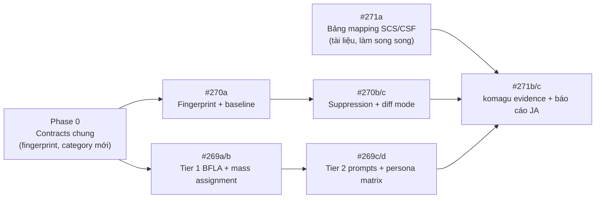

# Kế hoạch triển khai: #269 · #270 · #271

**Phạm vi:** 3 tính năng đề xuất sau đợt nghiên cứu thị trường ngày 2026-10-29.
**Phiên bản nền:** `komagu` v1.6.0 · LSA kit v1.3.0
**Trạng thái:** Bản nháp v0.1 — chờ duyệt thứ tự ưu tiên

| Issue | Tính năng | Giá trị chính |
|---|---|---|
| [#269](https://github.com/hoanghainh1188/komagu/issues/269) | Phát hiện BFLA + mass assignment, kiểm thử nhiều vai trò | Mở rộng năng lực lõi (OWASP API3 + API5) |
| [#270](https://github.com/hoanghainh1188/komagu/issues/270) | Baseline, suppression, chế độ PR diff | Nền tảng cho dịch vụ retainer hằng tháng |
| [#271](https://github.com/hoanghainh1188/komagu/issues/271) | Bộ bằng chứng METI SCS ★3/★4 + luật ACD | Đòn bẩy bán hàng trước mốc SCS 2027 |

---

## 1. Thứ tự và phụ thuộc



**Lý do chọn thứ tự này**

1. **Phase 0 đi trước:** cả #269 (thêm `category`) và #270 (thêm `fingerprint`) cùng sửa `contracts/schemas/finding.schema.json` và `findings_to_sarif.py`. Gộp các thay đổi schema vào một PR nhỏ giúp tránh xung đột khi hai nhánh chạy song song.
2. **#270a là nền móng:** fingerprint ổn định là điều kiện để baseline, suppression, trend, và cả evidence pack (#271) hoạt động.
3. **#271a không cần code:** bảng mapping là tài liệu trong `governance/` (open core theo ADR-0002), bắt đầu ngay được trong khi chờ tài liệu chính thức của METI.
4. **#271b/c đi sau cùng:** evidence pack tiêu thụ output của #269 và #270 (approval suppression, lịch sử fix, kiểm thử phân quyền theo vai trò).

---

## 2. Phase 0 — Contracts chung (1 PR, ~1 ngày)

| Thay đổi | File |
|---|---|
| `category` enum thêm `bfla`, `mass_assignment` | `contracts/schemas/finding.schema.json` |
| Trường tùy chọn `fingerprint` (string, `kfp1:<sha256>`) | `contracts/schemas/finding.schema.json` |
| Route thêm `privilege` (`anonymous` · `user` · `privileged` · `unknown`) và `body_bindings[]` (`target`, `style`: `whole_object` · `allowlist` · `explicit_fields`) | `contracts/schemas/route-inventory.schema.json` |
| Rule text, CWE (285, 269, 915), tag OWASP API3/API5 cho 2 category mới | `assess/lsa/scripts/findings_to_sarif.py`, `knowledge/severity-and-cwe.md` |

Tất cả trường mới đều **tùy chọn** → output cũ vẫn hợp lệ, `merge_findings.py` không gãy.

---

## 3. #270 — Baseline, suppression, PR diff mode

### 3.1 Thiết kế

**Fingerprint (`kfp1`)** — tính trong một module dùng chung `assess/lsa/scripts/fingerprint.py`:

```
sha256( category | subtype | METHOD normalized_path | handler_file | sink_symbol | normalized_sink_line )
```

- Không dùng số dòng → thêm/xóa dòng phía trên không đổi fingerprint.
- `normalized_sink_line`: dòng sink bỏ khoảng trắng, comment và literal số.
- Không dùng `finding_id` hay text do LLM sinh ra (Tier 2 không ổn định giữa các lần chạy).
- Ghi vào cả `finding.fingerprint` và SARIF `partialFingerprints["komagu/v1"]`.

**Baseline** — file `baseline.json` (schema mới `contracts/schemas/baseline.schema.json`):

```json
{ "version": 1, "entries": [
  { "fingerprint": "kfp1:…", "first_seen": "2026-11-02", "last_seen": "2026-11-20",
    "state": "open|fixed", "fixed_at": null, "severity": "high", "category": "bola" } ] }
```

| Kết quả so sánh | Điều kiện | SARIF `baselineState` |
|---|---|---|
| `new` | fingerprint chưa có trong baseline | `new` |
| `unchanged` | có, đang `open` | `unchanged` |
| `fixed` | `open` trong baseline nhưng không còn xuất hiện | (liệt kê trong báo cáo) |
| `regressed` | `fixed` trong baseline nhưng xuất hiện lại | `new` + property `regressed: true` |

Chấp nhận cả SARIF cũ làm baseline (đọc `partialFingerprints`), nhưng chỉ `baseline.json` mới phát hiện được `regressed`.

**Suppression** — `.komagu/suppressions.json` (**JSON thay vì YAML** như issue ghi, vì Tier 1 bắt buộc stdlib-only, Python không có parser YAML sẵn):

```json
[{ "fingerprint": "kfp1:…", "reason": "Route chỉ mở trong mạng nội bộ",
   "approved_by": "person-b@client", "expires": "2027-03-31" }]
```

- Xuất ra SARIF `suppressions[]` (`kind: external`, `justification`).
- Hết hạn → finding hoạt động lại và có cảnh báo trong báo cáo.
- Bắt buộc `approved_by`, nối với quy trình sign-off trong `governance/`.

**Diff mode** — `komagu scan --diff <base-ref>`:

1. `git diff --name-only <base-ref>...HEAD` (subprocess, không thêm dependency).
2. Tập file quét = file thay đổi + file route có tham chiếu tới basename/module của file thay đổi (heuristic v1).
3. Truyền danh sách file vào `map_routes` / `find_injection` và dùng lại `scan_cache`.
4. Mặc định `--fail-on new` trong diff mode.
5. **Giới hạn v1 (ghi rõ trong docs):** thay đổi gián tiếp sâu hơn 1 cấp (helper của helper) có thể bị bỏ sót → khuyến nghị full scan hằng đêm.

**CLI mới cho `komagu scan`**

| Flag | Ý nghĩa |
|---|---|
| `--baseline PATH` | So sánh với baseline (JSON hoặc SARIF) |
| `--update-baseline` | Ghi baseline mới sau khi quét |
| `--suppressions PATH` | Mặc định `.komagu/suppressions.json` nếu tồn tại |
| `--diff REF` | Chỉ quét phần thay đổi so với `REF` |
| `--fail-on {none,new,any}` | Điều kiện exit code ≠ 0 |
| `--fail-severity {low,medium,high,critical}` | Ngưỡng severity khi gate |

**Trend** — mỗi lần chạy với `--update-baseline` nối 1 dòng vào `history.json` (số lượng theo state/severity, ngày). `render_report.py` thêm mục "Xu hướng" và MTTR theo severity (EN + JA).

### 3.2 Chia PR

| PR | Nội dung | Ước lượng |
|---|---|---|
| #270a | `fingerprint.py`, baseline compare, `--baseline/--update-baseline/--fail-on/--fail-severity`, SARIF `baselineState` | 3–4 ngày |
| #270b | Suppression file + SARIF `suppressions` + hết hạn | 2 ngày |
| #270c | `--diff` + chọn file + cache reuse + benchmark | 3 ngày |
| #270d | `history.json` + mục Xu hướng / MTTR trong HTML & JA | 2–3 ngày |

### 3.3 Kiểm thử

- Fingerprint không đổi khi chèn dòng trống/comment phía trên finding (`test_baseline.py`).
- Fixture không đổi + baseline của chính nó → 0 `new`.
- Sửa lỗi trong fixture → `fixed`; đưa lỗi trở lại → `regressed`.
- Suppression hết hạn → finding hoạt động lại.
- Diff 1 file trên bộ benchmark (`test_performance.py`) nhanh hơn rõ rệt so với full scan.
- Upload SARIF lên GitHub code scanning của chính repo Komagu (workflow sẵn có).

---

## 4. #269 — BFLA + mass assignment + persona matrix

### 4.1 Tier 1 (deterministic, stdlib)

**BFLA — mở rộng `map_routes.py`**

- Gán `privilege` cho route: `privileged` nếu path/handler khớp mẫu quản trị (`/admin`, `/manage`, `/internal`, `/api/users/{id}/role`, `export`, `bulk_delete`, `impersonate`…) hoặc thao tác ghi trên bảng nhạy cảm (users, roles, permissions, settings).
- Route `privileged` mà `guards` không có `type: role` ở `before_handler`/`in_handler` → `needs_bfla_audit: true`.
- Tín hiệu mạnh: role đọc từ input (`req.body.isAdmin`, `$_POST['role']`, cookie `role=`), kiểm tra quyền chỉ ở tầng menu/view.
- Knowledge mới: `assess/lsa/knowledge/bfla-patterns.md` (theo 10 stack hiện có).

**Mass assignment — scanner mới `assess/lsa/scripts/find_mass_assignment.py`** (cùng cấu trúc với `find_injection.py`, dùng chung worker pool + cache)

| Stack | Mẫu cần bắt |
|---|---|
| Node/Express | `Model.create(req.body)`, `.update(req.body)`, `new Model(req.body)`, `Object.assign(entity, req.body)` |
| PHP / Laravel | `->fill($request->all())`, `::create($request->all())` khi model không có `$fillable`, `extract($_POST)` |
| Java Spring / Struts | `@RequestBody`/`@ModelAttribute` bind thẳng vào class `@Entity`; Struts `ActionForm` populate entity |
| .NET MVC / WebForms | Action nhận EF entity không có `[Bind(Include=…)]`, `TryUpdateModel(entity)` |
| Python | `Model(**request.json)`, `obj.__dict__.update(request.form)` |
| Ruby | `params.permit!`, `update(params[:x])` không qua strong params |
| ColdFusion / Classic ASP | `StructAppend(obj, form)`, vòng lặp gán mọi `Request.Form` vào record |

Ưu tiên finding khi entity có trường nhạy cảm: `role`, `is_admin`, `owner_id`, `user_id`, `tenant_id`, `price`, `balance`, `status`.
Knowledge mới: `assess/lsa/knowledge/mass-assignment-patterns.md`.

### 4.2 Tier 2 (cognitive agents)

- Prompt mới `assess/lsa/prompts/35-privilege-auditor.md`: một agent cho cả BFLA và mass assignment (cùng câu hỏi "ai được gọi chức năng/ghi trường này"), đọc `auth-model.md` để biết mô hình vai trò.
- Cập nhật `20-route-mapper.md` (điền `privilege`, `body_bindings`), `50-finding-verifier.md` (lý do bác bỏ: role check ở middleware toàn cục, DTO allow-list, `$guarded`…), `00-orchestrator.md` (thêm phase 4c), `60-reporter*.md`.
- Wire vào `build_adapters.py` cho đủ 5 runtime (claude-code, codex, cursor, generic, openhands) + agent `lsa-privilege-auditor`.
- `--headless-ai` (`operate/ai/runner.py`) gửi thêm batch privilege.

### 4.3 Persona matrix cho `komagu test`

Suite v2 (giữ nguyên tương thích suite v1 và `--token`):

```json
{
  "version": 2,
  "personas": {
    "anonymous": {},
    "user":  { "token_env": "KOMAGU_TOKEN_USER" },
    "admin": { "token_env": "KOMAGU_TOKEN_ADMIN" },
    "other_tenant": { "token_env": "KOMAGU_TOKEN_TENANT_B" }
  },
  "routes": [
    { "method": "DELETE", "path": "/api/admin/users/{id}", "allow": ["admin"] },
    { "method": "PUT", "path": "/api/profile", "allow": ["user", "admin"],
      "mass_assignment_probe": { "fields": { "role": "admin" }, "readback": "GET /api/profile" } }
  ]
}
```

- Token **chỉ đọc từ biến môi trường** (`token_env`), không cho phép ghi token thẳng trong file suite.
- Persona ngoài `allow` nhận `2xx` → breach (BFLA). Status từ chối: 401/403/404 (`--strict` vẫn chỉ chấp nhận 404).
- Mass assignment probe: gửi request hợp lệ + trường đặc quyền, rồi đọc lại qua `readback`; trường bị lưu → breach.
- `--from-scan` sinh test BFLA (persona thấp nhất gọi route `privileged`) và probe mass assignment từ finding.
- PoC export (`--export-poc`) hỗ trợ 2 class mới.

### 4.4 Chia PR

| PR | Nội dung | Ước lượng |
|---|---|---|
| #269a | Tier 1 BFLA trong `map_routes.py` + `bfla-patterns.md` + fixture 4 stack (PHP, Java, .NET, Node) | 4–5 ngày |
| #269b | `find_mass_assignment.py` + knowledge + fixture | 4–5 ngày |
| #269c | Prompt 35 + cập nhật prompt 00/20/50/60 + adapter + headless AI + cập nhật `score_findings.py` | 3–4 ngày |
| #269d | Persona matrix suite v2 + mass assignment probe + `--from-scan` + PoC | 4 ngày |
| #269e | Hiển thị trong HTML/JA/SARIF + cập nhật `cli-guide.md` | 1–2 ngày |
| (issue riêng sau) | `remediate/authz`: `@RequireRole` + hướng dẫn DTO allow-list | — |

### 4.5 Kiểm thử

- Fixture BFLA + mass assignment có cả **bản lỗi** và **bản an toàn** (có role guard / có allow-list) → đo cả recall và false positive.
- Toàn bộ fixture hiện có: **không thêm false positive** (giữ precision 1.000 trong `EVAL-RESULTS.md`).
- `mock_test_server.py` thêm route admin và route profile có lỗi mass assignment để test end-to-end persona matrix.
- Suite v1 cũ chạy lại không đổi kết quả.

---

## 5. #271 — Evidence pack METI SCS + ACD

### 5.1 Điều kiện tiên quyết (cần quyết định)

- Lấy **tài liệu yêu cầu chính thức** của METI SCS (★3/★4). Hiện chỉ có nguồn thứ cấp; mục nào chưa có văn bản chính thức thì đánh dấu `pending-official`.
- Review pháp lý/quản trị trước mọi tuyên bố với khách hàng (gắn label `decision`).

### 5.2 Thiết kế

**Mapping (open core — `governance/compliance/`)**

- `scs-mapping.json` (dữ liệu) + `scs-mapping.md` (bản đọc, EN + JA).
- Mỗi control gồm: `control_id`, `framework_refs` (SCS ★ level, NIST CSF 2.0 subcategory, nghĩa vụ ACD), `evidence_sources` (tên artifact Komagu), `coverage` (`covered` · `partial` · `organizational`), `notes`.
- Ví dụ: `ID.AM` ← route inventory + SBOM; `PR.AA` ← kết quả BOLA/BFLA + persona matrix; `PR.PS` ← `komagu fix` + SCA; `DE.CM` ← CI gate + trend; `RS.MI` ← WAF virtual patch + MTTR.

**`komagu evidence` (operate — closed)**

```
npx @hoanghainh/komagu evidence --scan-dir ./audit-output --devsecops-dir ./devsecops-out \
    --test-results ./test-results.json --out ./evidence-2026-11.zip --lang ja
```

- Thu thập: SARIF, `findings.json`, `baseline.json`/`history.json`, suppression đã duyệt, SBOM (CycloneDX/SPDX), kết quả SCA/secret scan, kết quả `komagu test`, phiên bản ruleset WAF.
- `manifest.json` (schema `contracts/schemas/evidence-manifest.schema.json`): sha256 từng file, phiên bản tool, git commit của target, thời điểm, phạm vi.
- Báo cáo gap `evidence-report.html` (EN/JA): trạng thái từng control, link tới bằng chứng, việc tổ chức còn phải làm.
- Tuyên bố miễn trừ rõ ràng: hỗ trợ chuẩn bị, **không thay thế** đánh giá của tổ chức được công nhận.
- Bỏ qua artifact còn thiếu (đánh dấu `missing` trong báo cáo), không làm lệnh thất bại.

### 5.3 Chia PR

| PR | Nội dung | Ước lượng |
|---|---|---|
| #271a | Mapping SCS/CSF/ACD (JSON + MD, EN/JA) | 3 ngày + thời gian review |
| #271b | `komagu evidence` + manifest schema + kiểm tra hash | 3–4 ngày |
| #271c | Báo cáo gap HTML EN/JA | 2–3 ngày |
| #271d | Job CI chạy end-to-end trên demo app (scan → test → devsecops → evidence) | 1–2 ngày |

### 5.4 Kiểm thử

- Manifest hợp lệ theo schema; sửa 1 byte trong file → kiểm tra hash thất bại.
- Thiếu một nguồn bằng chứng → báo cáo ghi `missing`, lệnh vẫn thành công.
- Snapshot test cho báo cáo JA (giống `test_japanese_report.py`).

---

## 6. Lịch dự kiến

Giả định 1 kỹ sư chính + AI agent; mỗi PR đi qua review + 6 CI check + release-please.

| Sprint (2 tuần) | Việc | Bản phát hành dự kiến |
|---|---|---|
| S1 (tuần 1–2) | Phase 0 · #270a · #271a (song song) | v1.7.0 |
| S2 (tuần 3–4) | #270b · #270c · #269a | v1.8.0 |
| S3 (tuần 5–6) | #269b · #269c · #270d | v1.9.0 |
| S4 (tuần 7–8) | #269d · #269e · #271b · #271c · #271d | v2.0.0 (đổi format suite test → cân nhắc major) |

Mốc SCS (cuối FY2026 – 03/2027) vẫn còn dư thời gian sau S4 cho pilot.

---

## 7. Rủi ro

| Rủi ro | Giảm thiểu |
|---|---|
| Fingerprint không ổn định giữa Tier 1 và Tier 2 | Chỉ dùng trường deterministic; test riêng cho finding do LLM sinh |
| Heuristic mass assignment nhiều false positive (khó biết model có allow-list) | Gắn `confidence: low` khi không thấy định nghĩa model; để Tier 2 + verifier quyết định |
| Diff mode bỏ sót thay đổi gián tiếp | Ghi rõ giới hạn; khuyến nghị full scan hằng đêm; mở rộng đồ thị phụ thuộc ở v2 |
| Lộ token persona trong CI | Chỉ `token_env`; che token trong log và báo cáo JSON |
| Tài liệu SCS chính thức chưa phát hành / thay đổi | Mapping có version, đánh dấu `pending-official`, review lại khi METI công bố |
| Tuyên bố tuân thủ quá mức với khách hàng | Disclaimer bắt buộc + review của governance trước khi pitch |

---

## 8. Quyết định cần chủ dự án

1. Duyệt thứ tự ưu tiên ở mục 1 (hoặc đẩy #271 lên trước nếu sales cần sớm).
2. Đồng ý đổi suppression sang JSON (ràng buộc stdlib-only).
3. Suite test v2 có coi là breaking change để lên v2.0.0 không.
4. Ai chịu trách nhiệm lấy tài liệu SCS chính thức và review pháp lý.

## Lịch sử phiên bản

| Phiên bản | Ngày | Thay đổi |
|---|---|---|
| v0.1 | 2026-10-29 | Bản nháp đầu tiên |
