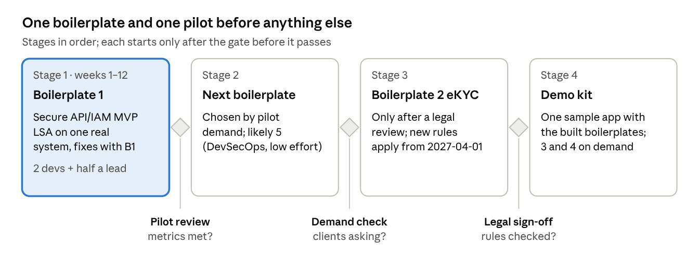

# Modernization Boilerplates — Proposal

Version 0.1 · 2026-10-17 · Owner: Harry · Status: approved by management (BOD) on 2026-10-17

## Executive summary

We propose to offer Japanese clients a **security-first modernization package**: a paid assessment of their legacy system, followed by reusable boilerplates that fix what the assessment finds. We start with one boilerplate (Secure API & IAM) and expand only after one paying pilot proves the value.

- **What we sell first:** a Legacy Security Assessment built on our LSA kit. It finds endpoints that leak other users' data (BOLA/IDOR) and hand-built SQL/NoSQL queries, with `file:line` evidence.
- **What follows:** fix and modernization work, delivered faster because the fixes come from tested boilerplates instead of being designed from scratch.
- **Why now:** Japanese companies carry large legacy estates, recent incidents and rule changes put data protection on the board agenda, and buyers want proof, not claims (see Context).
- **What exists today:** the LSA kit (v0.1, tested on 10 sample apps). The five boilerplates do not exist yet.
- **What we ask management:** approve Boilerplate 1 and one pilot, decide the open-source vs closed IP question, and assign a small team (see Decisions needed).

We make no time-saving claim to clients until the pilot has measured it.

## Context: why Japanese clients will buy now

Four public incidents in two months and one rule change make data protection and recovery a board-level topic in Japan. Each maps to one boilerplate.

| Date | Event | What happened | Boilerplate it supports |
| --- | --- | --- | --- |
| 2027-04-01 (in force) | [Amended Criminal Proceeds Act ordinance](https://www.cio.com/article/4035461/%E7%8A%AF%E5%8F%8E%E6%B3%95%E6%96%BD%E8%A1%8C%E8%A6%8F%E5%89%87%E6%94%B9%E6%AD%A3%E3%81%A7%E6%9C%AC%E4%BA%BA%E7%A2%BA%E8%AA%8D%E3%81%AE%E4%BD%95%E3%81%8C%E5%A4%89%E3%82%8F%E3%82%8B%E3%81%AE%E3%81%8B.html) | Online ID checks that rely only on an uploaded ID image are abolished for new users. JPKI (My Number Card) or IC-chip reading replace them. Promulgated 2025-06-24 ([industry notice](https://www.zennichi.or.jp/?p=73124)). | 2. Zero-PII eKYC |
| 2026-10-07 | [IDC Frontier ransomware](https://atmarkit.itmedia.co.jp/ait/articles/2610/09/news036.html) | IDCFCloud East Japan Region 1 was shut down. The company reports 495 companies and local governments affected. Data in four zones can be restored only from backups the customer holds. | 3. Immutable backup |
| 2026-09-25 | [Times Car (Times Mobility) breach](https://atmarkit.itmedia.co.jp/ait/spv/2609/30/news038.html) | Unauthorized access to about 6.6 million accounts, including driver's licence and ID images. The entry route has not been published. | 2. Zero-PII eKYC (stored ID images) |
| 2026-09-16 | [JGC Digital Metabase intrusion](https://scan.netsecurity.ne.jp/article/2026/10/09/56422.html) | A vulnerability in the Metabase BI tool was exploited; about 60,000 items of customer information were obtained. | 5. DevSecOps & SBOM |
| 2026-08-06 | [Metabase CVE-2026-72898](https://scan.netsecurity.ne.jp/article/2026/08/19/55958.html) | Unauthenticated SQL injection, CVSS 10, zero-day exploitation confirmed by the vendor; JPCERT/CC advisory on 2026-08-14. | 5. DevSecOps & SBOM; 1. Secure API (injection) |

- **Legacy estate.** METI's DX Report warned that legacy systems could cost Japan up to 12 trillion yen a year from 2025 ([summary by SMBC](https://www.smbc.co.jp/hojin/magazine/planning/about-2025-digital-cliff.html); original report to be cited before external use).
- **What we could not confirm.** The draft linked the Metabase case to the Digital Agency. No source we opened says so; we drop that link until one does.
- **No BOLA claim on Times Car.** The cause is not public. We must not tell clients it was an API authorization flaw.

## The offer: assess first, then fix with boilerplates

The package has one entry service and five boilerplates. The assessment finds real problems in the client's own code; each boilerplate is a tested, reusable fix for one class of problem.

**Entry service — Legacy Security Assessment (LSA).** An AI-assisted, human-reviewed static review of the client's controllers, routers and pages. It reports endpoints without object-level ownership checks (BOLA/IDOR) and SQL/HQL/NoSQL queries built from input, each with `file:line` evidence, severity, and a fix. Output: a report, SARIF for the client's code-scanning tool, and fix tickets. It is not a penetration test.

| # | Boilerplate | Problem it solves | Main contents |
| --- | --- | --- | --- |
| 1 | Secure API & IAM | Users reading or changing other users' data; injection; scraping; leaked API keys | Gateway config (rate limits, WAF rules, bot controls); OAuth 2.1 / OpenID Connect integration; object-level authorization middleware for .NET and Kotlin/Spring first; automated authorization tests in CI |
| 2 | Zero-PII eKYC & NFC | ID images stored and leaked; the 2027 rule change | NFC reader module (Flutter / native) for My Number Card, passport, IC driver's licence; backend that verifies the chip signature, keeps only needed fields, and tokenizes them; no raw images stored |
| 3 | Multi-region & immutable backup | Ransomware or provider outage destroys data and backups | Terraform / OpenTofu templates (multi-AZ, container clusters); backups locked against change and deletion (e.g. S3 Object Lock, compliance mode) in another region or cloud; DR runbook scripts that test and restore |
| 4 | Tenant-isolated SaaS | Enterprise buyers need proof that tenants cannot see each other's data | PostgreSQL row-level security or schema-per-tenant patterns; per-tenant encryption keys (BYOK) in a KMS or Vault-compatible store |
| 5 | DevSecOps & SBOM | Vulnerable dependencies and images reach production unseen | CI templates (GitHub Actions / GitLab CI): SAST (e.g. Semgrep), SCA and SBOM (e.g. Trivy, Syft), container image scanning; LSA as an extra AI review step via SARIF |

Tool and vendor names are examples. Each project picks what the client already runs.

## What we have and what we must build

Only the assessment exists today. Boilerplate 1 has the closest fit with our skills and with the assessment; Boilerplate 2 needs skills we have not shown yet.

| Item | What exists today | What must be built | Readiness |
| --- | --- | --- | --- |
| Legacy Security Assessment | LSA kit v0.1: prompts, pre-scan scripts, SARIF and report output, governance policy; tested on 10 sample apps and 3 public vulnerable apps | A run on one real client system; Japanese report template | Ready for a pilot |
| 1. Secure API & IAM | Team experience with Node.js, .NET, AWS; LSA finds the gaps this boilerplate fixes | Middleware libraries, gateway configs, CI test suite, demo app | Not started; best fit |
| 2. Zero-PII eKYC & NFC | Flutter and native mobile skills | NFC reading for Japanese IDs, JPKI integration, legal review of the 2027 rules | Not started; new domain |
| 3. Immutable backup | AWS experience | IaC templates, restore tests, DR runbook | Not started |
| 4. Tenant-isolated SaaS | Patterns from our own platform design: tenant ID on every table, Vault-compatible secret store | Extract the patterns as a reusable template | Not started; design know-how exists |
| 5. DevSecOps & SBOM | LSA SARIF output | CI templates for GitHub and GitLab | Not started; low effort |

Open question: which skills we have shown on past projects (named, dated) for each row, so the pitch can cite them.

## Priorities and roadmap

We build Boilerplate 1 first because it fixes exactly what the assessment finds, uses skills we already have, and gives the pilot something to deliver. Each later stage starts only when its gate passes.

Stages 2–4 have no dates yet; they are set at the pilot review. Clients that must comply with the April 2027 eKYC rules may pull Stage 3 earlier, but only after the legal review.

## Business model and positioning

Revenue comes from three services; the boilerplates are how we deliver them faster, not the product we sell. Whether the boilerplates are open or closed is a decision for management (below).

| Service | Pricing shape | Why the client buys |
| --- | --- | --- |
| Legacy Security Assessment | Fixed fee per scope (number of endpoints or modules) | Evidence about their own system, fast, before any big commitment |
| Fix / modernization project | Fixed price per work package, priced from assessment findings | Known scope, lower risk than open-ended rework |
| Continuous scanning and support | Monthly retainer | Findings stay closed after each release |

Prices are not set yet; they need the effort data from the pilot.

**Open or closed boilerplates?** The original draft calls them a "secret weapon" (closed IP). Our framework is MIT-licensed, with income from services only. The two positions conflict if the boilerplates live inside the framework.

| Option | For | Against |
| --- | --- | --- |
| A. Open source (MIT), sell services | Matches the framework; public code builds trust with security-minded Japanese buyers; easier for partners to adopt | Competitors can reuse the code; value must come from people and delivery |
| B. Closed IP, licensed per project | Protects the asset; supports higher fixed-price margins | Conflicts with the framework position; buyers cannot inspect it before buying; licence admin cost |
| C. Open core: generic boilerplates open, client-specific configs and the assessment know-how closed | Trust from open code; keeps the hardest-won knowledge in-house | Line between open and closed must be drawn and kept |

Recommendation: **C**, with the line drawn per boilerplate when it is built. Management decides.

## Effort and how we prove the claims

First estimate for the first stage: about 12 weeks with 2 developers and a part-time lead (half a person) for Boilerplate 1 plus one pilot. The detailed plan for Boilerplate 1 refines this. The other boilerplates are not estimated until the pilot ends.

The draft claimed 60–70% time saved and "3 months down to 3 weeks". We have no data for either. We will measure these instead and publish only measured numbers:

| Metric | How we measure it | Target for the pilot |
| --- | --- | --- |
| Platform build time | Person-days to put auth, object-level checks and gateway rules in place, vs. the same work on a recent comparable project (baseline from our time sheets) | Measured; no target until baseline is known |
| Assessment precision | Findings accepted by the reviewer / findings reported | 70% or more |
| Assessment coverage | Endpoints audited / endpoints inventoried | 100% |
| Authorization defects after release | BOLA/IDOR found by tests or the client after go-live | 0 on endpoints covered by the middleware |
| Reuse | Share of boilerplate code used unchanged in the pilot | Measured |
| Client outcome | Did the assessment lead to a paid fix project? | Yes / no |

## Risks

The biggest risk is promising security outcomes we cannot prove. Every client-facing claim needs evidence from our own pilot or a cited public source.

| Risk | Effect | How we handle it |
| --- | --- | --- |
| Over-promising ("absolute" security, unmeasured time savings) | Lost trust with Japanese clients; contract disputes | Publish only measured numbers; state that the assessment is not a penetration test |
| Client code sent to an outside AI service without approval | Breach of NDA or contract | Written approval per project; self-hosted model option; LSA usage policy |
| Too much at once (5 boilerplates) | Nothing finished; team spread thin | One boilerplate and one pilot first; next one only after a go/no-go review |
| eKYC legal details wrong | Non-compliant product under the 2027 rules | Legal review against the official National Police Agency text before building Boilerplate 2 |
| Boilerplates age fast (libraries, CVEs, cloud APIs) | Shipping outdated or vulnerable code | Owner per boilerplate; Boilerplate 5 pipeline runs on the boilerplates themselves; version and changelog |
| Incident references go stale or are wrong | Pitch loses credibility | Re-check sources before each pitch; drop any claim we cannot source |
| IP position unclear (open vs closed) | Rework, partner confusion | Decide before Boilerplate 1 is published |

## Decisions needed from management

Four decisions unblock the first stage; the rest can wait for the pilot review.

- [x] Approve Boilerplate 1 and the first stage (about 12 weeks, 2 developers + half a lead) — approved 2026-10-17 by Harry (BOD)
- [x] Choose the IP position: A open, B closed, or C open core (recommended) — Option C (Open Core) adopted via ADR-0002 on 2026-10-17
- [ ] Name a pilot client or an internal system for the first assessment, with written approval for AI processing of its code
- [x] Name a security reviewer (Person B) who signs off assessment findings — Harry (Human-in-the-loop reviewer for AI audits, decided 2026-10-17)
- [ ] Later, at the pilot review: go / no-go for the next boilerplate, using the metrics above

## Client-facing summary (for pitches)

*Use this section as the one-page pitch. Keep the claims as written; add measured results only after the pilot.*

**Modernize legacy systems with security built in — starting from evidence in your own code.**

1. **Assessment first.** We review your existing controllers and APIs and show, line by line, where one user can reach another user's data and where queries are built from raw input. Every finding is reviewed by a senior engineer before you see it.
2. **Fixes from tested building blocks.** We close the findings with prepared components: object-level authorization middleware, OAuth 2.1 / OpenID Connect integration, gateway rules, and automated authorization tests in your CI.
3. **Ready for what comes next.** The same approach extends to IC-chip identity checks for the April 2027 rule change, immutable off-site backups, tenant isolation, and dependency scanning.

What you receive from the assessment: a report with severity and fix for each finding, results in SARIF for your code-scanning tool, and fix tickets. What it is not: a penetration test or a guarantee that no vulnerabilities remain.

Your code stays under your control: we use AI only with your written approval, and can run it on a model hosted in our environment or yours.

## Sources

Pages opened on 2026-10-16:

- [犯収法施行規則改正で本人確認の何が変わるのか — CIO Japan](https://www.cio.com/article/4035461/%E7%8A%AF%E5%8F%8E%E6%B3%95%E6%96%BD%E8%A1%8C%E8%A6%8F%E5%89%87%E6%94%B9%E6%AD%A3%E3%81%A7%E6%9C%AC%E4%BA%BA%E7%A2%BA%E8%AA%8D%E3%81%AE%E4%BD%95%E3%81%8C%E5%A4%89%E3%82%8F%E3%82%8B%E3%81%AE%E3%81%8B.html) (check letter labels against the official National Police Agency text)
- [犯罪収益移転防止法施行規則 改正点のあらまし — 全日本不動産協会](https://www.zennichi.or.jp/?p=73124)
- [IDCフロンティアにランサムウェア、495社・自治体に影響 — @IT](https://atmarkit.itmedia.co.jp/ait/articles/2610/09/news036.html)
- [タイムズカーで不正アクセス 約660万件 — @IT](https://atmarkit.itmedia.co.jp/ait/spv/2609/30/news038.html)
- [JGC Digital Metabase 不正アクセス — ScanNetSecurity](https://scan.netsecurity.ne.jp/article/2026/10/09/56422.html)
- [Metabase に SQLインジェクションの脆弱性、ゼロデイ攻撃も確認 — ScanNetSecurity](https://scan.netsecurity.ne.jp/article/2026/08/19/55958.html)
- [Metabase CVE-2026-72898 — INTERNET Watch](https://internet.watch.impress.co.jp/docs/news/2134355.html)
- [2025年の崖 — SMBC](https://www.smbc.co.jp/hojin/magazine/planning/about-2025-digital-cliff.html) (secondary; cite the METI DX Report itself before external use)

## Version history

| Version | Date | Change |
| --- | --- | --- |
| 0.1 | 2026-10-16 | Rewrite of the original draft: sourced context, assessment-first offer, open/closed decision, measured claims only |
