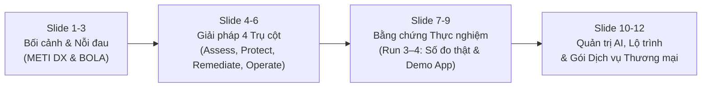
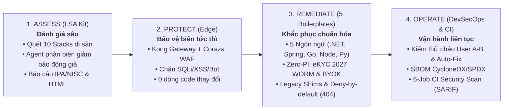

# Komagu (狛犬) — Pitching Deck & Sales Enablement Kit

**Tài liệu:** Bộ công cụ Thuyết trình & Hỗ trợ Kinh doanh (Sales Enablement Kit)  
**Đối tượng mục tiêu:** Ban Giám đốc (BOD), CISO, CIO, Trưởng ban Chuyển đổi số (DX Division), và Giám đốc Quản lý Ứng dụng (AMS / SIers) tại thị trường Nhật Bản.  
**Tác giả & Diễn giả:** Harry (Principal Architect / BrSE / Lead Oversight)  
**Phiên bản nền tảng:** Komagu `v1.2.1` (`komagu` trên npmjs & Docker Hub/GHCR)  

---

## MỤC LỤC BỘ TÀI LIỆU

1. **Khung Chiến lược Thuyết phục Khách hàng Doanh nghiệp Nhật**
2. **Cấu trúc Slide Deck 12 Trang (Slide-by-Slide Deck & Speaker Notes)**
3. **Kịch bản Live Demo 3 Phút (3-Minute Live Demo Script)**
4. **Tài liệu Tóm tắt Điều hành (One-Page Executive Briefing)**
5. **Cẩm nang Xử lý Từ chối & Câu hỏi Thường gặp (Objection Handling & FAQ)**

---

## 1. Khung Chiến lược Thuyết phục Khách hàng Doanh nghiệp Nhật

### 1.1. Bối cảnh Tâm lý & Nỗi đau của Khách hàng Doanh nghiệp Nhật Bản
1. **Nỗi sợ "Vách đá Kỹ thuật số 2025" (2025年の崖):** Theo Báo cáo METI DX Report, các hệ thống di sản (Legacy Systems) viết bằng Classic ASP, ColdFusion, Java Struts, PHP cũ hay .NET WebForms đang gây tổn thất lên tới 12.000 tỷ Yên mỗi năm vì thiếu hụt kỹ sư hiểu code cũ và chi phí bảo trì phình to.
2. **Khủng hoảng Rò rỉ Dữ liệu & Ransomware Gần đây:**
   - Vụ tấn công *Times Car (Times Mobility)* tháng 09/2026 làm rò rỉ 6,6 triệu tài khoản và hình ảnh bằng lái.
   - Vụ *Metabase Zero-Day (CVE-2026-72898)* tháng 08/2026 khai thác SQL Injection chiếm quyền hệ thống BI.
   - Vụ *Ransomware IDC Frontier* tháng 10/2026 đánh sập 495 doanh nghiệp và chính quyền địa phương.
3. **Thế tiến thoái lưỡng nan (Modernization Dilemma):** 
   - *Muốn sửa:* Sợ chạm vào code cũ không có tài liệu sẽ làm gãy nghiệp vụ đang chạy.
   - *Muốn quét lỗi:* Các công cụ SAST truyền thống (Fortify, Checkmarx, SonarQube) báo hàng nghìn cảnh báo giả (False Positives) nhưng lại bỏ sót lỗi phân quyền đối tượng **BOLA / IDOR** và các chuỗi ghép SQL động phức tạp.

### 1.2. Giá trị Cốt lõi của Komagu (The Komagu Value Proposition)
Komagu mang hình tượng **Cặp thần thú hộ vệ Shinto A–Un (阿吽)**:
- **Há miệng (A - 阿) $\rightarrow$ Đánh giá (Assess):** Rà soát quét sâu không chạm vào code (Read-only), phát hiện chính xác lỗ hổng BOLA và SQLi với bằng chứng `file:line` cụ thể, không báo động giả.
- **Ngậm miệng (Un - 吽) $\rightarrow$ Khóa chặt (Protect & Remediate):** Ngay lập tức đặt lá chắn Kong Gateway + Coraza WAF ở tầng biên mà **không cần sửa một dòng code di sản nào**, sau đó vá bằng các thư viện chuẩn hóa hoặc shims.

---

## 2. Cấu trúc Slide Deck 12 Trang (Slide-by-Slide Presentation)



---

### SLIDE 1: Title & Positioning
- **Tiêu đề Slide:** **Komagu (狛犬) — Security-First Legacy Modernization Platform**
- **Phụ đề:** *Chuyển dịch Hệ thống Di sản Sang Kiến trúc Hiện đại An toàn: Rà soát Chính xác, Bảo vệ Tức thì, Khắc phục Triệt để.*
- **Key Visual:** Biểu tượng cặp thần thú Shinto Komagu (A–Un) bảo vệ cổng đền linh thiêng.
- **Thông điệp chính:** Cầu nối giữa kiểm toán an ninh tĩnh và hiện đại hóa phần mềm thực dụng cho doanh nghiệp Nhật Bản.
- **Speaker Notes (Harry):**
  > *"Kính thưa Ban Giám đốc và quý đối tác. Trong truyền thống Thần đạo Nhật Bản, Komagu là linh vật hộ vệ đứng trước đền thờ, một con há miệng gọi là 'A' để nhận diện nguy nan, một con ngậm miệng gọi là 'Un' để khóa chặt cổng biên. Nền tảng Komagu của chúng tôi ra đời với cùng một triết lý: Giúp doanh nghiệp bảo vệ và tái thiết những hệ thống phần mềm di sản quý báu nhất mà không phải đánh đổi bằng sự gián đoạn kinh doanh."*

---

### SLIDE 2: The Burning Problem — The "2025 Digital Cliff" & Recent Breaches
- **Tiêu đề Slide:** **Di sản Kỹ thuật số: Khi Hệ thống Cũ Trở thành Điểm mù An ninh**
- **Nội dung hiển thị:**
  - **Cảnh báo METI DX Report:** Tổn thất tiềm tàng lên tới 12.000 tỷ Yên/năm tại Nhật Bản do hệ thống cũ cồng kềnh, thiếu tài liệu và thiếu kỹ sư duy trì.
  - **4 Sự cố Chấn động Gần đây (8-10/2026):**
    - *Times Car (6.6 triệu tài khoản):* Rò rỉ dữ liệu cá nhân do lỗ hổng phân quyền/truy cập.
    - *Metabase Zero-Day SQLi (CVE-2026-72898):* Khai thác câu truy vấn động, chiếm đoạt cơ sở dữ liệu.
    - *IDC Frontier Ransomware:* Đánh sập hệ thống đám mây của 495 doanh nghiệp và chính quyền.
  - **Nỗi sợ của Doanh nghiệp:** "Không dám sửa vì sợ gãy nghiệp vụ — Không dám để yên vì sợ sập hệ thống."
- **Speaker Notes (Harry):**
  > *"Doanh nghiệp Nhật Bản đang đối mặt với một nghịch lý: Hệ thống cốt lõi (Core Banking, Bảo hiểm, Bán lẻ) được viết từ 10-20 năm trước trên ASP.NET WebForms, Java Struts hay PHP cổ. Mọi người đều biết nó có rủi ro, nhưng 'nếu nó đang chạy thì đừng ai chạm vào'. Vấn đề là tội phạm mạng không chờ chúng ta viết lại code. Các lỗ hổng như BOLA hay SQLi trong code cũ là những quả bom nổ chậm."*

---

### SLIDE 3: The Blind Spots of Traditional SAST Tools
- **Tiêu đề Slide:** **Tại sao các Công cụ Quét Code Truyền thống Không Giải quyết Được?**
- **Bảng so sánh:**

| Vấn đề | Công cụ SAST truyền thống (Fortify, Checkmarx, Sonar) | Nền tảng Komagu |
| :--- | :--- | :--- |
| **BOLA / IDOR (CWE-639)** | ❌ **Bỏ sót:** Không hiểu mô hình sở hữu dữ liệu (Ai sở hữu bản ghi nào). | ✅ **Phát hiện 25/25 trên bộ mẫu (Run 3):** Mô hình hóa đối tượng và truy vết quyền sở hữu per-route. |
| **Báo động giả (False Positives)** | ❌ **Quá tải:** Báo hàng nghìn cảnh báo giả, làm tê liệt đội ngũ kỹ thuật. | ✅ **Ít báo động giả:** Agent phản biện (*Skeptic Verifier*) đối chiếu control trong code; 0 cảnh báo sai trên các đoạn code an toàn của bộ mẫu (Run 3, Run 4 vòng cuối). |
| **Biện pháp can thiệp** | ❌ **Chỉ báo lỗi:** Bắt khách hàng tự tìm cách sửa code cũ mạo hiểm. | ✅ **Bảo vệ biên tức thì:** Kong + WAF che chắn ngay lập tức trước khi sửa code. |
| **Tài liệu & Tuân thủ** | ❌ Báo cáo kỹ thuật tiếng Anh thuần túy, xa rời bối cảnh Nhật. | ✅ Báo cáo song ngữ tiếng Nhật chuẩn **IPA / NISC** và Dashboard tương tác. |

- **Speaker Notes (Harry):**
  > *"Nếu quý vị từng dùng các công cụ SAST truyền thống, quý vị sẽ thấy một bản báo cáo dài 500 trang với 2.000 cảnh báo, 95% trong số đó là cảnh báo giả. Đội ngũ kỹ sư mất hàng tuần để lọc và cuối cùng bỏ cuộc. Đặc biệt, lỗi BOLA — khi User A đổi ID trên URL để đọc hóa đơn của User B — các máy quét tĩnh thông thường hoàn toàn bất lực vì chúng không hiểu được logic nghiệp vụ."*

---

### SLIDE 4: The Komagu 4-Stage Lifecycle
- **Tiêu đề Slide:** **Giải pháp Toàn diện: Vòng đời Hiện đại hóa 4 Giai đoạn**
- **Nội dung sơ đồ Mermaid:**



- **Speaker Notes (Harry):**
  > *"Komagu không phải là một công cụ quét đơn thuần, mà là một quy trình hiện đại hóa hoàn chỉnh. Bước 1: Quét và chỉ ra đúng dòng code có nguy cơ. Bước 2: Dựng ngay lá chắn Kong Gateway và Coraza WAF ở tầng biên để chặn đứng tấn công trong khi chưa cần sửa code. Bước 3: Vá dần từng module bằng thư viện mẫu hoặc shim nhúng. Bước 4: Đưa kiểm thử tự động vào CI/CD để lỗi này vĩnh viễn không tái phát."*

---

### SLIDE 5: Pillar 1 — Assess: LSA Kit & Multi-Agent Intelligence
- **Tiêu đề Slide:** **Trụ cột 1 (Assess): Bộ công cụ LSA Kit & Trí tuệ Đa tác nhân**
- **Nội dung hiển thị:**
  - **Độ phủ 10 Legacy Stacks:** Classic ASP, ColdFusion, .NET Legacy (WebForms/MVC/Handlers), Java Legacy (Servlet/JSP/Struts1/Spring MVC/MyBatis/Hibernate), PHP Plain/CodeIgniter, Perl CGI, Node Express, Python Flask, SQL Procedures.
  - **Quy trình 6 Pha Tự động hóa với Trọng tài Phản biện (Skeptic Verifier):**
    - Pha 1: Pre-scan tiền định bằng Python chuẩn (100% Read-only, zero dependencies).
    - Pha 2: Nhận diện kiến trúc máy chủ và mô hình xác thực (Stack Detector).
    - Pha 3: Bản đồ hóa toàn bộ endpoints công khai và nội bộ (Route Mapper).
    - Pha 4a & 4b: Quét độc lập lỗ hổng BOLA và chuỗi SQL ghép động (Auditor Agents).
    - **Pha 5 — Trọng tài Hoài nghi (Skeptic Verifier):** *Cố tình tìm lý lẽ để chứng minh Auditor sai* (nhận diện enum mapping, `switch/case`, allow-list). Nếu có cơ chế kiểm tra quyền, lập tức hủy finding để đảm bảo không có báo động giả!
    - Pha 6: Xuất báo cáo Markdown, SARIF v2.1.0 và HTML Dashboard.
- **Speaker Notes (Harry):**
  > *"Điểm đột phá nhất của Komagu là vai trò của Agent Phản biện (Skeptic Verifier). Giống như trong một phiên tòa, Auditor đóng vai công tố viên buộc tội, còn Skeptic đóng vai luật sư bào chữa cho đoạn code của khách hàng. Chỉ khi bằng chứng lỗ hổng rõ mười mươi không thể bào chữa, lỗi đó mới được ghi vào báo cáo. Nhờ đó, báo động giả giảm mạnh, và mọi con số chúng tôi đưa ra đều đo được trong `EVAL-RESULTS.md`."*

---

### SLIDE 6: Empirical Proof — Evaluation Run 3 & Run 4 Benchmark Results
- **Tiêu đề Slide:** **Bằng chứng Thực nghiệm: Số đo thật trên 10 stack mẫu**
- **Bảng số liệu kiểm chứng (Được nghiệm thu tại `assess/lsa/tests/EVAL-RESULTS.md`):**

| Chỉ số Đo lường | Mục tiêu Thiết kế | Kết quả Thực nghiệm Run 3 | Đánh giá |
| :--- | :---: | :---: | :--- |
| **Độ bao phủ BOLA / IDOR Recall** | $\ge 95\%$ | **100% (25 / 25)** | Vượt mục tiêu; nhận diện cả quan hệ khóa ngoại gián tiếp |
| **Độ bao phủ Injection Recall (SQL/NoSQL)** | $\ge 95\%$ | **100% (34 / 34)** | Truy vết được cả các chuỗi builder tách rời qua nhiều hàm |
| **Tỷ lệ báo động giả (False Positives)** | **0%** | **0 (`[]`)** | Tuyệt đối không báo sai các hàm truy vấn an toàn |
| **Độ chính xác (Precision)** | $\ge 0.95$ | **1.000 (57 / 57)** | 100% lỗi báo ra là chính xác và có thể kiểm chứng |

- **Run 4–5 — BFLA & Mass Assignment, model chạy local (`gpt-oss:20b` trên Ollama, code không rời máy):**

| Chỉ số Đo lường | Kết quả Run 5 (2 lần chạy) | Đánh giá |
| :--- | :---: | :--- |
| **BFLA: route bị đánh giá đúng** | **10 / 10** (cả 2 lần) | Auditor nhận ra đúng mọi route thiếu kiểm tra quyền |
| **BFLA: finding ghi đúng vị trí** | **10 / 10 và 9 / 10** | Vị trí lấy từ inventory Tier 1 thay vì để model tự ghi (Run 4: 8 và 5 / 10) |
| **Mass Assignment (theo verdict / theo vị trí)** | **15 và 15 / 15 · 10 và 14 / 15** | Auditor được xem class model nên bắt được cả binding .NET/Java |
| **Báo động giả trên code an toàn** | **0** | Cả 4 nhóm lỗi, cả 2 lần chạy |

- **Speaker Notes (Harry):**
  > *"Tại thị trường Nhật Bản, 'nói có sách, mách có chứng'. Run 3 đo BOLA và injection trên 10 công nghệ di sản: bắt 25/25 và 34/34, không báo sai trên code an toàn. Run 4 đo thêm BFLA và mass assignment bằng một model 20B chạy hoàn toàn trên máy, không gửi code ra ngoài: model nhận ra đúng 10/10 route BFLA và 15/15 điểm mass assignment, nhưng kết quả giữa các lần chạy còn dao động, và chúng tôi công bố đúng con số đó. Đây là mức sàn của model local; model mạnh hơn có thể cho kết quả cao hơn, nhưng chúng tôi chưa đo."*

---

### SLIDE 7: Bilingual & Executive Reporting — Interactive HTML Dashboard
- **Tiêu đề Slide:** **Chuẩn hóa Báo cáo Doanh nghiệp: Song ngữ Nhật–Anh & Interactive Dashboard**
- **Nội dung hiển thị:**
  - **Báo cáo Tiếng Nhật chuẩn IPA/NISC:** Định dạng thuật ngữ chuẩn an toàn thông tin Nhật Bản (認可不備, 動的SQLインジェクション, 二者承認ルール) giúp báo cáo có thể trình trực tiếp lên C-Level hoặc gửi cho cơ quan kiểm toán Nhật Bản.
  - **Interactive HTML Dashboard (`report.html`):**
    - Tự chứa 100% (Self-contained, không phụ thuộc internet/CDN ngoài, an toàn tuyệt đối).
    - Biểu đồ SVG trực quan phân bổ mức độ nghiêm trọng (Critical/High/Medium/Low) và danh mục lỗ hổng.
    - Bộ lọc động theo độ nghiêm trọng, danh mục và từ khóa.
    - **Nút chuyển đổi ngôn ngữ tức thì (`EN` $\leftrightarrow$ `日本語`)** cho phép chuyên gia quốc tế và quản lý Nhật Bản xem chung một tài liệu.
  - **OASIS SARIF v2.1.0:** Tích hợp trực tiếp vào GitHub Security Code Scanning & CI/CD.
- **Speaker Notes (Harry):**
  > *"Chúng tôi hiểu rằng một báo cáo an ninh dù tốt đến đâu nhưng viết bằng tiếng Anh hàn lâm sẽ rất khó để các nhà quản trị Nhật Bản đưa ra quyết định ngân sách. Báo cáo của Komagu được chuẩn hóa song ngữ hoàn chỉnh, tuân thủ hướng dẫn của IPA và NISC, và có một bảng điều khiển HTML có thể mở ngoại tuyến ở bất kỳ đâu chỉ với một cú nhấp chuột."*

---

### SLIDE 8: Pillar 2 & 3 — Protect at the Edge & 5 Drop-in Modernization Boilerplates
- **Tiêu đề Slide:** **Trụ cột 2 & 3: Bảo vệ Biên Tức thì & 5 Bộ Giải pháp Khắc phục Toàn diện**
- **Nội dung 2 cột:**
  - **Cột Trái — Bảo vệ tức thì (Edge Shield - D4):**
    - Cấu hình khai báo Kong Gateway (`kong.yaml` qua decK) + Coraza WAF (OWASP Core Rule Set v4), chống rò rỉ token trên log kiểm toán.
    - Chặn đứng SQLi, XSS, Path Traversal và áp đặt Rate Limiting theo Consumer/IP.
    - **Triển khai trong 10 phút, 0 thay đổi mã nguồn!**
  - **Cột Phải — 5 Boilerplates Chuẩn hóa & Legacy Shims:**
    - **BP1 — Secure API & IAM:** Bộ thư viện phân quyền cấp đối tượng (D1) & OIDC RFC 9700 (D2) trên **5 hệ sinh thái** (**.NET 8, Kotlin / Spring Boot 3, Go, Node.js / NestJS, Python / FastAPI**), quy tắc *Deny-by-default (404 Not Found)*, Roslyn & Detekt static rules (D3), kèm Drop-in Shims cho **PHP, Java, ColdFusion, Classic ASP**.
    - **BP2 — Zero-PII eKYC & NFC (Tuân thủ Luật Nhật Bản 04/2027):** Xác thực chữ ký số JPKI (My Number Card) và chip IC bằng lái; từ chối 100% ảnh giấy tờ thô (`HTTP 422`), lưu trữ bằng Blind-Index Tokenization.
    - **BP3 — Multi-Region Resilience & Immutable WORM Backup:** Terraform IaC thiết lập S3 Object Lock (`COMPLIANCE` mode) chống Ransomware, khóa KMS CMK chống xóa, và CLI kiểm thử phục hồi thảm họa (`dr_manager.py`).
    - **BP4 — Tenant-Isolated SaaS & BYOK Encryption:** Cô lập PostgreSQL bằng RLS & Schema-per-tenant, mã hóa phong bì AES-256-GCM với khóa riêng từng khách hàng (BYOK & Crypto-shredding), và chuỗi nhật ký kiểm toán HMAC-SHA256 chống giả mạo.
    - **BP5 — DevSecOps, SBOM & Auto-Remediator:** Xuất SBOM CycloneDX 1.5 / SPDX 2.3, tự động sinh bản vá (`komagu fix`), và pipeline 6-job CI Security Scan.
- **Speaker Notes (Harry):**
  > *"Điểm cốt lõi giúp Komagu thắng thầu là: Chúng tôi không chỉ tìm ra lỗi mà đã xây dựng sẵn trọn bộ 5 Boilerplates giải quyết đúng các bài toán sống còn tại Nhật Bản: từ phân quyền BOLA trên 5 ngôn ngữ hiện đại và 4 ngôn ngữ cổ điển, cho đến eKYC không lưu ảnh giấy tờ theo luật tháng 4/2027, sao lưu bất biến WORM chống Ransomware, và cô lập đa khách hàng với khóa BYOK."*

---

### SLIDE 9: Pillar 4 — Operate: Continuous Verification & Zero-Install CLI
- **Tiêu đề Slide:** **Trụ cột 4: Vận hành Kiểm thử Chéo & Trải nghiệm Zero-Install**
- **Nội dung hiển thị:**
  - **Cross-User Authorization Test Runner (D5):**
    - Giả lập kịch bản User A dùng token của mình cố tình truy cập hoặc chỉnh sửa tài nguyên của User B.
    - Tự động chặn Pull Request trên GitHub Actions / GitLab CI nếu phát hiện code mới gây rò rỉ BOLA.
  - **Phân phối Chuẩn Quốc tế — Zero-Install Experience:**
    - **Qua npmjs:** Chỉ cần một dòng lệnh chạy tức thì:
      ```bash
      npx @hoanghainh/komagu scan /path/to/legacy-repo --lang ja --format html
      ```
    - **Qua Docker Container:** Khép kín không cần cài đặt môi trường host:
      ```bash
      docker run --rm -v $(pwd):/workspace ghcr.io/hoanghainh1188/komagu:latest scan ...
      ```
- **Speaker Notes (Harry):**
  > *"Không có công cụ nào phát huy tác dụng nếu việc cài đặt quá phức tạp. Với Komagu, các kỹ sư không cần cài đặt thư viện rườm rà. Chỉ cần gõ lệnh `npx @hoanghainh/komagu scan` hoặc chạy Docker, toàn bộ quy trình phân tích và tạo báo cáo sẽ hoàn tất trong vài giây."*

---

### SLIDE 10: Strict Governance & The Two-Person Rule
- **Tiêu đề Slide:** **Quản trị Bảo mật Nghiêm ngặt: Quy tắc Phê duyệt Hai Người (Two-Person Rule)**
- **Nội dung hiển thị:**
  - **Chính sách Không Lưu giữ Mã nguồn (Zero-Retention Policy):**
    - Mã nguồn chỉ được phân tích tại chỗ (local/in-memory).
    - Tuyệt đối không gửi code khách hàng lên đám mây công cộng và không dùng để huấn luyện mô hình (No Training).
  - **Quy tắc Hai Người (Two-Person Rule — [`governance/usage-policy.md`](governance/usage-policy.md)):**
    - **Người A (AI Agent / Auditor):** Chạy công cụ tự động, thu thập bằng chứng kỹ thuật.
    - **Người B (Principal Architect / Human Reviewer - Harry):** Chuyên gia an ninh độc lập ký duyệt trên từng finding trước khi gửi báo cáo cho khách hàng.
    - Đảm bảo tính pháp lý và trách nhiệm giải trình tuyệt đối trước pháp luật Nhật Bản.
- **Speaker Notes (Harry):**
  > *"Chúng tôi hiểu sâu sắc rằng đối với các doanh nghiệp Nhật Bản, việc đưa AI vào xử lý mã nguồn đòi hỏi sự an tâm tuyệt đối về bảo mật dữ liệu. Komagu tuân thủ nghiêm ngặt Quy tắc Hai Người (Two-Person Rule): Mọi kết quả do AI phân tích bắt buộc phải được chuyên gia an ninh con người ký duyệt. Không một dòng code nào của khách hàng bị lưu trữ hay sử dụng để huấn luyện mô hình."*

---

### SLIDE 11: Business Model & Service Offerings
- **Tiêu đề Slide:** **Gói Dịch vụ & Mô hình Hợp tác Linh hoạt**
- **Nội dung hiển thị:**

| Gói Dịch vụ | Hình thức Chi phí | Giá trị Bàn giao cho Khách hàng | Thời gian |
| :--- | :--- | :--- | :--- |
| **Gói 1: Legacy Security Assessment (LSA)** | **Phí Cố định** (Fixed-fee per scope) | Báo cáo kiểm toán song ngữ IPA/NISC, Dashboard HTML, SARIF, danh sách lỗi `file:line` và đề xuất vá tự động (`komagu fix`). | **1 – 2 Tuần** |
| **Gói 2: Edge Protection & Rapid Shim** | **Trọn gói** (Fixed-price project) | Triển khai Kong Gateway + Coraza WAF tầng biên và nhúng Shims vá ngay các lỗ hổng nghiêm trọng. | **2 – 4 Tuần** |
| **Gói 3: Modernization by 5 Boilerplates** | **Theo Gói Công việc** (Milestone-based) | Chuyển dịch sang 5 ngôn ngữ (.NET 8, Spring Boot 3, Go, Node.js, Python) với BP1 (Authz/OIDC), BP2 (Zero-PII eKYC 2027), BP3 (WORM Backup/DR), BP4 (Multi-Tenant RLS & BYOK). | **6 – 12 Tuần** |
| **Gói 4: Continuous DevSecOps Retainer (BP5)** | **Duy trì Hàng tháng** (Monthly Retainer) | Tích hợp LSA, Cross-User Test, SBOM (CycloneDX/SPDX) & 6-job CI Security Scan, định kỳ rà soát chống hồi quy lỗi. | **Hàng tháng** |

- **Speaker Notes (Harry):**
  > *"Mô hình hợp tác của chúng tôi rất linh hoạt và giảm thiểu tối đa rủi ro cho quý vị. Quý vị có thể bắt đầu với gói LSA Audit trong 1-2 tuần với chi phí cố định thấp để có được bức tranh chân thực về hệ thống của mình. Khi nhìn thấy bằng chứng rõ ràng, chúng ta mới quyết định triển khai các gói tiếp theo."*

---

### SLIDE 12: Next Steps & Call-to-Action
- **Tiêu đề Slide:** **Bước Khởi đầu: Khảo sát Thử nghiệm (Zero-Risk Pilot)**
- **Kế hoạch hành động 3 bước:**
  1. **Bước 1 — Chọn phạm vi nhỏ (Scope Selection):** Chọn 1 ứng dụng di sản (khoảng 30–50 endpoints) đang cần đánh giá an ninh.
  2. **Bước 2 — Ký kết Thỏa thuận Bảo mật & Chấp thuận AI (NDA & Written Approval):** Tuân thủ chính sách bảo mật nội bộ của khách hàng.
  3. **Bước 3 — Thực hiện Audit & Bàn giao Báo cáo (1 tuần):** Chạy `npx @hoanghainh/komagu`, chuyên gia Person B rà soát và thuyết trình báo cáo Dashboard trực tiếp cho Ban Lãnh đạo.
- **Thông tin liên hệ & Q&A:**
  - Harry — Principal Architect & Modernization Lead
  - GitHub: [https://github.com/hoanghainh1188/komagu](https://github.com/hoanghainh1188/komagu)
  - npmjs: [https://www.npmjs.com/package/@hoanghainh/komagu](https://www.npmjs.com/package/@hoanghainh/komagu)
- **Speaker Notes (Harry):**
  > *"Để bắt đầu, quý vị không cần phải cam kết bất kỳ một dự án triệu đô nào. Hãy cùng chúng tôi chọn ra một ứng dụng di sản nhỏ đang vận hành. Trong vòng 1 tuần, chúng tôi sẽ bàn giao cho quý vị một bức tranh an ninh rõ ràng nhất mà quý vị từng thấy. Xin trân trọng cảm ơn quý vị và tôi rất sẵn lòng giải đáp mọi câu hỏi."*

---

## 3. Kịch bản Live Demo 3 Phút (3-Minute Live Demo Script)

*Kịch bản này được thiết kế để Harry trình chiếu trực tiếp trên máy tính trước mặt khách hàng/BOD.*

### Phút 0:00 – 0:45: Giới thiệu & Kích hoạt Chế độ Zero-Install
- **Thao tác:** Mở terminal rỗng, gõ lệnh:
  ```bash
  npx --yes komagu --version
  npx --yes komagu help
  ```
- **Lời thoại của Harry:**
  > *"Xin quý vị lưu ý, máy tính của tôi hoàn toàn là một môi trường sạch, không hề cài đặt trước bất kỳ phần mềm chuyên dụng nào. Nhờ việc đã phân phối chính thức trên npmjs toàn cầu, tôi chỉ cần gõ `npx @hoanghainh/komagu`. Hệ thống sẵn sàng hoạt động ngay lập tức."*

### Phút 0:45 – 1:45: Thực thi Quét Trực tiếp trên Mã nguồn Di sản
- **Thao tác:** Chạy lệnh audit trên một thư mục code mẫu (ví dụ PHP/Java legacy):
  ```bash
  npx @hoanghainh/komagu scan ./legacy-app --lang all --format all --out ./demo-audit
  ```
- **Hiện tượng trên màn hình:**
  - Banner ASCII Komagu hiện lên.
  - Các bước phát hiện framework (Classic ASP, PHP, Java...), lập danh mục route, phân tích chuỗi SQL ghép động diễn ra trong 2–3 giây.
  - Kết xuất thông báo: `Report generated: ./demo-audit/report.html`.
- **Lời thoại của Harry:**
  > *"Chỉ trong 3 giây, Komagu đã quét qua toàn bộ các tệp mã nguồn, định vị toàn bộ các route và các vị trí ghép chuỗi SQL nguy hiểm. Đặc biệt, Komagu hoàn toàn chỉ đọc (Read-only), không sửa đổi bất kỳ byte nào trong mã nguồn gốc của quý vị."*

### Phút 1:45 – 3:00: Trình chiếu Bảng điều khiển HTML Tương tác & Chuyển ngữ
- **Thao tác:** Mở file `demo-audit/report.html` trên trình duyệt Chrome.
- **Điểm nhấn trình chiếu:**
  1. Chỉ vào biểu đồ Donut phân bổ mức độ nghiêm trọng và biểu đồ cột phân loại lỗi.
  2. Bấm vào nút chuyển ngôn ngữ **`[日本語]`** trên thanh tiêu đề $\rightarrow$ Toàn bộ giao diện, bảng lỗi, khuyến nghị tự động đổi sang tiếng Nhật chuẩn IPA/NISC.
  3. Bấm lọc theo `BOLA / IDOR` $\rightarrow$ Bấm mở một finding: Cho khách hàng thấy rõ đường dẫn `file:line`, đoạn code gốc không kiểm tra quyền sở hữu, và đoạn code gợi ý khắc phục.
- **Lời thoại của Harry:**
  > *"Đây chính là bảng điều khiển tương tác offline độc quyền của Komagu. Quý vị có thể thấy rõ ràng từng lỗ hổng với bằng chứng file và dòng code xác thực. Khi nhấp vào nút tiếng Nhật, toàn bộ nội dung chuyển thành ngôn ngữ bản địa chuẩn IPA/NISC để các sếp có thể duyệt ngay. Đây là giá trị khác biệt hoàn toàn so với những tệp PDF vô cảm hàng nghìn trang của các công cụ khác."*

---

## 4. Tài liệu Tóm tắt Điều hành (One-Page Executive Briefing)

*(Dùng để in ấn trên 1 tờ giấy A4 hai mặt hoặc xuất file PDF đính kèm email cho BOD/khách hàng)*

```text
========================================================================================
KOMAGU (狛犬) — EXECUTIVE BRIEFING: SECURITY-FIRST LEGACY MODERNIZATION
========================================================================================
MỤC TIÊU:
Giải quyết triệt để rủi ro an ninh mạng của hệ thống di sản (BOLA/IDOR, SQLi) và mở đường 
hiện đại hóa phần mềm an toàn, tiết kiệm 50% thời gian cho doanh nghiệp Nhật Bản.

VẤN ĐỀ CỦA DOANH NGHIỆP:
1. Chi phí duy trì hệ thống cũ phình to theo cảnh báo "Vách đá số 2025" (METI DX Report).
2. Lỗ hổng BOLA (người dùng xem trộm dữ liệu nhau) và Dynamic SQLi gây rò rỉ dữ liệu nghiêm trọng.
3. Các công cụ quét mã nguồn SAST truyền thống báo quá nhiều cảnh báo giả và không thể tự vá lỗi.

GIẢI PHÁP 4 TRỤ CỘT CỦA KOMAGU (A-UN LIFECYCLE):
┌──────────────┐   ┌──────────────┐   ┌──────────────┐   ┌──────────────┐
│  1. ASSESS   │──>│  2. PROTECT  │──>│ 3. REMEDIATE │──>│  4. OPERATE  │
│  (LSA Kit)   │   │  (Edge WAF)  │   │(Boilerplate) │   │ (CI Testing) │
└──────────────┘   └──────────────┘   └──────────────┘   └──────────────┘
• Assess: Phân tích sâu 10 stack di sản; Run 3: BOLA 25/25, injection 34/34, 0 báo sai; Run 5 (model local): BFLA 9–10/10, mass assignment 15/15 theo verdict.
• Protect: Đặt Kong Gateway + Coraza WAF che chắn tầng biên trong 10 phút, không sửa code cũ.
• Remediate: 5 Boilerplates (.NET 8, Spring 3, Go, Node, Python; Zero-PII eKYC 2027; WORM Backup; Multi-Tenant BYOK; Legacy Shims).
• Operate: Kiểm thử chéo User A-B, tự động vá lỗi (komagu fix), xuất SBOM & 6-job CI Security Scan.

KẾT QUẢ ĐÃ ĐƯỢC CHỨNG MINH THỰC NGHIỆM:
• Recall phát hiện BOLA/IDOR: 100% (25/25 vectors)
• Recall phát hiện Dynamic Injection: 100% (34/34 candidates)
• Tỷ lệ báo động sai trên code an toàn: 0%
• Độ chính xác kỹ thuật (Precision): 1.000 (57/57 findings)
• Định dạng báo cáo: Markdown song ngữ, OASIS SARIF v2.1.0, Interactive HTML Dashboard (EN/JA).

CHÍNH SÁCH BẢO MẬT & QUẢN TRỊ (TWO-PERSON RULE):
• Zero-Retention: Tuyệt đối không lưu trữ hay dùng code khách hàng để huấn luyện AI.
• Two-Person Rule: Mọi kết luận kỹ thuật đều có chuyên gia an ninh con người ký duyệt.

CÁCH THỨC BẮT ĐẦU:
• Triển khai thử nghiệm (Pilot) trên 1 module/ứng dụng nhỏ (30-50 endpoints) trong 1 tuần.
• Trải nghiệm Zero-Install ngay lập tức: npx @hoanghainh/komagu scan <repo>
========================================================================================
```

---

## 5. Cẩm nang Xử lý Từ chối & Câu hỏi Thường gặp (Objection Handling & FAQ)

### Q1: Khách hàng Nhật hỏi: "Chúng tôi đã mua bản quyền Fortify / SonarQube rồi, tại sao phải cần thêm Komagu?"
- **Cách trả lời của Harry:**
  > *"Fortify hay SonarQube là những công cụ tuyệt vời cho việc quét cú pháp chuẩn (code smells) và các lỗi tràn bộ nhớ mức thấp. Tuy nhiên, điểm yếu lớn nhất của chúng là **hoàn toàn mù về mặt ngữ cảnh nghiệp vụ (Business Context Blind)**. Chúng không thể biết endpoint `/orders/{id}` có đang kiểm tra quyền sở hữu giữa người mua và người bán hay không. Đó là lý do tại sao BOLA/IDOR hiện đứng số 1 trong OWASP API Top 10 và các vụ rò rỉ dữ liệu lớn vẫn xảy ra dù các công ty đều đã chạy SAST. Komagu không thay thế hoàn toàn SAST, mà bổ khuyết đúng vào 2 lỗ hổng chí mạng nhất: BOLA và Dynamic Query Injection với độ chính xác tuyệt đối."*

### Q2: Khách hàng Nhật lo ngại: "Việc sử dụng AI để đọc mã nguồn có làm lộ bí mật kinh doanh hay vi phạm NDA không?"
- **Cách trả lời của Harry:**
  > *"Đây là mối quan tâm hoàn toàn chính đáng và chúng tôi đặt vấn đề bảo mật lên ưu tiên cao nhất:
  > 1. Toàn bộ tiền xử lý (Pre-scan) của Komagu chạy cục bộ 100% trên hạ tầng nội bộ bằng Python standard library, không gửi bất kỳ dữ liệu nào ra ngoài.
  > 2. Khi chạy các Agent phân tích sâu, chúng tôi hỗ trợ phương án **Self-Hosted LLM chạy trên máy chủ riêng biệt (On-Premise / Private Cloud)** hoặc qua các cổng API doanh nghiệp bảo mật có cam kết Zero-Data Retention (không lưu trữ, không dùng để huấn luyện).
  > 3. Chúng tôi thực thi **Quy tắc Phê duyệt Hai Người (Two-Person Rule)**: Tôi và chuyên gia bảo mật con người trực tiếp ký xác nhận biên bản rà soát (`review-log.md`) trước khi báo cáo đến tay quý vị."*

### Q3: Khách hàng hỏi: "Code legacy của chúng tôi viết từ 15 năm trước, không ai dám sửa vì sợ lỗi nghiệp vụ. Komagu giúp gì được?"
- **Cách trả lời của Harry:**
  > *"Đây chính là lý do chúng tôi thiết kế **Trụ cột số 2 (Protect at the Edge)**. Thay vì yêu cầu quý vị sửa code ngay, chúng tôi đặt một cổng bảo vệ Kong Gateway và Coraza WAF đứng trước hệ thống cũ. Cổng này tự động nhận diện và chặn đứng các chuỗi tấn công SQLi, XSS hoặc hành vi vét dữ liệu bất thường mà **không cần đụng tới một dòng code cũ nào**. Sau khi hệ thống đã an toàn ở tầng biên, chúng ta mới dùng các giải pháp Shims hoặc thư viện chuẩn để vá dần từng phần với rủi ro bằng 0."*

### Q4: Ban Giám đốc hỏi: "Chúng ta bán sản phẩm hay bán dịch vụ? Làm sao chứng minh thời gian tiết kiệm được?"
- **Cách trả lời của Harry:**
  > *"Chúng tôi áp dụng mô hình **Open Core & Dịch vụ Giá trị cao (High-Value Services)**. Nền tảng lõi được công khai để lấy sự tin tưởng và minh bạch tuyệt đối với khách hàng Nhật Bản. Doanh thu của chúng tôi đến từ 3 nguồn: Phí đánh giá nhanh LSA, Gói dự án hiện đại hóa trọn gói (Fixed-price), và Phí duy trì kiểm thử bảo mật hàng tháng (Retainer). Về số liệu tiết kiệm thời gian: Chúng tôi không đưa ra con số ước lượng cảm tính, mà trong Giai đoạn Pilot sắp tới, chúng tôi sẽ đo đạc trực tiếp số ngày công (Person-days) thực tế so sánh với dự án đối ứng trong quá khứ để chứng minh hiệu quả bằng dữ liệu định lượng."*
