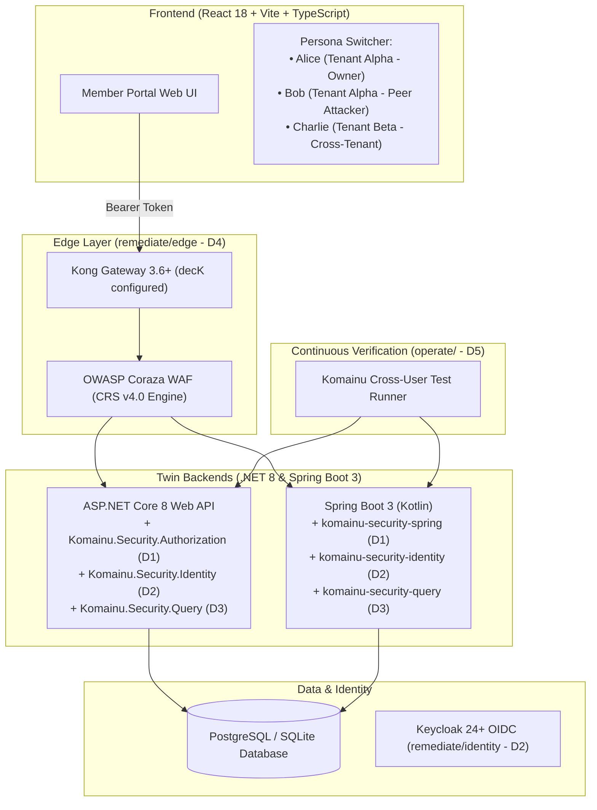

# Komainu Member Portal Demo App (Deliverable B1-D6)

The **Komainu Member Portal** is the canonical reference application demonstrating the full integration of Boilerplate 1 security deliverables (**D1 through D5**) across both frontend and backend layers.

---

## Architecture Overview



---

## 1. Quick Start

### Option A: Run Full Stack via Docker Compose

```bash
docker compose -f examples/member-portal/docker-compose.yml up --build
```
- **Frontend SPA**: `http://localhost:3000`
- **.NET 8 Backend**: `http://localhost:5001`
- **Spring Boot 3 Backend**: `http://localhost:5002`
- **PostgreSQL**: `localhost:5432`

### Option B: Run Locally Without Docker

#### 1. Start .NET Backend
```bash
dotnet run --project examples/member-portal/backend-dotnet/MemberPortal.Backend.csproj
# Listening on http://localhost:5001
```

#### 2. Start Spring Boot Backend
```bash
gradle -p examples/member-portal/backend-spring bootRun
# Listening on http://localhost:5002
```

#### 3. Start Frontend
```bash
cd examples/member-portal/frontend
npm install
npm run dev
# Vite dev server running on http://localhost:3000
```

---

## 2. Interactive Security Walkthrough

Open the Member Portal in your browser (`http://localhost:3000`).

### Scenario 1: Legitimate Resource Access (Alice)
1. Select **Alice (User A - Owner)** in the Persona Switcher.
2. In the Orders table, Alice sees her own orders (`ord-001`, `ord-002`).
3. Click **1. Test Standard API (D1 Protected)**.
4. **Result:** `HTTP 200 OK`. Alice is the verified owner, access is granted.

### Scenario 2: BOLA / IDOR Attack Blocked by D1 (Bob)
1. Switch Persona to **Bob (User B - Attacker/Peer)**.
2. Bob only sees his own order (`ord-003`).
3. Click **1. Test Standard API (D1 Protected)** to attempt reading Alice's `ord-001`.
4. **Result:** `HTTP 404 Not Found`.
   - *Why 404 instead of 403?* Komainu enforces a strict information disclosure invariant: returning 404 prevents the attacker from confirming whether `ord-001` exists (preventing ID harvesting and resource enumeration).

### Scenario 3: Planted BOLA Vulnerability Leak (Bob)
1. Keeping **Bob** as the active persona, click **2. Test Legacy API (Planted BOLA)**.
2. **Result:** `HTTP 200 OK` (Vulnerability Flagged).
   - The planted legacy endpoint queried the database directly without ownership checks. Bob successfully extracted Alice's confidential order details.

### Scenario 4: SQL Injection Probe Defeated
1. Click **3. Test Legacy Search (Planted SQLi)** with payload `' OR '1'='1`.
2. Notice how unparameterized queries leak unauthorized rows across tenants, whereas the standard API uses `SafeSortAllowList` (D3) to strictly reject illegal SQL identifiers.

---

## 3. Automated Verification via D5 Pipeline

Run the automated integration test verifying that the D5 CI test runner catches the planted BOLA vulnerability while passing clean on D1:

```bash
python3 examples/member-portal/tests/test_d6_demo_app.py
```

Expected output:
```text
.....
----------------------------------------------------------------------
Ran 5 tests in 1.202s

OK
```

---

## 4. Adoption Guide: Migrating Legacy Systems Behind Komainu

For organizations with legacy applications (Classic ASP, PHP, .NET Framework, Java Struts/Spring 3), adopt Komainu in 4 progressive stages:

### Stage 1: Perimeter Shielding (Zero Code Changes)
Deploy **Kong Gateway 3.6+** with **OWASP Coraza WAF** (`remediate/edge`):
- Place Kong in front of your legacy monolith.
- Coraza with OWASP CRS v4 automatically drops SQL injection, XSS, and path traversal probes at the network boundary before reaching legacy code.

### Stage 2: Centralized Identity (OIDC Migration)
Integrate **Keycloak** or Enterprise IdP (`remediate/identity`):
- Migrate legacy session cookies to short-lived signed JWTs with PKCE flow (RFC 9700).
- Extract verified claims (`sub`, `tenant_id`) into request headers passed to backends.

### Stage 3: Object-Level Authorization (Remediation)
Incorporate **Komainu D1 Authorization Library** into modernizing services:
- **.NET 8**: Add `Komainu.Security.AspNetCore` and `Komainu.Security.EntityFrameworkCore`. Use `[RequireOwnership]` or `.WithUserScope(userId, tenantId)`.
- **Spring Boot 3**: Add `komainu-security-spring`. Use `@RequireOwnership` or `KomainuSecurityManager.requireOwnership()`.
- Ensure all authorization rejections return **HTTP 404 Not Found**.

### Stage 4: Continuous CI/CD Verification
Add **Komainu D5 Pipeline** to GitHub Actions or GitLab CI (`operate/ci`):
- Run `operate/cross_user_tester/runner.py` on pull requests to test cross-user CRUD operations.
- Convert LSA audit findings to SARIF using `operate/lsa_sarif/lsa_to_sarif.py` to display security findings inline in PR reviews.
